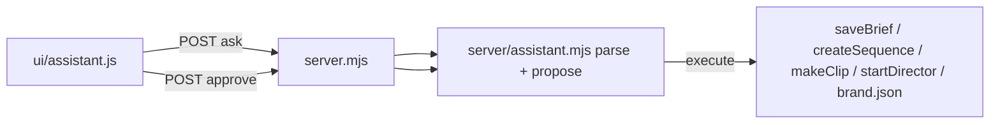

# assistant-chat — Assistant panel (commands and approval cards, no model)

**Status:** in-review
**Author:** tech-lead
**Branch:** master
**Created:** 2026-10-30
**Risk tier / auto-enabled phases:** server boundary → security review; job state → engine test

## Intent
A chat panel in the UI that makes the common things (a brief, a sequence, a clip, a Director run, a brand change) from one typed line, modelled on the NSC CSR dashboard's assistant: transcript, suggestion chips, slash commands, and an approval card before every write.
**For whom / outcome:** the person running Motion Studio; fewer form clicks for routine work, with nothing written until they approve.

## Options considered
| Option | Pros | Cons | Chosen? |
|--------|------|------|---------|
| A. Intent parser, no model | No new model path, no cap or key, deterministic, testable | Only the phrasings the parser knows | ✅ user decision 2026-10-30 ("A first, B later") |
| B. Freeform: a model picks the intent | Any wording | A fourth model path: needs a user decision, caps, a conventions.md change | ✅ user decision 2026-10-30 (same day, after A): `server/assistant-model.mjs`, Gemini with the person's own key, parser first, one capped request, the pick takes the proposal road |

## Scope
- [x] `server/assistant.mjs`: `parseAsk`, `createAssistant(deps, cfg)` with `ask`, `suggestions`, `capabilities`, `approvals`, `approve`, `reject`; `BRAND_FIELDS` whitelist; proposals in memory with a TTL and a cap.
- [x] `server/server.mjs`: `/api/assistant/capabilities|suggestions|ask|approvals|approvals/:id/approve|reject`; writes reuse `saveBrief`, `startDirector`, `createSequence`, `makeClip` (through `withAssetSlot`) and the brand write; 404 on the review link.
- [x] `ui/assistant.js`, `ui/index.html`, `ui/app.css`, `ui/app.js`: the panel as a third grid column, header toggle, chips, composer with a command datalist, approval cards with expiry, refresh of jobs / sequences / brand after an approval; hidden under `data-review`.
- [x] `config/studio.json` → `assistant: { approvalMinutes, maxOpen, freeform: false }`.
- [x] `tests/assistant.test.mjs`.
- [x] Docs: CLAUDE.md layout line.
- [x] B: `server/assistant-model.mjs` (`createIntentPicker`: one `generateContent` request, JSON schema answer, `pickedFrom` types and caps every field, pause on 429, `maxAsksPerDay`, one at a time, redacted log in `logs/assistant/`); `ask` falls through to it only for a plain line the parser does not know (or a brief/clip/brand line with its parts missing) and a `model` from `assistant.models`; `modelContext` sends ids and values only; conventions.md fourth exception, security-lint allowlist, every mirror; `tests/assistant-model.test.mjs`.
- [x] UI after the NSC panel: centred empty state (title, two lines, three pills, skeleton pills while loading), composer box with a textarea, a model select ("Commands only" + `assistant.models`, disabled without a key), help (`/help`), speech input (the browser's SpeechRecognition, hidden where absent) and a send button; "via <model>" under a model-picked answer.

## Out of scope
- Render, approve storyboard, delete: stay on their buttons (the Director rule, and the destructive ones).
- Persisting the transcript across reloads.

## Reuse & extension
- **Reused:** `validateBrief` + `saveBrief`, `startDirector` + `nextRun`, `createSequence`, `makeClip` + `withAssetSlot`, `validateBrand`; `assertId` / `assertFileName` on every outside id; `StudioError` codes (400 bad ask, 404 missing job/asset, 409 used/expired proposal, 429 too many open).
- **Extracted:** none.
- **Extension point:** a new intent is one parser branch plus one `*Proposal` function and one `execute` entry; option B plugs in before `parseAsk` and returns the same `{ intent, args }`.
- **Old path proven by:** the brief, sequence, clip and brand routes are untouched; their tests (`fix-jobs-brief`, `fix-jobs-sequences`, `footage`, `assets`) still pass.

## Architecture

State: proposals live in the server process (Map, TTL `approvalMinutes`, cap `maxOpen`); the transcript lives in the page.

## Verify
- `node --test tests/assistant.test.mjs tests/assistant-model.test.mjs` (17 pass).
- Smoke on a spare port: capabilities, suggestions, `/status`, a bad brand value (400), propose → list → reject → approve again (409), a POST without `X-Studio` (403), `/ui/assistant.js` served.
