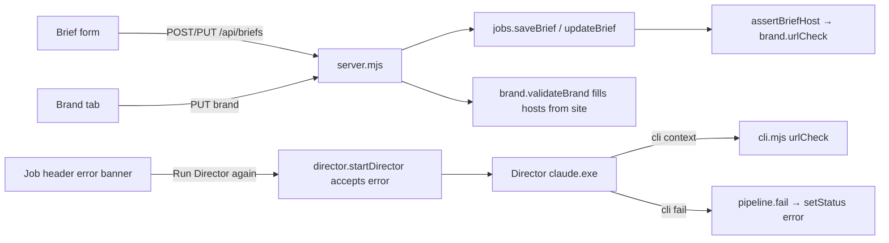

# brief-host-guard — refuse off-list brief URLs, keep hosts in step with site, let the Director fail a job

**Status:** in-review
**Author:** senior-dev (fixes approved by the user on 2026-10-15)
**Branch:** none (the folder is not a git repository)
**Created:** 2026-10-15
**Risk tier / auto-enabled phases:** Director allowlist + job state → security review of `server/director.mjs` rules, engine tests

## Intent
Brief `nsc-award/teesst` pointed at `niteco.com` while the brand's `sources.allowedHosts` was `[]`. The Director refused to fetch, but it had no way to put the job into `error`, so the reason lived only in `logs/director/nsc-award.log`. Stop that brief at save time, fill an empty host list from `site` on brand save, and give the Director a capped `fail` command so a refused job shows its reason in the UI.
**For whom / outcome:** the person who writes briefs and clicks Run Director. They see why a job cannot run, and how to fix it, in the brief form or the job header, not in a log file.

## Options considered
| Option | Pros | Cons | Chosen? |
|--------|------|------|---------|
| Host check inside `validateBrief` | One call site | `validateBrief` is pure today and runs in ~40 tests on projects with no `brand.json` | ❌ it would load the brand from a pure validator |
| Host check in `saveBrief` + `updateBrief` (engine) | Every write path (server, tests, future CLI) is covered; reads stay free | Two call sites | ✅ |
| Fill hosts in the PUT brand route only | Smallest diff | `createProject` and the route would hold two copies of one rule | ❌ |
| Fill hosts in `validateBrand` (moving `hostsFromSite` into `engine/brand.mjs`) | One rule for every brand write; no import cycle (`brand.mjs` imports only `core.mjs`) | `validateBrand` output changes for an empty list + a site | ✅ that change is the requested behaviour |

## Scope
- [x] Fix 1: `saveBrief` / `updateBrief` refuse a brief whose `url` host is not in the brand's `sources.allowedHosts` (exact, case-insensitive) with a 400 that names the host and the fix. Reading a stored brief is unchanged. The brief form shows the message through the existing `#bf-err` box.
- [x] Fix 2: `validateBrand` fills an empty `sources.allowedHosts` from `site` with `hostsFromSite`; a non-empty list stays. The PUT brand route returns the saved brand and the Brand tab writes the hosts back into its input.
- [x] Fix 3a: `cli context` adds `urlCheck: { host, allowed }` (null without a url).
- [x] Fix 3b: `cli fail <project> <job> --reason "<text>" [--by name]` → `pipeline.fail`: `setStatus` to `error` with the cleaned reason (control chars stripped, 300 chars), only from `queued`, `scripting`, `scripted`, `dirty`.
- [x] Fix 3c: `Bash(node engine/cli.mjs fail *)` in `config/studio.json` → `director.allowedTools`; a director test proves it passes and render/approve/sequence/reset-dirty rules are still refused.
- [x] Fix 3d: studio skill: check `urlCheck` before `claim`, run `fail` for that and for the other stops the skill already turns into `error`. CLI usage text lists `fail`.
- [x] Fix 3e: recovery. Existing path: the job header's error banner shows `status.error` and its "Run Director again" button posts `/director/run` for the job; `startDirector` accepts an `error` job and `claim` accepts `error`. A test pins that `claim` works from an error that `fail` set. Added during T2 QA: the job card carries the error reason as its `title`, and the banner no longer prints ".." when a reason ends with a period.
- [x] Docs: conventions gotcha, architecture step 2, file-index, README CLI list.

## Out of scope
- `profiles/nsc-award` and `out/nsc-award/teesst` real data (the person fixes it in the UI).
- A job left in `scripting` when the UI server stops mid-run (`finish()` never runs, so nothing resets it). Reported as a follow-up.
- Re-queueing an `error` job on a brief edit that changes nothing a Director already used: the Run Director button already covers recovery.

## Reuse & extension
- **Reused:** `StudioError`, `setStatus` (`engine/jobs.mjs`), `loadBrand`, `hostsFromSite` (moved, re-exported from `jobs.mjs` so `tests/engine.test.mjs` imports stay), `requireStatus` (`engine/pipeline.mjs`), the `execFileSync` CLI test shape from `tests/bullet-screenshots.test.mjs`, the error banner and `busy(..., $('#bf-err'))` in `ui/app.js`.
- **Extracted:** `urlCheck(url, hosts)` in `engine/brand.mjs`: consumers `assertBriefHost` (save/update) and `cli context`.
- **Extension point:** `FAILABLE` list in `pipeline.mjs`; `UNSAFE_RULE` unchanged.
- **Old path proven by:** the full `npm test` (existing brief, brand and director tests pass unedited).

## Architecture

## Files to create / modify
| File | Change |
|------|--------|
| `engine/brand.mjs` | `hostsFromSite` moved here; `urlCheck`; empty hosts filled from `site` |
| `engine/jobs.mjs` | re-export `hostsFromSite`; `assertBriefHost` in `saveBrief` / `updateBrief` |
| `engine/pipeline.mjs` | `fail` |
| `engine/cli.mjs` | `context.urlCheck`, `fail` command, usage text |
| `server/server.mjs` | PUT brand returns `{ ok, brand }` |
| `ui/app.js` | Brand tab refreshes the hosts input after save |
| `config/studio.json` | allow `fail` |
| `.claude/skills/studio/SKILL.md` | urlCheck before claim; `fail` for pre-claim stops |
| `tests/brief-host.test.mjs` | new |
| `tests/director.test.mjs` | one appended case |
| `.ai/docs/conventions.md`, `architecture.md`, `file-index.md`, `README.md` | docs |

## Task breakdown

### T1 — Fix 1 + Fix 2 engine: host check on save/update, hosts follow site
- **Files:** `engine/brand.mjs`, `engine/jobs.mjs`, `tests/brief-host.test.mjs`
- **Verify:** `node --test tests/brief-host.test.mjs tests/engine.test.mjs`
- [x] done — `node --test tests/brief-host.test.mjs tests/engine.test.mjs` → 34/34 pass (first run 27/34: `loadBrand` was evaluated before the empty-url return; fixed in the same task)

### T2 — Fix 2 surface: PUT brand returns the brand, Brand tab shows filled hosts
- **Depends:** T1
- **Files:** `server/server.mjs`, `ui/app.js`
- **Verify:** second UI instance on `MOTION_STUDIO_PORT=4791` with a scratch project: PUT brand with `site` and empty hosts answers the filled list; POST a brief with an off-list URL answers 400 with the host message.
- [x] done — 4791 + scratch `zz-qa-hosts`: PUT brand empty+site → 200 `["niteco.com","www.niteco.com"]`; typed `["cdn.example.com"]` kept; POST off-list brief → 400 host message; invalid url → 400 "url must be an http(s) URL"; allowed → 201. Playwright: brief form `#bf-err` shows "The brief URL host example.org is not in this brand's allowed hosts. Add it in Brand → Allowed data hosts, or clear the URL."; Brand tab hosts input reads "www.example.org, example.org" after saving site `https://www.example.org/shop` with an empty list, "cdn.example.com" stays. After `cli fail`, job header reads "Error: <reason>. Run the Director again…" with the "Run Director again" button and the job card `title` carries the reason (found and fixed a doubled ".." in the banner). Server PID 54360 killed, scratch folders removed, 4780 untouched.

### T3 — Fix 3 engine + CLI: urlCheck in context, `fail` command
- **Files:** `engine/pipeline.mjs`, `engine/cli.mjs`, `tests/brief-host.test.mjs`
- **Verify:** `node --test tests/brief-host.test.mjs`
- [x] done — `node --test tests/brief-host.test.mjs tests/director.test.mjs` → 29/29 pass; `node engine/cli.mjs help` lists `fail`

### T4 — Fix 3 Director: allowlist, skill, docs
- **Files:** `config/studio.json`, `tests/director.test.mjs`, `.claude/skills/studio/SKILL.md`, docs
- **Verify:** `node --test tests/director.test.mjs`; `node .claude/scripts/check-propagation.js` → only the 2 known "CLAUDE.md is abbreviated" warnings
- [x] done — director tests pass (in the 29/29 run); `generate-mirrors.js` exit 0; `check-propagation.js` exit 0 with only the 2 known "CLAUDE.md is abbreviated" warnings

### T5 — Full suite
- **Verify:** `npm test`
- [x] done — `npm test` → 288/288 pass, exit 0

## Acceptance criteria
- [x] Saving a brief whose URL host is off the brand list shows "The brief URL host <host> is not in this brand's allowed hosts. Add it in Brand → Allowed data hosts, or clear the URL." in the brief form (400).
- [x] An invalid URL keeps its own message ("url must be an http(s) URL").
- [x] A stored brief with an off-list URL still loads and lists.
- [x] Saving a brand with `site` and empty hosts stores and shows `hostsFromSite(site)`; a typed list is kept.
- [x] `cli context` prints `urlCheck`; `cli fail` moves a pre-render job to `error` with the cleaned reason and refuses from `approved`, `rendering`, `done`.
- [x] The Director allowlist includes `fail`; render, approve, sequence and reset-dirty rules are still refused.
- [x] A failed job shows its reason in the job header and recovers through "Run Director again" (`claim` from `error`).

## Risks & impact
- `validateBrand` consumers: `createProject` (same hosts as before), PUT brand, tests. `saveBrief` / `updateBrief` consumers: server routes and tests (no test brief carries a `url`).
- `fail` is a new Director permission. It writes only `status.json` through `setStatus`, never from a status a person owns (`awaiting_review`, `approved`) or the engine owns (`preparing`, `rendering`).

## Verification
2026-10-15 — T1-T5 green: `npm test` 288/288; API and Playwright checks on a second server (4791) with scratch project `zz-qa-hosts`, removed afterwards. Not verified: a real Director run (it spends seat quota) and `nsc-award` data (left for the person).
