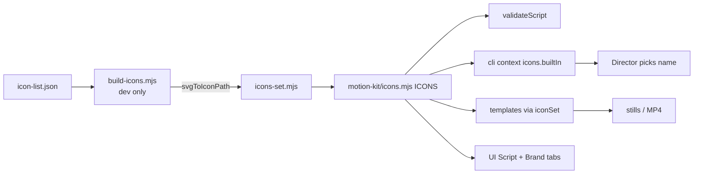

# builtin-icon-set — Commerce icon set for the motion kit

**Status:** in-review (code done; UI acceptance needs a server restart)
**Author:** tech-lead
**Branch:** n/a (folder is not a git repository)
**Created:** 2026-10-15
**Risk tier / auto-enabled phases:** template look → USER_REVIEW with stills; template contract → engine test

## Intent
A brief that is only a URL (home, PLP or PDP) gives the Director claims like "free shipping", "30-day returns" or "20% off", but the built-in icons are 11 health-care shapes (drop, shield, cloth...). The Director picks the closest one and the meaning drifts (free shipping → `bolt`). Add a curated set of filled icons so the Director can pick an icon that says what the claim says.
**For whom / outcome:** people who make promo videos for e-commerce brands that have not uploaded their own icons. Benefit and offer scenes show an icon that matches the claim, with no extra upload and no extra Claude calls.

## Options considered
| Option | Pros | Cons | Chosen? |
|--------|------|------|---------|
| Vendor a curated filled set (Phosphor Fill, MIT) as built-ins, converted once by the existing `svgToIconPath` | Deterministic, consistent style, zero model calls, reuses the brand-icon converter | One-time curation; slightly more detailed than the 11 originals | ✅ cheapest at run time and the safest for the seat |
| Let the Director draw an SVG path per job | Any concept | Hand-drawn paths look uneven, need a review step per job, more turns per run | ❌ quality and cost |
| Add `@phosphor-icons/core` as a runtime dependency and resolve names at render | Whole 1,512-icon library | Unbounded choice list in `context`, runtime conversion, new dependency | ❌ too broad |

Feasibility checked on 2026-10-15: all 70 proposed icons convert through `svgToIconPath` without error; longest path 1,686 chars (cap is 16,000); median 3 subpaths. Preview: scratchpad `icon-preview.html`.

## Scope
- [x] `motion-kit/icon-list.json`: the approved list, `{ "<motion-kit name>": "<phosphor fill name>" }`, grouped by order.
- [x] `motion-kit/build-icons.mjs`: dev-only generator. `node motion-kit/build-icons.mjs <extracted @phosphor-icons/core dir>` reads the list, converts each `assets/fill/<name>-fill.svg` with `svgToIconPath`, and writes `motion-kit/icons-set.mjs`. No network, no new npm dependency.
- [x] `motion-kit/icons-set.mjs`: generated `SET_ICONS` paths, header says "generated, do not edit" and names the source version.
- [x] `motion-kit/icons.mjs`: `ICONS = { ...the 11 originals unchanged, ...SET_ICONS }`, so `ICON_NAMES` lists the originals first.
- [x] `motion-kit/LICENSE-phosphor.txt`: the MIT notice.
- [x] `.claude/skills/studio/SKILL.md`: stop hardcoding the 11 names; point to `icons.builtIn` in `context` and say to choose by meaning, brand icon first.
- [x] Propagate the SKILL change (update-propagation: `AGENTS.md`, `.cursor/rules`, `.github/copilot-instructions.md` where they mention icons) and update `.ai/docs/architecture.md`, `.ai/docs/file-index.md`.
- [x] Tests in `tests/icons.test.mjs`.

## Out of scope
- Generating or drawing icons per job (option 2).
- Stroke/outline icon support in `svgToIconPath`.
- The 24x24 nav icons inside `templates/ui-story/template.mjs` (`script.app.nav`): a separate set, not validated as scene icons.
- Image capture from a URL (separate idea).

## Reuse & extension
- **Reused:** `svgToIconPath`, `ICON_PATH_RE`, `ICON_NAME_RE` from `engine/icons.mjs`; `iconSet()` in `motion-kit/icons.mjs`, which every renderer already calls (`product-demo`, `promo`, `explainer`, `ui-story`). Twin rules: `validateScript` icon check (`engine/script.mjs:74`) ↔ `context` `icons.builtIn` (`engine/cli.mjs:80`) ↔ UI pickers (`ui/app.js:651`, `:1625`). All read `ICONS`/`ICON_NAMES`, so they pick up the set with no code change.
- **Extracted:** none.
- **Extension point:** adding an icon later = one line in `icon-list.json` + rerun the generator.
- **Old path proven by:** the 11 original paths stay byte-for-byte (test), and existing scripts in `out/` that use them still validate and prepare.

## Architecture

The seam is `ICONS`. Brand icons still merge on top via `iconsFor()`; a brand upload whose name is now built-in is refused by the existing 409 in `saveIcon`.

## Files to create / modify
| File | Change |
|------|--------|
| `motion-kit/icon-list.json` | new — approved names |
| `motion-kit/build-icons.mjs` | new — generator |
| `motion-kit/icons-set.mjs` | new — generated paths |
| `motion-kit/LICENSE-phosphor.txt` | new — MIT notice |
| `motion-kit/icons.mjs` | modified — merge set after originals |
| `tests/icons.test.mjs` | modified — set tests; rename the brand-icon fixture `truck` (now built-in) |
| `.claude/skills/studio/SKILL.md` + mirrors | modified — icon guidance |
| `.ai/docs/architecture.md`, `.ai/docs/file-index.md` | modified — new files |

## Task breakdown

### T1 — Generator and generated set
- **Files:** `motion-kit/icon-list.json`, `motion-kit/build-icons.mjs`, `motion-kit/icons-set.mjs`, `motion-kit/LICENSE-phosphor.txt`
- **Verify:** `node motion-kit/build-icons.mjs <phosphor dir>` → "70 icons written"; rerun gives an identical file (deterministic).
- [x] done — generator run twice → "70 icons written to motion-kit/icons-set.mjs" both times, `cmp` identical (57,659 bytes)

### T2 — Merge into ICONS + tests
- **Depends:** T1
- **Files:** `motion-kit/icons.mjs`, `tests/icons.test.mjs`
- **Verify:** `npm test` all pass. New tests: originals unchanged; every name matches `ICON_NAME_RE`, no duplicates; every path matches `ICON_PATH_RE` and ≤ 16,000 chars; `icons-set.mjs` names equal `icon-list.json`; `validateScript` accepts `truck`; `saveIcon(..., 'truck.svg')` now 409. Brand-icon fixture renamed so the old upload/replace/delete tests still run.
- [x] done — `node --test tests/icons.test.mjs` → 16/16 pass; `npm test` → 230/230 pass (first full run had 1 failure in tests/stt.test.mjs "prepare captions a footage clip…", which passed alone and on the rerun: an STT timing flake, not icon code)

### T3 — Templates show the new icons
- **Depends:** T2
- **Files:** none (sample jobs under `out/` only)
- **Verify:** a `product-demo` job with benefits on `truck`, `return`, `badge` and a `promo` offer on `tag`: `node engine/cli.mjs prepare 
 <j>` passes lint; stills show the right icons; one mid-morph frame (`coins` → `truck`, 7 → 3 subpaths) has no stray shapes.
- [x] done — temp job nsc/icon-check-9x16 (copy of megamax-9x16 with coins, truck, badge, return): both commits validated; prepare made 5 stills, each new icon drawn with outline + fill; frames at 8.85/9.05/9.25/9.5 s show a clean coins → truck morph. Lint reported only the copied script's length (23.4 s vs 20 s), not icons. A promo `tag` still was not made: the template test covers promo drawing a set icon.

### T4 — Director guidance and docs
- **Depends:** T2
- **Files:** `.claude/skills/studio/SKILL.md`, mirrors, `.ai/docs/*`
- **Verify:** `node engine/cli.mjs context 
 <j>` lists the new names under `icons.builtIn`; propagation check passes (`node .claude/scripts/check-propagation.js`).
- [x] done — `context nsc megamax-9x16` → 81 built-in names; check-propagation shows only its 2 earlier warnings. Mirrors (.cursor, AGENTS.md, other skills) name only the module path, so they stay true.

## Acceptance criteria
- [ ] Brand tab → "Built-in icons" shows 81 icons (11 + 70) with readable names.
- [ ] Script tab icon picker lists the new icons under "Built-in" and a picked one saves and validates.
- [ ] A storyboard still of a `product-demo` benefit shows `truck` (done: still of nsc/icon-check-9x16); a `promo` offer still shows `tag` (not yet: covered by the template test only).
- [x] Existing jobs that use the 11 original icons render the same: the original paths are pinned by a sha256 test and come first in `ICON_NAMES`.
- [x] `npm test` passes (230/230).

## Risks & impact
- **Style mix:** Phosphor Fill is more detailed than the 11 silhouettes (holes, inner lines). Checked in the preview; it reads well at icon size. Review in T3 stills.
- **Morph between different subpath counts** (`sun` 9, `barcode` 8, `coins` 7 vs 1–3 for most): MorphSVG handles it but the in-between frame may look busy. T3 checks one.
- **Brand name clashes:** no project has `icons.json` today. A future upload with a built-in name gets the existing 409. A pre-existing brand icon with a clashing name would be silently replaced by the built-in (`loadBrandIcons` skips it); none exist, so no migration.
- **Choice list size:** `context` grows by ~70 short names (< 1 KB). No extra Claude calls.
- **Licence:** Phosphor is MIT; the notice ships in `motion-kit/LICENSE-phosphor.txt`.

## Verification
2026-10-15 — T1-T4 done (results under each task). Open: the two UI criteria need `npm run ui` restarted (the running server still serves 11 icons from before the change), then a check of the Brand and Script tabs.
