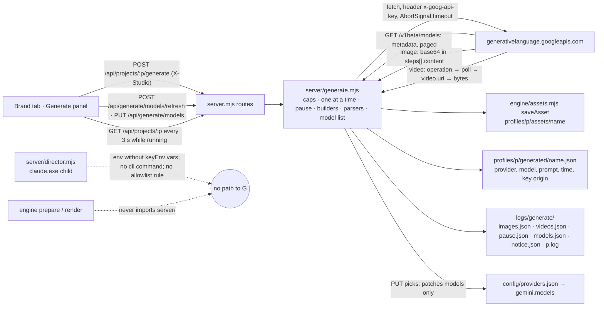

# gemini-asset-worker — Generate brand images and clips with the Gemini API

**Status:** planning (updated 2026-10-15 with the user's answers)
**Author:** tech-lead
**Branch:** none (folder is not a git repo)
**Created:** 2026-10-15
**Risk tier / auto-enabled phases:** calls a model provider + secrets + server boundary → security-review skill on every diff, implementer `senior-dev` with `model: "fable"`; new UI panel → QA in the browser. Two tasks (T8, T11) spend real money and are human-only gates: the loop stops there.

## Intent
Let a person make a product or scene image, or a short clip, straight from the Brand tab, with their own Google Gemini API key, and keep the result as a normal brand asset. Today every visual has to be uploaded; the only path from Google Flow is a manual download.

**For whom / outcome:** the person who builds briefs for a brand (today: the user, for csr-console and side projects). Outcome: a hero image or a 4-8 s clip in under a minute, inside the tool, without leaving for AI Studio and re-uploading. Generated files are visuals, not claims: the script rules stay as they are.

Decided by the user on 2026-10-15: a personal Gemini API key from Google AI Studio, billed to the user's own Cloud Billing account, is acceptable in this repo. That contradicts two written rules (see "Rule changes"). The plan changes them deliberately and narrowly.

## Decisions from the user (2026-10-15)
1. `directorEnv` strips every `keyEnv` from the Claude child, `ANTHROPIC_API_KEY` included. Reason given: the company may later move to the Claude API; when it does, the local seat Director mode gets switched off, so the Director must never pick up an API key by accident.
2. The key probe ran on 2026-10-15 with free calls only. `models.list` returned 63 models: eight image models (all `generateContent`, none `predict`, no Imagen) and three Veo ids (`predictLongRunning`). Empty-body probes on the Veo ids answered 400 `INVALID_ARGUMENT` "No instances in the request", not 403: the key reaches the models, but validation runs before any billing check, so the tier is still unknown and the person reads it in AI Studio. The caps below are final: the tool's own ceiling under personal billing, with day and month limits.
3. The data-notice tick is remembered once per machine, for every project, with the time. The one-line notice itself stays on the panel every time.
4. The person picks the models. A Refresh models action lists what the key can reach (metadata only), the person saves a default image model and a default clip model, and each Generate can override from the same list. Hard-coded ids remain only as a first-run fallback.
5. (Added later on 2026-10-15) The UI server reads `GEMINI_API_KEY` from a `.env` file at the repo root, so `npm run ui` works without setting the variable by hand. This is a deliberate, narrow Floor change. Only the server reads it, once at start, from the fixed path `<ROOT>/.env`, with Node's built-in `util.parseEnv`. Only the names listed as `keyEnv` in `config/providers.json` are copied, and only where the environment has no value; the environment wins. Values are never logged, returned or stored. The Director child still receives none of them (`directorEnv`). The engine, `cli.mjs` and the Director never read the file. See T7b.

## Options considered
Skills loaded for this plan: `server-route`, `testing-patterns`, `project-conventions`, `update-propagation`, `security-review` (checklist read for the seam). No template changes, so `template-authoring` was not needed.

| Option | Pros | Cons | Chosen? |
|--------|------|------|---------|
| Images only | smallest surface, cheapest ($0.03 per image) | the user also wants clips | ❌ as the end state; ✅ as phase 1 |
| Images first, Veo clips second, one module | one seam, one cap table, one UI panel; clips reuse the image path's caps, pause and sidecar | Veo adds polling and a download step | ✅ |
| Gemini API with an AI Studio key | one env var, three REST endpoints, Node `fetch`, no SDK | key is personal; preview model ids move | ✅ (the user's decision) |
| Vertex AI | enterprise data terms, GCS output | needs gcloud auth, a service account, a GCS bucket for Veo output, far more surface | ❌ |
| Interactions API for images (`POST /v1beta/interactions`) | the documented path for the recommended model `gemini-nano-banana-2.1`; synchronous; base64 in the response | new API, reference docs still thin | ✅ with a live check in T8; `generateContent` with `responseModalities` is the fallback |
| Veo 3.1 via `:predictLongRunning` | documented: operation name → poll → `video.uri` → download; 4/6/8 s; 16:9 or 9:16 | preview ids; 2-day retention on Google's side | ✅ fallback default `veo-3.1-lite-generate-preview` ($0.05 per second) |
| Gemini Omni Flash for video (`gemini-omni-1.1-flash`) | ~$0.10 per second, same Interactions API as images | marked New / Preview on 2026-10-06; fewer documented options; the clip filter will not list it unless the probe shows `predictLongRunning` | ❌ for v1 |
| `@google/genai` SDK | typed client | a dependency for three endpoints; conventions say no dependency for what `fetch` does | ❌ |
| Put the call in `engine/` | next to `assets.mjs` | the engine would gain network code; `engine/cli.mjs` is what the Director may run | ❌ — the call lives in `server/generate.mjs`, like `server/director.mjs` |
| Model ids hard-coded in config only | no extra call | Google renames preview ids; the person cannot see what the key reaches | ❌ — fetched list + person's pick, ids in config only as first-run fallback |
| Store the model picks in `config/studio.json` | one config file | `studio.json` is read once at startup into `cfg`; a pick would need a restart | ❌ |
| Store the model picks in `config/providers.json` → `gemini.models` | model ids already live there for every provider (`model` field); the server reads the file per request, so a pick applies at once; not a secret | a repo-tracked file changes on a click | ✅ the route patches only `models` and keeps every other byte (tested) |
| Store the fetched list and the notice tick in `config/` | next to the picks | both are machine- or key-local state; a teammate's tick or key reach must not travel with the repo; `*.local.json` is reserved for secrets by the conventions | ❌ |
| Store them in `logs/generate/` | gitignored; already the home of the Director's machine-local state (`runs.json`, `pause.json`) | a person has to know where to look (README says) | ✅ |

## Scope
- [ ] Rule change, narrow: a second person-clicked, capped model path (`server/generate.mjs`) next to `server/director.mjs`, covering one generation per click and one metadata call per Refresh click; the "company key" sentence replaced; propagated to every mirror, agent and skill that restates the rule (T1).
- [ ] `config/studio.json` → new `generate` block (day and month ceilings, timeout, byte caps); `config/providers.json` → `gemini.models` (the person's default image and clip ids, written by the UI) and an updated note.
- [ ] `server/caps.mjs`: the day counter and pause-file helpers shared by the Director and the generator (moved out of `director.mjs`, re-exported there).
- [ ] `server/director.mjs`: the Claude child gets an environment without any `keyEnv` variable from `config/providers.json`.
- [ ] `server/generate.mjs`: request builders, response parsers, caps, one-at-a-time state, capped fetch, model list (refresh, filter, sort, pick), notice state, save through `saveAsset`, sidecar, capped log.
- [ ] Routes: `POST /api/projects/:p/generate` (202, background), `DELETE /api/projects/:p/generate/pause`, `POST /api/generate/models/refresh` (200, metadata), `PUT /api/generate/models` (save the picks); `GET /api/projects/:p` gains `generate` (state, options, counts, models, notice, sidecars; never the key). `DELETE …/assets/:name` also removes the sidecar. Project delete refuses while a generation runs.
- [ ] Brand tab: "Generate with Gemini" panel under Assets with model pickers and Refresh models; a "Generated" badge on asset cards; polling while a generation runs; the data notice line; a tick remembered once per machine.
- [ ] Phase 2: Veo clips through the same route and panel (kind `video`, duration 4/6/8 s, 16:9 or 9:16, 720p).
- [ ] Tests with an injected `fetch`; `npm test` makes no network call.
- [ ] Keys from `.env` (decision 5, T7b): `server/keys.mjs` loads `keyEnv` names only from `<ROOT>/.env` at server start. `.env.example` sits at the root. The NEVER rule "no key in a file" gains exactly this one exception, propagated like T1. `.env` stays gitignored and out of every copy, zip and trash path.
- [ ] README section: key setup, reading the tier in AI Studio, costs, the budget alert, what goes to Google, where the local state lives.

## Out of scope
- Google Flow. It has no public API. Automating its web UI or reusing its session cookies or tokens is not allowed. The only Flow path stays manual: download the clip from Flow, upload it under Assets (already supported).
- The Google AI Pro subscription. Its quota applies only inside the AI Studio web UI. Nothing here uses a subscription session or token; API calls bill the Cloud Billing account linked to the key's project.
- Vertex AI, service accounts, GCS buckets.
- Any automatic generation: by the Director, by `prepare` or `render`, on brief save, on a timer, or as a retry. A generation starts only from a person's click and makes exactly one asset. The model list is also refreshed only on a click, never on page load.
- A script-writing worker on Gemini or any other API. `providers.json` keeps saying worker mode is not built.
- Image editing, reference images, image-to-video, video extension, batch mode, 2K/4K images, 1080p/4K video, cancelling an in-flight clip.
- Cost tracking in the tool beyond per-day counts. The budget alert lives in Google Cloud. Google does not expose the key's tier or spend through the API.
- Gemini Omni Flash as the video model (it may appear in the list later if Google exposes it under `predictLongRunning`; not tested here).

## Reuse & extension
- **Reused:** `saveAsset` / `cleanAssetName` / `ASSET_TYPES` (`engine/assets.mjs`) for the file, name cleaning, magic-byte check and size cap; `profileDir`, `listAssets` (`engine/jobs.mjs`); `assertId`, `assertFileName`, `within`, `readJson`, `writeJson`, `nowIso`, `StudioError`, `loadStudioConfig` (`engine/core.mjs`); `runDay`, `runsToday`, `countRun`, `readPause`, `clearPause` (today in `server/director.mjs`, moved to `server/caps.mjs`); the capped-log shape of `startDirector`; the sidecar-per-asset layout of `engine/stt.mjs` (`transcripts/<asset>.json` → `generated/<asset>.json`); the Brand tab's `watchTranscripts` polling and `busy()`/`toast()` helpers in `ui/app.js`; `readBody` / `send` / the Host, Origin and `X-Studio` checks in `server/server.mjs`; `Intl.Collator('en', { numeric: true })` for the version-aware sort (already used in `resolveClaude`). Twins kept in sync by data, not by copies: the aspect-ratio and duration lists and the model list live once in `server/generate.mjs` and reach the UI through `GET /api/projects/:p` → `generate`.
- **Extracted:** `server/caps.mjs` (`runDay`, `runsToday`, `countRun`, `readPause(file)`, `clearPause(file)`) with two real consumers: `director.mjs` and `generate.mjs`. `director.mjs` re-exports them, so `tests/director.test.mjs` stays unedited.
- **Extension point:** `config/providers.json` → `gemini.models.{image,video}` holds the person's defaults; `FALLBACK_MODELS` in code covers the first run; `config/studio.json` → `generate` holds every cap. A new kind (say, a 2K image) is a new entry in `GENERATE_OPTIONS` plus a request-builder branch; the route and the UI read the options table. Director behaviour stays byte-for-byte the same except for the stripped env.
- **Old path proven by:** `node --test tests/director.test.mjs` (unedited) after T2; `node --test tests/assets.test.mjs` (unedited) after T4; `npm test` green at every task.

## Architecture


The seam that can break: `server/generate.mjs` → Google. Everything on the left of it is the existing asset path (`saveAsset`, the asset list, scene `asset`/`video` fields). The key crosses exactly one line: `process.env[keyEnv]` → the `x-goog-api-key` header. It is never a URL parameter, never logged, never in the sidecar, never in a response to the UI, never in the Director child's environment. Three kinds of call go out: a metadata list (free, on Refresh), an image (paid, on Generate), a clip (paid, on Generate). All three share the one-at-a-time slot, the timeout, the byte caps and the pause.

## External system contract
Verified on 2026-10-15 against ai.google.dev (image generation guide, Veo guide, models page, models REST reference, pricing, rate limits, API key page, Gemini API Additional Terms). Marked **spike** where the docs did not settle it.

Host and auth
- Host: `https://generativelanguage.googleapis.com`, path prefix `/v1beta`. Nothing else is ever fetched, except a Veo download URI (see below).
- Auth: header `x-goog-api-key: <key>`. The docs recommend the env var `GEMINI_API_KEY`; this tool reads only the name in `config/providers.json` → `gemini.keyEnv`. The key is never put in the URL (`?key=` would land in logs).
- Rate limits: counted per Google Cloud project, not per key. Over a limit, or over the spend-based cap (Tier 1: $10 in a rolling 10 minutes), Google answers HTTP 429 `RESOURCE_EXHAUSTED`. Requests-per-day counters reset at midnight Pacific. Per-model RPM/RPD for image and Veo models are not published on the rate-limits page; the tool's own caps govern.
- Tiers: the free tier exists, but none of the image or video models below is available on it. Billing must be on. Tier 1 unlocks when a billing account is linked. The API does not report a key's tier; the person reads it in AI Studio (Usage / rate limits). Probe result 2026-10-15: empty-body `predictLongRunning` calls on the three Veo ids answered 400 `INVALID_ARGUMENT` "No instances in the request", not 403 `PERMISSION_DENIED`. Validation runs before billing, so a 400 proves reach, not billing. T8 and T11 stay the real proof.

Model list (Refresh models)
- `GET /v1beta/models?pageSize=200[&pageToken=…]` → `{ models: [...], nextPageToken? }`. `pageSize` defaults to 50, max 1000. The tool follows `nextPageToken` for at most `MAX_MODEL_PAGES = 5` pages.
- Model resource fields: `name` (`models/<id>`), `baseModelId`, `version`, `displayName`, `description`, `inputTokenLimit`, `outputTokenLimit`, `supportedGenerationMethods[]` (Pascal-case method names such as `generateContent`), `thinking`, `temperature`, `maxTemperature`, `topP`, `topK`. There is no field for output modalities: nothing in the resource says "this model outputs images".
- Probe data (2026-10-15, this key): 63 models. Image, all with `generateContent` and none with `predict`: `gemini-2.5-flash-image` (Nano Banana), `gemini-3-pro-image-preview`, `gemini-3-pro-image`, `nano-banana-pro-preview` (Nano Banana Pro), `gemini-3.1-flash-image-preview`, `gemini-3.1-flash-image` (Nano Banana 2), `gemini-3.1-flash-lite-image` (Nano Banana 2 Lite), `gemini-nano-banana-2.1` (Nano Banana 2.1). No Imagen model is visible. Clips, with `predictLongRunning`: `veo-3.1-generate-preview`, `veo-3.1-fast-generate-preview`, `veo-3.1-lite-generate-preview`.
- Filter, pinned by the probe: `kind: 'image'` when `supportedGenerationMethods` includes `generateContent` and the id or `displayName` matches `/image|banana/i`; `kind: 'video'` when it includes `predictLongRunning` and the id starts with `veo`. Everything else is dropped; `predict` and Imagen are not handled.
- Sort, newest first: by the highest version number in the id (`\d+(\.\d+)?`), numeric, descending; at the same version a GA id comes before its `-preview` twin; then by id with `Intl.Collator('en', { numeric: true })`, descending. An id with no version number (`nano-banana-pro-preview`) sorts last. Known wrinkle: `gemini-2.5-flash-image` sorts above `gemini-nano-banana-2.1`; the person sees `displayName` and description and picks.
- Listed is not usable. The probe still lists `gemini-2.5-flash-image` two weeks after the docs say it was shut down (2026-10-02). The runner turns a 404, or a 4xx whose message says the model is not found, retired or deprecated, into "Model <id> is listed but Google refused it: <message>. Click Refresh models and pick another." The picker shows a one-line hint saying a listed id can still be refused.
- This call generates nothing and costs nothing, but it is still a person's click, keyed, capped (one at a time, timeout, `maxResponseBytes`, pause on 429) and logged.

Images (phase 1)
- Model: `gemini-nano-banana-2.1` (stable, updated 2026-10-06; the guide's recommended model; newest non-preview id in the probe) is the first-run fallback. The probe's other seven image ids are above. `gemini-2.5-flash-image` was shut down on 2026-10-02 yet is still listed: expect a refusal if picked. Imagen is shut down and absent from the list.
- Endpoint: `POST /v1beta/interactions`, body `{ "model": "<id>", "input": "<prompt>", "response_format": { "type": "image", "mime_type": "image/jpeg", "aspect_ratio": "16:9", "image_size": "1K" } }`. Synchronous: the response is the finished interaction. `image_size` values: `512`, `1K`, `2K`, `4K`; `aspect_ratio` includes `1:1`, `16:9`, `9:16`, `4:5`, `3:2`, `2:3`, `21:9`.
- Response: `steps[]` with a `model_output` step whose `content[]` holds an item `{ "type": "image", "data": "<base64>", "mime_type": "image/jpeg" }`. `output_image.data` is an SDK convenience, not a REST field; the parser walks `steps`. **Spike (T8):** confirm the exact `content[]` item shape on one real call; if it differs, fix the parser and the test fixture together.
- Fallback, if the Interactions call fails for the model: `POST /v1beta/models/<id>:generateContent` with `generationConfig.responseModalities: ["IMAGE"]`; image at `candidates[0].content.parts[].inlineData.{mimeType,data}`. The `inlineData` shape is in the reference; the `responseModalities`/`imageConfig` fields could not be read on 2026-10-15 (page truncated). **Spike only if needed.**
- Every generated image carries an invisible SynthID watermark.
- Price (paid tier, standard): $0.0336 per 1K image, $0.0504 per 2K, $0.113 per 4K. Token-based: 1,120 output tokens per 1K image at $30 per million.

Clips (phase 2)
- Models: `veo-3.1-lite-generate-preview` (first-run fallback; cheapest; no 4K; no extension), `veo-3.1-fast-generate-preview`, `veo-3.1-generate-preview`. All preview ids. Audio is always generated. Text prompt limit 1,024 tokens (Lite page). One video per request.
- Start: `POST /v1beta/models/<id>:predictLongRunning`, body `{ "instances": [{ "prompt": "<text>" }], "parameters": { "aspectRatio": "16:9", "resolution": "720p", "durationSeconds": "4", "personGeneration": "allow_adult" } }`. `durationSeconds` is a string: `"4"`, `"6"` or `"8"`. `aspectRatio`: `"16:9"` or `"9:16"`. `resolution`: `"720p"` default; `"1080p"` and `"4k"` need 8 s and are out of scope. In EU/UK/CH/MENA `allow_adult` is the only allowed `personGeneration`; the tool sends it always.
- Response: a long-running operation `{ "name": "models/<id>/operations/<opid>", "done": false }`.
- Poll: `GET /v1beta/<name>` with the key header until `done: true`. Then `response.generateVideoResponse.generatedSamples[0].video.uri`. An operation can also carry `error: { code, message }`.
- Download: `GET <uri>` with the key header; the guide uses `curl -L`, so expect a redirect. The tool follows at most 2 redirects by hand (`redirect: 'manual'`) and refuses any hop whose host is not `*.googleapis.com` or `*.googleusercontent.com`. **Spike (T11):** record the real hop chain and content type.
- Retention: Google keeps the video for 2 days; the tool downloads right after `done`.
- Price (paid tier, with audio): Lite $0.05 per second at 720p; Fast $0.10; Standard $0.40. A 4 s Lite clip is $0.20; an 8 s Standard clip is $3.20. Charged only when the generation succeeds.
- **Spike (T11):** the Lite model page lists no durations or aspect ratios; the family guide does. Confirm `"4"` and `"9:16"` on Lite.

Data use (Gemini API Additional Terms, read 2026-10-15)
- Unpaid services: Google uses prompts and outputs to improve its products; human reviewers may read them; the terms say not to submit sensitive, confidential or personal information. Paid services (a Cloud project with an active billing account): prompts and responses are not used to improve products; they are logged for a limited time for abuse detection and legal reasons. The AI Pro subscription does not make API use "paid".
- Consequence for this tool: brand and client text in a prompt goes to Google under the person's own account. The UI says so in one line every time, and the README tells the person to keep billing on and to set a Cloud Billing budget alert.

Human-only gates
- Creating the key in AI Studio, linking a billing account, setting the budget alert, setting `GEMINI_API_KEY` in the user's environment and restarting `npm run ui`.
- Reading the tier in AI Studio (Usage / rate limits). The API does not report it and the probe could not tell billing from validation. The probe itself is done.
- T8 and T11: the first real image and the first real clip (they cost money and need the key). The loop stops and asks.
- Picking the models after Refresh. Google's 404 text is shown when a saved id disappears, so the person knows to refresh and pick again.

## Files to create / modify
| File | Change |
|------|--------|
| `.ai/docs/conventions.md` | modified — the model NEVER gains a second exception (`server/generate.mjs`); the director ALWAYS covers `generate` caps too |
| `CLAUDE.md` | modified — "Rules for using Claude here" bullets 1 and 4; the NEVER summary line |
| `.cursor/rules/project.mdc`, `.claude/skills/project-conventions/SKILL.md`, `AGENTS.md`, `.github/copilot-instructions.md` | regenerated blocks (`generate-mirrors.js`) + the hand-written intro sentence in each that says no code may call a model |
| `.cursor/rules/core.mdc`, `.cursor/rules/workflow.mdc`, `.cursor/rules/new-feature.mdc` | modified — one sentence each |
| `.claude/rules/backend-security.md` | modified — first bullet |
| `.claude/skills/security-review/SKILL.md` | modified — description, boundary checklist (new item for `generate.mjs`) |
| `.claude/skills/server-route/SKILL.md`, `.claude/skills/code-review/SKILL.md`, `.claude/commands/workflow.md` (line 211) | modified — the "no route invokes a model" sentence |
| `.claude/agents/tech-lead.md`, `.claude/agents/senior-dev.md`, `.cursor/agents/tech-lead.md`, `.cursor/agents/senior-dev.md` | modified — the boundary sentence |
| `.claude/skills/studio/SKILL.md` | modified — one line: the Director cannot generate assets; a person does, in the Brand tab |
| `config/studio.json` | modified — `generate` block (day and month ceilings) |
| `config/providers.json` | modified — `gemini.models` (written later by the UI pick), note |
| `server/caps.mjs` | new — day counter and pause helpers |
| `server/director.mjs` | modified — import and re-export from `caps.mjs`; `directorEnv`; `spawn(..., { env })` |
| `server/generate.mjs` | new — the generator and the model list |
| `server/server.mjs` | modified — routes, project GET, asset delete, project delete guard |
| `ui/app.js`, `ui/app.css` | modified — Generate panel, model pickers, badge, polling, notice |
| `tests/generate.test.mjs` | new |
| `server/keys.mjs`, `tests/keys.test.mjs`, `.env.example` | new (T7b, decision 5): keys from the root `.env` |
| `package.json`, `gitignore.recommended` | modified (T7b): `engines` `>=20.12`; `.env` ignored |
| `tests/director.test.mjs` | modified — one appended case for `directorEnv`; nothing existing changes |
| `README.md`, `.ai/docs/architecture.md`, `.ai/docs/file-index.md` | modified — setup, tier, costs, seam, new files, local state under `logs/generate/` |

## Data design
Config, `config/studio.json` → `generate`. Final values from the user (2026-10-15): the tool's own ceiling under personal billing, with a day and a month limit per kind. Google does not expose the key's tier through the API; the person reads it in AI Studio under Usage / rate limits and keeps these numbers below it.
```json
"generate": {
  "maxImagesPerDay": 20,
  "maxImagesPerMonth": 300,
  "maxVideosPerDay": 4,
  "maxVideosPerMonth": 40,
  "maxRefreshesPerDay": 10,
  "requestTimeoutSeconds": 120,
  "maxResponseBytes": 40000000,
  "maxVideoBytes": 100000000,
  "maxVideoSeconds": 8,
  "pollSeconds": 10,
  "maxPollMinutes": 6,
  "pauseMinutes": 15,
  "imageSize": "1K",
  "maxLogBytes": 200000
}
```
Worst-case estimate at the prices verified on 2026-10-15 (1K images at $0.0336; 8 s clips; Lite $0.05 per second, Standard $0.40): a day is $0.67 in images plus $1.60 in Lite clips ($12.80 with Standard); a month is $10.08 in images plus $16.00 in Lite clips ($128 with Standard). Prices change and failed clips are not billed, so this is an estimate: the person sets a Cloud Billing budget alert at or below the monthly figure they accept.

Config, `config/providers.json` → `gemini`: add `"models": { "image": "gemini-nano-banana-2.1", "video": "veo-3.1-lite-generate-preview" }` and change the note to "Asset generation only (Brand tab → Generate). Personal key, see README. Worker mode is not implemented." The `models` object is what the person saves from the panel; the same two ids live in code as `FALLBACK_MODELS` for a first run where the file has no `models` yet. `PUT /api/generate/models` rewrites the file with only `providers.gemini.models` changed.

Fetched list, `logs/generate/models.json`: `{ "fetchedAt": "…", "by": "…", "models": [ { "id": "gemini-nano-banana-2.1", "displayName": "…", "description": "<first 160 chars>", "methods": ["generateContent", "…"], "kind": "image" }, … ] }`, sorted newest first. Per-key state, so it lives with the other machine-local files, not in `config/`.

Notice, `logs/generate/notice.json`: `{ "acknowledgedAt": "…", "by": "…" }`. Written once per machine the first time a person ticks "I understand"; read as `generate.notice` (null until then). While null, the generate route requires `acknowledged: true`. Why `logs/` and not `config/`: it is state, not configuration; `config/` travels with the repo and a teammate's tick must not; `logs/` is gitignored and already holds the Director's `runs.json` and `pause.json`.

Sidecar, `profiles/<project>/generated/<asset>.json`:
```json
{ "provider": "gemini", "kind": "image", "model": "gemini-nano-banana-2.1", "prompt": "…", "aspectRatio": "16:9", "size": "1K",
  "madeAt": "2026-10-15T07:31:00.000Z", "by": "phuong.nguyen6", "key": "personal (GEMINI_API_KEY)", "bytes": 412345, "responseId": "…" }
```
A clip adds `"durationSeconds": 4, "resolution": "720p", "operation": "models/…/operations/…"` instead of `size`/`responseId`. No field ever holds the key.

State, `logs/generate/` (gitignored): `images.json` and `videos.json` (`{ day, count, month, monthCount }`: the Director's `{ day, count }` shape plus the month, each part resetting on its own rollover), `refreshes.json` (same shape, Refresh models clicks, security review L4), `pause.json` (`{ until, reason, at, project }`), `models.json`, `notice.json`, `<project>.log` (capped). In memory: `current` (one run, shared by generation and refresh) and `last`, as in `director.mjs`.

Route body, `POST /api/projects/:p/generate`: `{ "kind": "image" | "video", "prompt": "…", "aspectRatio": "16:9", "durationSeconds": 4, "model": "<id, optional, defaults to the saved default for the kind>", "name": "hero.jpg", "replace": false, "acknowledged": true }`. Answer 202 `{ started: kind, name, model }`. Errors: 400 bad field or unknown model, 403 missing `X-Studio`, 404 unknown project, 409 already running / name exists, 429 day or month cap, or paused, 503 no key or bad config, 502 Google answered something the parser cannot use (a listed-but-retired model included, with the "Refresh models" message).

`POST /api/generate/models/refresh`: no body; 200 `{ fetchedAt, models }`; 409 while a generation runs; 429 while paused; 503 without a key. `PUT /api/generate/models`: `{ "image": "<id>", "video": "<id>" }`; 200 `{ models }`; 400 when an id is not in the fetched list (or, with no list yet, not the fallback default).

`GET /api/projects/:p` → `generate`: `{ hasKey, keyEnv, options: { image: { aspectRatios, size }, video: { aspectRatios, durations } }, models: { defaults: { image, video }, available: [...], fetchedAt }, caps: { maxImagesPerDay, maxImagesPerMonth, maxVideosPerDay, maxVideosPerMonth }, usage: { images: { day, month }, videos: { day, month } }, running, last, pause, notice, generated: { "<asset>": { kind, model, madeAt, prompt } } }`.

Default asset name: `gen-<yyyymmdd>-<hhmm>.jpg` or `.mp4`, through `cleanAssetName`. A `name` the person types is cleaned the same way; `replace` works as for uploads.

Model id rule (`assertKnownModel(kind, id, list, defaults)`): with a fetched list, `id` must be in it with that `kind`; with no list yet, `id` must equal the default for that kind. Applied to `body.model` on Generate and to both ids on `PUT /api/generate/models`. Message: "Model <id> is not in the fetched list. Click Refresh models or pick another."

## Task breakdown

### T1 — Change the rule, narrowly, and propagate it
Files: `.ai/docs/conventions.md`, `CLAUDE.md`, the four generated mirrors, `.cursor/rules/{core,workflow,new-feature}.mdc`, `.claude/rules/backend-security.md`, `.claude/skills/{security-review,server-route,code-review,studio}/SKILL.md`, `.claude/commands/workflow.md`, `.claude/agents/{tech-lead,senior-dev}.md`, `.cursor/agents/{tech-lead,senior-dev}.md`.
Exact wording is in "Rule changes" below. Run `node .claude/scripts/generate-mirrors.js` after editing conventions.md. The security-review checklist gets a new item: "`server/generate.mjs` keeps: key from `process.env[keyEnv]` only, header not URL, host fixed, one at a time, day caps, timeout, body caps, pause on 429, `saveAsset`, sidecar, model ids only from the fetched list or the fallback, no caller but the routes".
- **Verify:** `node .claude/scripts/check-propagation.js` exits 0 with no errors; `node .claude/scripts/spec-lint.js` exits 0; `grep -rn "any model" CLAUDE.md .ai/docs/conventions.md .claude .cursor AGENTS.md .github` shows the two-exception wording and no leftover "No other route may invoke Claude or any model" / "company key".
- [x] done — `node .claude/scripts/check-propagation.js` → exit 0, 0 errors, only the 2 pre-existing "CLAUDE.md is abbreviated" warnings; `node .claude/scripts/spec-lint.js` → exit 0; `grep -rn "No other route may invoke Claude or any model\|company key"` over the listed paths → 0 lines; 18 files carry "any model" with the two-exception wording. Sentences 4 and 5 also name `maxImagesPerMonth` and `maxVideosPerMonth` (correction from the user). Also updated `.github/agents/{tech-lead,senior-dev}.agent.md`, which restate the rule but were not in the file list.

### T2 — Shared caps module and a key-free Director environment
Files: `server/caps.mjs` (new), `server/director.mjs`, `tests/director.test.mjs` (one appended case).
Move `runDay`, `runsToday`, `countRun` and file-parameterised `readPause(file)`, `clearPause(file)` into `caps.mjs`; `director.mjs` imports them, re-exports the three day helpers, and keeps its own `readPause()`/`clearPause()` bound to its pause file. Add `export function directorEnv(env, providers)` that returns a copy of `env` without every `keyEnv` named in `providers.json`, and pass `env: directorEnv(process.env, readJson(providers.json))` to the `spawn` in `startDirector`. Stripping includes `ANTHROPIC_API_KEY`, by the user's decision: the company may move to the Claude API later, and the seat Director mode will then be switched off; until then the Director must never run on an API key by accident (README line 98 already says no key is added). Put that reason in a one-line comment above `directorEnv`.
- **Verify:** `node --test tests/director.test.mjs` → every existing case passes unedited, plus `directorEnv({ GEMINI_API_KEY: 'k', ANTHROPIC_API_KEY: 'a', XAI_API_KEY: 'x', PATH: 'p' }, providers)` has none of the three keys and keeps `PATH`.
- [x] done — `node --test tests/director.test.mjs` → 17/17 pass (16 existing cases unedited + 1 appended; one import line added, nothing existing changed). `directorEnv` strips every `keyEnv` case-insensitively (Windows env names are case-insensitive).

### T3 — Config and the pure parts of the generator
Files: `config/studio.json`, `config/providers.json`, `server/generate.mjs` (new), `tests/generate.test.mjs` (new).
Exports: `assertGenerateConfig(cfg)` (every cap a positive number, else 503), `GENERATE_OPTIONS` (`image: { aspectRatios: ['16:9','9:16','1:1','4:5'], size from config }`, `video: { aspectRatios: ['16:9','9:16'], durations: [4,6,8] clipped by maxVideoSeconds }`), `MAX_PROMPT_CHARS = 2000`, `MAX_MODEL_PAGES = 5`, `FALLBACK_MODELS`, `validateRequest(body, options)` → `{ kind, prompt, aspectRatio, durationSeconds, model, name, replace, acknowledged }` or 400, `imageRequest({ model, prompt, aspectRatio, size })` → `{ url, init }` with `x-goog-api-key` taken from a `key` argument, `imageFromInteraction(json, maxBytes)` → `{ buf, mime }` or 502, `modelsRequest(pageToken)`, `filterModels(resourceList)` → `[{ id, displayName, description, methods, kind }]`, `sortModels(list)` (newest first, see the contract), `assertKnownModel(kind, id, list, defaults)`, `assetNameFor(kind, custom, now)`, `sidecarFile(project, asset)`, `generatedFor(project)` (only for assets that still exist), `noticeFile`, `readNotice(file)`, `redact(text, key)`.
- **Verify:** `node --test tests/generate.test.mjs` → cases: bad config 503; URL is exactly `https://generativelanguage.googleapis.com/v1beta/interactions`; the key is in the header and nowhere in `url` or `init.body`; body has model, prompt, `response_format.type === 'image'`; a response without an image item → 502; a base64 larger than the cap → 413 and no buffer; `assetNameFor('image', '', date)` → `gen-20261015-0731.jpg`; `assetNameFor('image', '../Hero Shot.PNG')` → `Hero-Shot.png`; `redact('key k-123 leaked', 'k-123')` has no `k-123`; `filterModels` on a fixture built from the probe keeps `gemini-nano-banana-2.1`, `nano-banana-pro-preview` (id has "banana", displayName "Nano Banana Pro"), `gemini-3.1-flash-image` and `gemini-3.1-flash-image-preview` as `image`, `veo-3.1-lite-generate-preview` and `veo-3.1-generate-preview` as `video`, and drops `gemini-2.5-pro` (generateContent, no hint), `text-embedding-004`, `gemini-omni-1.1-flash` (generateContent, no hint) and an `imagen-4.0-generate-001` that only has `predict`; `sortModels` puts `gemini-3.1-flash-image` before `gemini-3.1-flash-image-preview` (GA before preview at the same version), both above `gemini-3-pro-image`, `veo-3.1-generate-preview` above `veo-3.0-generate-001`, and `nano-banana-pro-preview` (no version number) last; `assertKnownModel('image', 'x', list, defaults)` → 400 naming "Refresh models", `assertKnownModel('image', defaults.image, null, defaults)` passes, `assertKnownModel('image', 'other', null, defaults)` → 400, a `video` id asked for as `image` → 400.
- [x] done — `node --test tests/generate.test.mjs` → 10/10 pass, every case listed above covered. Deviations: `GENERATE_OPTIONS` is the fixed table and `optionsFor(g)` adds the config size and clips durations by `maxVideoSeconds`; the state files are one `filesIn(dir)` object (`FILES` for `logs/generate/`, a temp folder in tests) instead of a lone `noticeFile`; builders take the key as a second argument; `imageRequest` takes a `mime` (jpg/png from the file name) so a `.png` name gets PNG bytes; `imageFromInteraction` accepts only `image/jpeg` and `image/png`.

### T4 — The image runner: caps, pause, timeout, save, sidecar, log, notice
Depends: T2, T3.
Files: `server/caps.mjs`, `server/generate.mjs`, `tests/generate.test.mjs`.
`server/caps.mjs` gains `runMonth(now)` → `YYYY-MM`, `usage(file, now)` → `{ day, month }` (the stored counts, each reset when its own period rolled over) and `countUse(file, now)` (adds one to both). `startGenerate(cfg, providers, { project, body, by, fetch = globalThis.fetch, env = process.env, now, files })`: refuses with 503 when `env[keyEnv]` is empty ("Set GEMINI_API_KEY in your environment and restart npm run ui"), 409 while `current` exists, 429 while paused or over a cap ("Daily image limit reached (20, generate.maxImagesPerDay)" or "Monthly image limit reached (300, generate.maxImagesPerMonth)"), 400 when `readNotice()` is null and `acknowledged` is not true ("Tick the notice first"), 400 from `assertKnownModel` for `body.model` (default: the saved default for the kind). On the first `acknowledged: true` it writes `notice.json` with `acknowledgedAt` and `by`. Then counts the use, writes the log line (time, by, kind, model, prompt first 200 chars), runs the fetch with `AbortSignal.timeout(requestTimeoutSeconds * 1000)`, reads the body through `readCapped(res, maxResponseBytes)`, maps 429 to a pause file plus message "Gemini quota or spend limit reached. Paused until <time>.", maps a 404, or a 4xx whose message says the model is not found, retired or deprecated, to "Model <id> is listed but Google refused it: <message>. Click Refresh models and pick another.", maps other non-2xx to 502 with Google's message (first 300 chars, redacted), saves with `saveAsset(project, name, buf, { replace })`, writes the sidecar with `writeJson`, sets `last`. `generateState(project)` returns the public object from "Data design". `generateHas(project)` for the delete guard. The `files` argument lets tests point every state file at a temp folder.
- **Verify:** `node --test tests/generate.test.mjs` with a fake `fetch` and a temp project `zz-test-generate` under `profiles/` (removed in `after`): success writes `assets/<name>.jpg` (JPEG magic bytes from the fixture) and `generated/<name>.jpg.json` with `provider: 'gemini'`, `key: 'personal (GEMINI_API_KEY)'`, the prompt, the model and `madeAt`; `images.json` day and month counts go 0 → 1; `usage` with a fake `now` resets the day count at midnight and the month count on the 1st, independently; a second call while the first is pending → 409; a 429 body → pause file with `until`, `last.message` mentions "quota", the next call → 429 "Paused until"; day count at the cap → 429 "Daily image limit"; month count at the cap with the day count 0 → 429 "Monthly image limit"; a 404 body naming the model → `last.message` names the model and "Refresh models", nothing written; a fetch that rejects on `signal` abort with `requestTimeoutSeconds: 0.01` → `last.status === 'error'` mentioning "timed out"; no key → 503 naming `GEMINI_API_KEY`; without `notice.json` and without `acknowledged` → 400 "Tick the notice first", with `acknowledged: true` → `notice.json` exists with `acknowledgedAt`, and a later call in another temp project with no `acknowledged` passes (once per machine, not per project); `body.model` outside the fetched list → 400 and no fetch call; `JSON.stringify(generateState())` and the log file never contain the sentinel key `SENTINEL-KEY-123`; the test file sets `globalThis.fetch` to a function that throws, so any real call fails the suite.
- [x] done — `node --test tests/generate.test.mjs` → 21/21 pass (11 new: save + sidecar + counts, usage rollover, 409 while pending, 429 → pause → "Paused until", day cap, month cap, 404 → "Refresh models" with nothing written, timeout, no key 503, notice once per machine across two temp projects, model outside the list with 0 fetch calls, sentinel key absent from state and log); no `zz-test-generate*` folder left in `profiles/`. Signatures take the config and providers explicitly: `startGenerate(g, providers, {...})`, `generateState(g, providers, project, { env, files })`. A `kind: 'video'` request answers 400 "Clip generation is not available yet" until T9.

### T5 — Model list: refresh, store, pick
Depends: T4.
Files: `server/generate.mjs`, `tests/generate.test.mjs`.
`refreshModels(cfg, providers, { by, fetch, env, now, files })`: 503 without a key, 409 while `current` exists (takes the slot itself), 429 while paused; `GET /v1beta/models?pageSize=200` with the key header and `AbortSignal.timeout`, `readCapped(res, maxResponseBytes)`, follows `nextPageToken` up to `MAX_MODEL_PAGES`, 429 → the same pause file, other non-2xx → 502 redacted; `filterModels` + `sortModels`; writes `models.json` with `fetchedAt` and `by`; logs "models refreshed: N image, M video"; returns the stored object. Not counted against the image or clip caps: it generates nothing and `models.list` is free. Expected on this key: 63 models in, 8 image and 3 clip out. `saveModelDefaults(providersFile, { image, video }, list)`: `assertKnownModel` on both, then rewrites `config/providers.json` with `writeJson`, changing only `providers.gemini.models`. `modelDefaults(providers)` → saved `models` or `FALLBACK_MODELS`.
- **Verify:** `node --test tests/generate.test.mjs`: a two-page fake (`nextPageToken` on page 1) yields one merged, filtered, sorted list and `models.json` with `fetchedAt`; a fake that keeps returning `nextPageToken` stops after 5 pages; refresh during a pending generation → 409; a 429 → pause file and 429 on the next refresh; `saveModelDefaults` on a copy of `config/providers.json` in a temp folder changes `providers.gemini.models` and nothing else (`JSON.parse` both, delete `models`, `assert.deepEqual`); an id outside the list → 400 and the file is untouched; with no `models.json`, the defaults from the file or `FALLBACK_MODELS` are returned.
- [x] done — `node --test tests/generate.test.mjs` → 28/28 pass (7 new: two pages merged + `models.json` with `fetchedAt` and no key, stop at 5 pages, 409 during a pending generation, 429 → pause → next refresh 429, `saveModelDefaults` changes only `gemini.models` on a temp copy, an id outside the list → 400 with the file byte-identical, defaults from the file or the fallback). Refresh logs to `logs/generate/_models.log` (a project id cannot start with `_`). `fetchedModels(files)` is exported for the `PUT` route.

### T6 — Routes and project state
Depends: T5.
Files: `server/server.mjs`.
`POST /api/projects/:p/generate` → `readBody`, `assertId`, `send(res, 202, startGenerate(...))`. `DELETE /api/projects/:p/generate/pause` → `clearPause`. `POST /api/generate/models/refresh` → `send(res, 200, await refreshModels(...))`. `PUT /api/generate/models` → `send(res, 200, saveModelDefaults(...))`. `GET /api/projects/:p` adds `generate: generateState(project)`. `DELETE …/assets/:name` removes the sidecar after `deleteAsset`. `DELETE /api/projects/:p` refuses with 409 while `generateHas(project)`. `providersPublic()` unchanged (it already reports `hasKey` without the value).
- **Verify:** `npm run ui`, then from PowerShell: `Invoke-WebRequest -Method POST http://127.0.0.1:4780/api/projects/csr-console/generate` without `X-Studio` → 403; with `X-Studio: 1` and `{ "kind": "image", "prompt": "x" }` and no key in the server's env → 503 naming `GEMINI_API_KEY`; `POST /api/generate/models/refresh` without a key → 503; `PUT /api/generate/models` with `{ "image": "nope", "video": "nope" }` → 400 naming "Refresh models"; `Invoke-RestMethod http://127.0.0.1:4780/api/projects/csr-console` has `generate.hasKey === false`, `generate.models.defaults.image === 'gemini-nano-banana-2.1'`, `generate.notice === null`, `generate.usage.images.day === 0`, `generate.caps.maxImagesPerMonth === 300`, `generate.options.image.aspectRatios`, and no property whose value looks like a key. No request reaches Google (the generator logs nothing).
- [x] done — run against a second server instance on port 4791 (`MOTION_STUDIO_PORT=4791`, every `keyEnv` removed from its env), so the user's server on 4780 stayed untouched; Node `fetch` to 127.0.0.1 instead of PowerShell. 15/15 checks pass: POST generate without `X-Studio` → 403; with it and no key → 503 "Set GEMINI_API_KEY in your environment and restart npm run ui"; refresh → 503; `PUT /api/generate/models` nope/nope → 400 "…Click Refresh models or pick another."; pause DELETE without `X-Studio` → 403; `GET /api/projects/csr-console` → `generate.hasKey` false, default image `gemini-nano-banana-2.1`, `notice` null, `usage.images.day` 0, `caps.maxImagesPerMonth` 300, `options.image.aspectRatios` present, no key-like value; `/api/state` gemini `hasKey` false; `logs/generate/` not created (no request reached Google). The user's running server still serves the old code until `npm run ui` is restarted.

### T7 — Brand tab panel for images
Depends: T6.
Files: `ui/app.js`, `ui/app.css`.
Under Assets: `<h3>Generate with Gemini</h3>`, one notice line shown every time ("Your prompt and this brand's text go to Google under your own Gemini API key and billing. Keep billing on: the free tier may use prompts to improve Google products."), a tick "I understand" shown only while `generate.notice` is null, a Models row: "Default image model" and "Default clip model" selects from `generate.models.available` by kind (saved on change through `PUT /api/generate/models`), a Refresh models button, and "fetched <time>" or "Click Refresh models to see what your key can reach" while there is no list; a saved default missing from the list shows "<id> is not in the fetched list" in red; one muted line says "A listed model can still be refused by Google: a retired id stays in the list for a while." Then the Generate form: kind select (Image now; Clip appears in T10), prompt textarea prefilled from the brand (`"<name> product photo, brand colors <primary> and <secondary>, clean studio background"`, editable), a model select preset to the saved default and changeable for this one click, aspect-ratio select from `generate.options`, optional file name, Replace checkbox, the Generate button, and a status line: "Images: 3/20 today · 41/300 this month", "Paused until <time> · Clear pause", or "Set GEMINI_API_KEY in your environment and restart npm run ui" with every button disabled. While `generate.running`, poll `GET /api/projects/:p` every 3 s (same shape as `watchTranscripts`), then redraw assets and `toast('Generated <name>')` or show `last.message` in the error box. Asset cards with a sidecar get a "Generated" tag whose `title` is model and time. All text through `esc()`; labels in English.
- **Verify:** in the browser with no key: the panel shows, every button is disabled, the message names `GEMINI_API_KEY`, the Network tab shows no request to googleapis on page load or on opening the tab. With a fake key set (`GEMINI_API_KEY=x`): Refresh models → Google's 400 for the fake key appears in the error box and the list stays empty; the model selects show only the fallback default and the hint; a Generate click without the tick → the error box says to tick the notice; with the tick → 202, the status shows "Generating…", the poll runs, Google's error appears within the timeout, and after a reload the tick is gone (remembered) while the notice line is still there. `npm test` green.
- [x] done — browser QA (Playwright) against a second server instance on port 4791 with every `keyEnv` removed from its env; the user's server on 4780 was not touched. **No key, real server:** the panel shows under Assets with the notice line, the "I understand" tick, both default selects disabled, Refresh models and Generate disabled, status "Set GEMINI_API_KEY in your environment and restart npm run ui", "Click Refresh models to see what your key can reach", the selects hold only the fallback ids, aspect ratios 16:9/9:16/1:1/4:5, the prompt prefilled from the brand. The Network list shows no request to `generativelanguage.googleapis.com` and no `/api/generate*` call on load or on opening the tab; the only googleapis requests are the existing `fonts.googleapis.com` stylesheets. **Fake-key flow, `/api` answers stubbed with `page.route` instead of a real fake-key call:** a real call would tick the data notice in `logs/generate/notice.json` on the user's behalf and count one image against the real daily cap. Results: the status reads "Images: 0/20 today · 0/300 this month"; Refresh models → Google's 400 text in the error box and the list stays empty; Generate without the tick → "Tick the notice first"; with the tick → POST body `{ kind: 'image', prompt, aspectRatio: '16:9', model: 'gemini-nano-banana-2.1', name: '', replace: false, acknowledged: true }`, status "Generating…" with Generate disabled, 2 polls at 3 s, then Google's error in the error box, the tick hidden and the notice line still shown. A stubbed list without the saved default shows "gemini-nano-banana-2.1 is not in the fetched list" in red and the option "(not in the fetched list)". A stubbed pause shows "Paused until … · Clear pause" with Generate disabled. A stubbed sidecar shows the "Generated" tag with model and time in `title`. No overflow at 375 px. `logs/generate/` was never created. **Not run:** a real call with a fake key (see above); the real end-to-end flow is T8. The upload route also removes a sidecar when an upload replaces a generated file, so the tag never lies (one line in `server/server.mjs`).

### T7b — Keys from .env (decision 5)
Depends: T6, T7.
Files: `server/keys.mjs` (new), `server/server.mjs`, `server/generate.mjs` (no-key message), `ui/app.js` (none: the message comes from the server state), `tests/keys.test.mjs` (new), `tests/director.test.mjs` (one appended case), `.env.example` (new), `gitignore.recommended`, `package.json` (`engines` → `>=20.12`, the first 20.x with `util.parseEnv`), `.ai/docs/conventions.md` and the generated mirrors, `CLAUDE.md`, `.claude/rules/backend-security.md`, `.claude/skills/security-review/SKILL.md`. README does not explain key setup yet; T12 covers `.env` there.
`loadKeysFromEnvFile(file, names, env)` is a pure function: given the path, the allowed names and an env object, it returns the names it loaded. It reads the file only if it exists, parses it with `util.parseEnv`, and sets `env[name]` only for an allowed name whose current value is empty. Every other variable is ignored. The server calls it once at start with `path.join(ROOT, '.env')` and the `keyEnv` names, then prints "Keys from .env: <names>" or nothing. The path is fixed: no request or config value can change it. The no-key message becomes "Add GEMINI_API_KEY to .env in the Motion Studio folder (or set it in your environment), then restart npm run ui."
- **Verify:** `node --test tests/keys.test.mjs` with temp files only, never the real `.env`. Cases:
  - only allowed names load;
  - an existing non-empty value wins, an empty one is filled;
  - a missing file loads nothing;
  - the returned names carry no value;
  - comments, quotes and `export` lines parse.

  `node --test tests/director.test.mjs`: a key loaded from a temp `.env` into an env object does not reach `directorEnv`. `npm test` green. `check-propagation.js` shows only the 2 old warnings. Grep: no packaging, copy or trash path names `.env`.
- [x] done — `node --test tests/keys.test.mjs tests/director.test.mjs tests/generate.test.mjs` → 60/60: 6 new in keys, 1 new in director. The keys cases cover allowed names only, the environment winning over the file, a missing file or empty value, no value in the result, comments, quotes, `export` and trailing comments, and `keyEnvNames` from `providers.json`. The director case loads a temp env file, then checks that `directorEnv` strips the loaded names. `check-propagation.js` exit 0 with the same 2 old warnings; `spec-lint.js` exit 0; mirrors regenerated.
  - Grep results: only `server/server.mjs` reads `ROOT/.env`, and nothing under `engine/`, `ui/`, `templates/` or `captures/` names it. `deleteProject` moves only `out`, `briefs`, `sequences` and `profiles`. `MANIFEST.txt` is the AI-config export list, has no `.env`, and its build script (`build-export.sh`) is not in this folder. `.gitignore` line 4 ignores `.env`, and `gitignore.recommended` now does too. `.env.example` (empty value) is tracked.
  - `package.json` `engines` is now `>=20.12`, the first 20.x with `util.parseEnv`; this machine runs v24.21.0. The protect-files hook blocks `package-lock.json`, so its root `engines` entry still says `>=20` until the next `npm install`.
  - Not run: a server start that prints "Keys from .env: …". If a real `.env` exists, that would load a real key. The three-line wiring in `server/server.mjs` was checked by reading it; the function itself is covered by the tests.
  - Follow-up, not done: engine children started by `runEngine`/`runTranscribe` inherit `process.env`, now including a key loaded from `.env`, as they already did for a key set in the environment. The engine never reads it; passing `env: directorEnv(process.env, providers)` there would close it.

### T8 — Live check with a real key (human-only, about $0.04)
Depends: T7.
Files: none expected; `server/generate.mjs` and the test fixtures if the response shapes differ.
The person sets a real `GEMINI_API_KEY`, confirms billing is on and a budget alert exists, reads the tier in AI Studio, restarts `npm run ui`, clicks Refresh models, saves the defaults, and generates one 16:9 image in a side project.
- **Verify:** Refresh models lists the probe's 8 image and 3 clip models, newest first (`gemini-3.1-flash-image` before its `-preview` twin, `nano-banana-pro-preview` last); the saved defaults survive a server restart (`config/providers.json` → `gemini.models`); the asset card appears with the "Generated" tag; `profiles/<p>/assets/<name>.jpg` opens; `profiles/<p>/generated/<name>.jpg.json` lists model, prompt and `key: 'personal (GEMINI_API_KEY)'`; `logs/generate/images.json` says `count: 1`; the file is pickable as a logo in the Brand tab and as a bullet `asset` in a job's Source tab; `node engine/cli.mjs prepare <p> <job>` on a job whose scene uses it makes a storyboard with that image, with no network call in `engine.log`. Record the real `steps[].content[]` item shape and the tier read in AI Studio in "External system contract".
- [ ] done

### T9 — Veo parts: start, poll, download, save
Depends: T4.
Files: `server/generate.mjs`, `tests/generate.test.mjs`.
`videoRequest({ model, prompt, aspectRatio, durationSeconds })` → `:predictLongRunning` URL and body as in the contract; `videoFromOperation(json)` → `null` while `done` is false, the `uri` when done, 502 with Google's `error.message` when set; `pollOperation` every `pollSeconds` up to `maxPollMinutes` (then "Clip did not finish in 6 min (generate.maxPollMinutes)"); `download(uri)` with the key header, `redirect: 'manual'`, at most 2 hops, host allowlist, `readCapped(res, maxVideoBytes)`; then `saveAsset` (`.mp4`, `ftyp` check) and the sidecar with `durationSeconds`, `resolution`, `operation`. The video day counter is `videos.json`. `body.model` for a clip goes through `assertKnownModel('video', …)`.
- **Verify:** `node --test tests/generate.test.mjs` with a scripted fake `fetch`: start → `{ name }`; poll 1 → `done: false`; poll 2 → `done: true` with `uri`; download → 302 to a `*.googleusercontent.com` URL → bytes starting with `....ftyp` → `assets/<name>.mp4` and the sidecar exist, `videos.json` is 1; a hop to `evil.example` → error, nothing written; bytes over `maxVideoBytes` → 413, nothing written; `done: false` past `maxPollMinutes` (fake `now`) → error mentioning `maxPollMinutes`; `durationSeconds: 9` → 400; `aspectRatio: '1:1'` for video → 400; an image id passed as the clip model → 400.
- [ ] done

### T10 — Clip option in the route and the panel
Depends: T9, T7.
Files: `server/server.mjs` (nothing new if T6 passed `body` through; confirm), `ui/app.js`.
Kind select gains "Clip (Veo, 4-8 s, with sound)"; the model select switches to the clip models and the saved clip default; duration select from `generate.options.video.durations`; aspect ratios 16:9 / 9:16; status line adds "Clips: 1/4 today · 7/40 this month" and, while running, "Generating a clip, usually 1-3 minutes…". Prices stay out of the UI and config; the README carries them, because they change.
- **Verify:** browser with a fake key: choosing Clip shows the duration select with 4/6/8, only 16:9 and 9:16, and the clip default model; a 9 s value cannot be chosen; the POST body carries `kind: 'video'`, `durationSeconds` and `model`; `npm test` green.
- [ ] done

### T11 — Live check for one clip (human-only, about $0.20)
Depends: T10.
Generate one 4 s 16:9 clip with the saved clip default (Lite unless the person picked otherwise).
- **Verify:** the asset card appears with the "Generated" tag and plays in the browser from `/assets/<p>/<name>.mp4`. Put it as a scene `video` in a kit-template brief and run `node engine/cli.mjs prepare <p> <job>`: `out/<p>/<job>/clips/<scene>.mp4` exists and that scene's still shows the clip's first frame. `logs/generate/videos.json` says `count: 1`. Record the real redirect chain and the `generatedSamples` shape in "External system contract".
- [ ] done

### T12 — Docs
Depends: T8 (the real shapes and caps), T11.
Files: `README.md`, `.ai/docs/architecture.md`, `.ai/docs/file-index.md`.
README: a "Generating images and clips (Gemini)" section: create a key in AI Studio on your own Google account, put it in `.env` (copy `.env.example`; gitignored, never commit it) or a user environment variable (decision 5), link a billing account (the models are not on the free tier), read your tier under Usage / rate limits in AI Studio (the API does not report it) and keep `config/studio.json` → `generate` below it, set a budget alert in Google Cloud Billing, set `GEMINI_API_KEY` as a user environment variable and restart `npm run ui`, click Refresh models and pick defaults; what leaves the machine; prices, the day and month caps and the worst-case estimate from "Data design"; the local state in `logs/generate/` (list, notice, counters, pause); Flow stays manual. Architecture: a short "Asset generation (Gemini)" section and an update to the Director boundary paragraph. File index: the new files, the `generate` config block, `gemini.models`.
- **Verify:** `node .ai/scripts/prose-audit.js README.md .ai/docs/architecture.md .ai/plans/gemini-asset-worker.md` → no findings; `node .claude/scripts/check-propagation.js` → 0 errors; `bash .ai/scripts/detect-leftovers.sh` clean; `npm test` green.
- [ ] done

## Rule changes (exact sentences)
1. `CLAUDE.md` → "Rules for using Claude here", bullet 1, last sentence. Now: "No other route may invoke Claude or any model." Becomes: "No other route may invoke Claude. The one other model path is `server/generate.mjs`: the Brand tab's Generate button makes one image (Gemini) or one clip (Veo) per click, and its Refresh models button lists the key's models (metadata only), with the person's own `GEMINI_API_KEY` from the environment, capped by `config/studio.json` → `generate`, saved once into the brand's assets. The Director, `engine/`, prepare, render, a cron or a loop never call it."
2. `CLAUDE.md` bullet 4. Now: "API providers in `config/providers.json` keep keys in environment variables only. A worker that calls them is not built yet; when it is, it must use the company key, rate limits and the same caps." Becomes: "API providers in `config/providers.json` keep keys in environment variables only. The Gemini asset generator reads the person's own key (`GEMINI_API_KEY`, personal Google account, own Cloud Billing, by the user's decision of 2026-10-15); it never writes, logs or returns the key, and the Director child process receives no `keyEnv` variable at all. No script-writing worker exists; the Director stays on the seat."
3. `CLAUDE.md` → "NEVER" summary, first bullet. Now: "NEVER invoke Claude or any model from `server/`, the UI, the engine, a cron or a loop — sole exception: `server/director.mjs` (person-clicked Run Director, `claude.exe -p` on their own seat, allowlisted, capped, one at a time, no auto-start or retries)". Becomes: "NEVER invoke Claude or any model from `server/`, the UI, the engine, a cron or a loop — two exceptions, both person-clicked, capped, one at a time, no auto-start, no retries: `server/director.mjs` (Run Director, `claude.exe -p` on their own seat, allowlisted) and `server/generate.mjs` (one Gemini image or Veo clip into the brand's assets, or one model-list call, `GEMINI_API_KEY` from the environment only)".
4. `.ai/docs/conventions.md` → NEVER, the security bullet. Keep the whole Director text and append before the final sentence: "The second exception is `server/generate.mjs`: a person clicks Generate (or Refresh models) in the Brand tab; the local server makes one request to `generativelanguage.googleapis.com` with Node `fetch` and the person's own `GEMINI_API_KEY` (read from the environment variable named by `keyEnv`, never written, logged or sent to the UI, stripped from the Director child's environment together with every other `keyEnv`), capped by `config/studio.json` → `generate` (one request at a time, `maxImagesPerDay`, `maxVideosPerDay`, a timeout, response and download byte caps, a poll limit, a pause on 429), with model ids only from the list the person fetched or the first-run fallback, and saves one asset with `saveAsset` plus a `generated/<asset>.json` sidecar. `engine/`, `engine/cli.mjs`, prepare, render and the Director have no path to it." The closing sentence becomes: "No other call site, no auto-start, no retries."
5. `.ai/docs/conventions.md` → ALWAYS. Now: "ALWAYS keep director runs capped by `config/studio.json` → `director` (max jobs per run, minutes per job)". Becomes: "ALWAYS keep director runs and asset generation capped by `config/studio.json` → `director` (max jobs per run, minutes per job) and `generate` (requests per day, timeout, bytes)".
6. Hand-written one-liners that say "no code path may call a model" (`.cursor/rules/core.mdc` line 7, `.cursor/rules/project.mdc` line 11, `.github/copilot-instructions.md` line 3, `.cursor/rules/workflow.mdc` line 47, `.cursor/rules/new-feature.mdc` line 19, `.claude/rules/backend-security.md` line 13, `.claude/skills/server-route/SKILL.md` line 15, `.claude/skills/code-review/SKILL.md` line 16, `.claude/commands/workflow.md` line 211, `.claude/agents/senior-dev.md` line 40, `.cursor/agents/senior-dev.md` line 22, `.cursor/agents/tech-lead.md` line 27, `.claude/agents/tech-lead.md` line 22, `.claude/skills/security-review/SKILL.md` lines 3 and 15): each becomes "… except the two person-clicked paths, `server/director.mjs` (Claude Code on the seat) and `server/generate.mjs` (Gemini assets with the person's own key)". The tech-lead agent's point 5 drops "company key from env only" for "the named `keyEnv` variable, never a file".
7. `.claude/skills/studio/SKILL.md`: add after the transcribe sentence: "You cannot generate images or clips; a person does it in the Brand tab. A generated file is an ordinary asset in `assets`."

Floor status after the change: the Claude/seat rules are untouched (no token reuse, no bypass flags, no second Claude call site). The generator is a Floor item too: its caps, its single call site, its key handling and its model-list rule may not be loosened without asking the user.

## Acceptance criteria
- [ ] Brand tab → Assets → "Generate with Gemini" is visible for every project. With no `GEMINI_API_KEY` in the server's environment every button is disabled and the status line names the variable; the browser Network tab shows no request to `googleapis.com` on load or on opening the tab.
- [ ] Refresh models (one click) lists the image and clip models the key reaches, newest first, in two selects; the saved defaults land in `config/providers.json` → `gemini.models` and survive a server restart; a saved id that is no longer in the list is flagged in the panel, and Generate with it answers 400 naming "Refresh models".
- [ ] One click, one asset: after a real generation (T8) the asset list shows a new card with the "Generated" tag, `profiles/<p>/assets/<name>.jpg` exists, `profiles/<p>/generated/<name>.jpg.json` records provider, model, prompt, time and "personal (GEMINI_API_KEY)", and `logs/generate/images.json` counts 1.
- [ ] A generated image works everywhere an upload works: logo pick in the Brand tab, bullet `asset` in Source, scene `asset` in Script; `prepare` builds the storyboard with it and `engine.log` shows no network activity.
- [ ] The caps hold: with `maxImagesPerDay` reached, the status line says "Daily image limit reached" and the route answers 429; with `maxImagesPerMonth` reached and a fresh day, "Monthly image limit reached" (test with the counter file edited by hand). The panel shows used/cap for the day and the month, for images and for clips.
- [ ] A listed-but-retired model (fake 404 in tests; `gemini-2.5-flash-image` live if the person tries it) ends with "Model <id> is listed but Google refused it … Click Refresh models and pick another." in the error box, and nothing is written.
- [ ] A 429 from Google pauses: the status line shows "Paused until <time>" with a Clear pause action; `DELETE /api/projects/:p/generate/pause` lifts it (test with a fake fetch; live only if it happens).
- [ ] The notice: the one-line data notice is on the panel every time; the first generation on this machine needs the tick; the server refuses without it (400); `logs/generate/notice.json` holds the time; after that no project on this machine asks again, and the notice line is still shown.
- [ ] Nothing automatic: no timer, no retry, no call from `engine/`, `prepare`, `render` or the Director; the model list refreshes only on a click. Tests pin it: `engine/cli.mjs` has no `generate` command; no `config/studio.json` → `director.allowedTools` rule mentions `generate`; `directorEnv` strips every `keyEnv`; no file under `engine/` contains `generativelanguage`.
- [ ] Key hygiene: the key appears only in the `x-goog-api-key` header; `GET /api/state` and `GET /api/projects/:p` carry `hasKey` booleans only; the log, sidecar, `models.json` and `generateState()` never contain the sentinel key in tests.
- [ ] Phase 2: one click makes a 4-8 s 720p mp4 asset with sound and a sidecar; a kit-template scene can use it as `video` and `prepare` cuts it into `clips/`.
- [ ] `npm test` passes without network; `node .claude/scripts/check-propagation.js` reports 0 errors; the server still binds to 127.0.0.1 and the Host, Origin and `X-Studio` checks run before the new routes (403 without the header).

## Risks & impact
- Cost. Prices on 2026-10-15: $0.0336 per 1K image; Veo Lite $0.05 per second, Standard $0.40. Final caps: 20 images and 4 clips a day, 300 images and 40 clips a month. Worst case, estimated: about $2.27 a day and $26 a month on Lite; $13.47 a day and $138 a month if the person picks the Standard clip model. The tool counts, it cannot see the bill or the tier: the person sets a Cloud Billing budget alert and reads the tier in AI Studio (README, T12). The panel shows the model id; the README shows the prices.
- Personal-account data. Brand and client text leaves the machine under the user's own Google account. Paid-tier terms say it is not used for training; abuse logs are kept for a limited time; SynthID marks every image. A client under NDA may still object: the notice line stays on the panel every time so the person decides per prompt, even though the tick is asked once per machine.
- Quota and the spend window. Tier 1 refuses when $10 is spent inside 10 minutes; 4 Standard 8 s clips get there. The pause (15 min default) and the day caps keep this from looping; a person has to click again.
- Key leakage. Mitigations: header only, `redact` on every error text before logging, no key in state, sidecar or model list, `directorEnv` strips every `keyEnv` from the Claude child, `.gitignore` already excludes `logs/` and `.env`. Remaining risk: the user pastes the key into a file; the README says to use a user environment variable.
- Stripping `ANTHROPIC_API_KEY` too. Today Claude Code on this machine runs on the seat login, so nothing changes; if the company moves to the Claude API later, the seat Director mode is switched off and a worker (not this plan) would carry the company key with its own caps. Recorded in T2's comment so nobody "fixes" it back.
- The model filter is a heuristic, now pinned by data. The Model resource has no output-modality field, so `filterModels` keys on `supportedGenerationMethods` plus the name hints the probe confirmed on 63 models (image: `generateContent` + `image|banana`; clip: `predictLongRunning` + `veo`). It hides Omni Flash and would show a text model whose id said "image". A later Google rename can also slip past it; the person sees `displayName` and description, and Google's own refusal is shown in English.
- Listed is not usable. The probe lists `gemini-2.5-flash-image` after its shutdown. The runner's "listed but Google refused it" message and the panel hint cover it; a retired default is a 502 on Generate, not a crash.
- Writing `config/providers.json` from a route. A repo-tracked file changes on a click. Acceptable: model ids are not secrets, that file already carries a `model` per provider, and the test asserts every byte outside `providers.gemini.models` is unchanged. The server reads the file per request, so no restart is needed.
- Rule drift. `check-propagation.js` byte-compares the generated blocks and keyword-matches CLAUDE.md, but the 15 hand-written one-liners in "Rule changes" item 6 are only covered by T1's grep. A reviewer running the security-review skill before T1 lands would flag the generator as Critical: T1 goes first.
- Preview model ids. Both Veo ids end in `-preview`; `gemini-2.5-flash-image` was shut down on 2026-10-02, two weeks ago. The fetched list and the "not in the fetched list" flag make a rename visible; the fallback ids in code are for the first run only.
- Docs in flux. The image guide moved to the Interactions API; its reference page does not yet describe the image item fully. T8 is the gate; `generateContent` is the documented fallback.
- Server restart mid-clip. The poll dies with the server; Google finishes and bills anyway; the clip stays retrievable for 2 days but the tool forgets the operation name (it is in `<project>.log`). Documented in README; a "retry download" is out of scope.
- Corporate proxy. Node `fetch` ignores `HTTP_PROXY`. On a proxied network the call fails with "fetch failed" and its cause is shown. Out of scope to fix.
- Shared code touched: `server/director.mjs` (re-export + env). Consumers: `server/server.mjs`, `tests/director.test.mjs`. Templates, engine, locks: untouched.
- Spikes left: T8 (image response item shape, billing proof), T11 (Lite durations and aspect ratios, redirect chain). Both are live, paid, human-only. The key probe closed the filter-rule and model-reach questions.

## Verification
- 2026-10-15, after T7: `npm test` → 259 tests, 259 pass, 0 fail, 0 skipped. Re-run after the last edit, which made `mimeForName`/`extForMime` module-private: `node --test tests/generate.test.mjs tests/director.test.mjs tests/assets.test.mjs` → 49/49. `check-propagation.js` → exit 0, only the 2 pre-existing "CLAUDE.md is abbreviated" warnings. Browser checks of T7: see T7. T8 onwards not started.
- Security review fixes (2026-10-15, each with a test that injects `fetch`; no network):
  - M1: `callGoogle` sends `redirect: 'error'` and refuses any 3xx answer with "Google answered with a redirect. The request was stopped so the key is never sent to another host." Test: a 302 to `evil.example` → 1 fetch call, `init.redirect === 'error'`, that message in `last.message`. The T9 download keeps its own manual, host-allowlisted redirects.
  - M2: when Google answers in another format than the name asked for, the image is saved under the new extension with `replace: false`, even with Replace ticked, at the first free `<stem>-2.<ext>`, `-3`…; a same-format race also takes a suffix instead of dropping a paid image. `last.name` and `last.message` report the final name. Tests: PNG for `hero.jpg` with Replace ticked and `hero.png` present → `hero-2.png`, `hero.png` byte-identical; `shot.png` and `shot-2.png` taken → `shot-3.png`.
  - L3: `error.status === 'RESOURCE_EXHAUSTED'` pauses whatever the HTTP status. Test: a 400 with that status → pause file, "Paused until".
  - L4: `generate.maxRefreshesPerDay` = 10 in `config/studio.json`, counted in `logs/generate/refreshes.json` before the request: "Daily model refresh limit reached (10, generate.maxRefreshesPerDay)". One `AbortSignal.timeout(requestTimeoutSeconds)` covers every page of a refresh. Tests: the cap → 429 with 0 fetch calls and the image counter untouched; 40 ms pages under a 100 ms overall timeout → 504 "timed out" before page 5, no `models.json`. The conventions sentences list each cap by name, so `maxRefreshesPerDay` was added there and the mirrors regenerated: `check-propagation.js` exit 0, the same 2 pre-existing warnings.
  - L5: `directorEnv` also strips a fixed deny-list, case-insensitively: `GOOGLE_API_KEY`, `GOOGLE_GENAI_API_KEY`, `ANTHROPIC_AUTH_TOKEN`, `ANTHROPIC_BASE_URL`, `CLAUDE_CODE_USE_BEDROCK`, `CLAUDE_CODE_USE_VERTEX`, `AWS_BEARER_TOKEN_BEDROCK`. It keeps `CLAUDE_CODE_OAUTH_TOKEN` and everything else the seat login needs. One appended test case; the existing cases are unedited.
  - L6: `logLine` turns C0/C1 control characters and U+2028/U+2029 into spaces before writing. Test: CR/LF and U+2028 in the prompt and in Google's error text → exactly 2 log lines, none with CR or U+2028.
  - `node --test tests/generate.test.mjs tests/director.test.mjs` → 53/53. Full `npm test` → 267 tests, 267 pass, 0 fail, 0 skipped; no `zz-test-generate*` folder left; `logs/generate/` never created.
- T7b, keys from `.env` (2026-10-15): full `npm test` → 274 tests, 274 pass, 0 fail, 0 skipped; no test project left; `logs/generate/` never created. Details are under T7b.
- UI QA on the user's own server waits for the user to restart `npm run ui`. Their running instance still has the old server code, and the new `ui/app.js` shows "Restart npm run ui to enable generation." until then.
<Still to fill: the browser check of T10, the live results of T8 and T11 with the recorded response shapes and the tier read in AI Studio.>

## Loop autonomy & process invariants
- No pop-up questions except at T8 and T11, which spend the user's money with the user's key: the loop stops before each and asks. Everything else runs with the usual gates.
- Full gate per task: IMPLEMENT → CODE_REVIEW (security-review skill on every diff touching `server/` or `config/`) → VERIFY → UNIT_TEST → QA for T7 and T10.
- No commit tooling: the folder is not a git repository. Record Verify results in this file.
- Never loosen a cap, the host, the header, the model-list rule or the single call site to make a gate green; report instead.

## Resume across quota reset
On "You've hit your session limit", come back after the reset and re-run the same loop command or `claude --continue`. The loop reads the task checkboxes and the Loop Journal and continues from the first open task. Keep `npm run ui` running for T6, T7 and T10. Do not schedule anything unattended.

## Loop Journal
<`<iso-ts> | iter N | <gate> | <failure-signature or "green"> | <action taken>` — one line per iteration.>

## What the loop built
<Written on DONE: one plain sentence for a stakeholder, then 3-6 sentences a teammate needs.>
