# mixed-template — scenes from several templates in one video

**Status:** in progress (E1–E9 done 2026-10-14; E10 awaiting director run by user)
**Author:** tech-lead
**Branch:** n/a (folder is not a git repository)
**Created:** 2026-10-14
**Risk tier / auto-enabled phases:** shared code (`templates/kit.mjs`, `engine/jobs.mjs`, `engine/script.mjs`, `engine/timing.mjs`) → QA; template look changes (ui-story moves onto the kit) → USER_REVIEW with stills from `prepare`; server routes touched but the 127.0.0.1 / Host / Origin / `X-Studio` boundary stays byte-for-byte → security lens in CODE_REVIEW, no new exposure. Implementer: `senior-dev`.

## Intent

One brief, one script, one MP4, but the scenes may come from different templates. The person picks the templates when writing the brief. Example: a ui-story software tour with one data-story chart and one testimonial quote in the middle.

**For whom / outcome:** The person writing briefs for `csr-console` (today: the user). Their tours are ui-story videos; proof (a number, a customer quote) currently needs a second and third job joined with a Sequence, which means three voices, three approvals and hard cuts. With a mixed brief they get one storyboard, one voice track, one approval and one `final.mp4`. ui-story is therefore the first renderer that must mix, not the last.

## Options considered

Skills read before planning: `template-authoring`, `server-route`, `testing-patterns` (`.claude/skills/*/SKILL.md`), plus the director skill `.claude/skills/studio/SKILL.md`.

### Brief shape

| Option | Pros | Cons | Chosen? |
|--------|------|------|---------|
| A. `template: "mixed"` + `mix: [ids]` | Reads like the feature name | `mixed` is not a folder: every `loadTemplate(brief.template)` call (pipeline ×3, cli, server ×2, validateBrief) needs a branch; the UI template list needs a fake entry; no template owns title/cta/size | ❌ |
| B. `template: <lead>` + `mix: [extra ids]` | `brief.template` stays a real template, so size, durations, title and cta have an owner; an empty `mix` is today's brief byte for byte; maps to the user's sentence "a ui-story tour with a chart and a quote" | Two fields describe one choice | ✅ |
| C. No brief change; per-scene `template` discovered from the script | Nothing to validate up front | The director gets no rules before writing; the UI cannot show the format intersection; a brief cannot refuse an impossible mix | ❌ |

### Script shape

| Option | Pros | Cons | Chosen? |
|--------|------|------|---------|
| a. Namespaced kind `"data-story.bars"`; lead scenes keep bare kinds | `validateScript`'s sequence + fields loop runs unchanged (keys are just longer); the UI "add scene" picker and field lookup work on `kind` as today; one token for the director; a plain lead script stays valid | The compositor splits the kind on `.`; the UI id generator must strip the prefix | ✅ |
| b. Per-scene `template` field | Renderers never see a prefix | Every lookup becomes `(template, kind)`: validator loop, `fields`, `defaults`, UI picker, locks; a second identity field a person could edit | ❌ |

### Rendering

| Option | Pros | Cons | Chosen? |
|--------|------|------|---------|
| Compositor: each renderer exports `parts()` (css, body, scenes, js); `engine/mix.mjs` scopes css per template, wraps js in a function scope and calls kit `page()` once | One page, one GSAP timeline, one `seek(t)`, one subtitle track, one lint pass; a single-template `build()` becomes `page(parts())` with identical output | Renderers must keep css flat (no `@media`) and prefix global ids; cross-scene state must check "same template" | ✅ |
| One mega renderer that knows every kind | No per-template work | 14 templates' code in one file; every template change becomes a shared-code change | ❌ |
| Iframes or concatenated pages | Zero refactor | Two timelines, two subtitle tracks, no shared background; stills and lint break | ❌ |

### Non-kit renderers (ui-story, product-demo, app-walkthrough)

| Option | Pros | Cons | Chosen? |
|--------|------|------|---------|
| Move ui-story onto `kit.mjs` now, keeping its raw 1920×1080 px (`formats: ["16:9"]`, `size`) | `U = 1` at 1920×1080, so no unit conversion; the 714 lines lose ~200 lines of duplicated shell; feature-launch follows for free via `extends`; the mix is then limited to 16:9 by the format intersection, which is exactly the honest limit | Visual drift: kit subtitle pill replaces ui-story's light subtitle; the kicker line moves into the scene; ~1.5–2 days | ✅ for ui-story |
| Wrap the old page (regex out css/body/js) | No refactor | Brittle; ui-story's own `#stage`, subtitles and `seek` would fight the kit's | ❌ |
| Defer product-demo, social-teaser, app-walkthrough, talking-head, logo-reveal | Keeps v1 to one hard refactor | They cannot be mixed in v1 | ✅ (deferred, see Out of scope) |

### Pace per scene

| Option | Pros | Cons | Chosen? |
|--------|------|------|---------|
| `paceCfg.byKind` map resolved by `resolvePace(paceCfg, sc)` in `engine/timing.mjs` | `estimateTiming` / `speakScript` keep their signatures; existing tests pass unedited | A map nested beside `quick/normal/focus` | ✅ |
| Pass `beats` to timing | Cleaner | Changes two exported signatures and four test call sites | ❌ |

## Scope

- [x] Brief: optional `mix: [templateId, …]` (1–3 extras, `MAX_MIX_EXTRAS = 3`), validated in `validateBrief`; `updateBrief` treats `mix` like `template` (fixed once `script.json` exists).
- [x] `beats.json`: new optional key `mixable: [kinds]` — the body kinds a template contributes when mixed in. Absent = not mixable (as lead or extra).
- [x] `engine/mix.mjs` (new): `MAX_MIX_EXTRAS`, `splitKind`, `isMixable`, `composeBeats`, `scopeCss`, `buildMixed`.
- [x] `engine/jobs.mjs`: `loadBriefTemplate(brief)` returning `{ dir, beats }` where `beats` is composed when `brief.mix` is non-empty; all `loadTemplate(brief.template)` consumers switch to it.
- [x] `engine/script.mjs`: per-scene rules (`limits`, `voWords`, `enums`, `stat`) come from the scene's source template; a namespaced kind whose template is not in the mix gets a specific error.
- [x] `engine/timing.mjs` + `engine/tts.mjs`: pace table per scene via `resolvePace`.
- [x] `templates/kit.mjs`: `KINDS` lookup honours `scene.tpl`; `__studio.scenes[].kind` reports the namespaced kind; new `particles` option (default `true`).
- [x] Renderers explainer, data-story, testimonial, event: export `parts()`; `build()` = `page(parts())`, output unchanged (hash-checked).
- [x] ui-story onto the kit (`parts()` + `build()`), `mixable: ["ui","beat"]`, `defaults` added; feature-launch gets `mixable: ["ui"]` + `defaults`. `page({ subs })`: the lead template's subtitle style.
- [x] `engine/pipeline.mjs`: `prepare` builds with `buildMixed` when `beats.mixed`.
- [x] `engine/cli.mjs context`: prints the composed rules (union) for a mixed brief; `list` shows `+n`.
- [x] `server/server.mjs`: `jobDetail.template` and `PUT …/script` use the composed rules; `/api/state` adds `mix.maxExtras`.
- [x] `ui/app.js`: brief form "Mix in scenes from" checkboxes with live format intersection and per-template "adds …" hints; job pills show the mix; Script tab "Add scene" grouped by template, limits/enums per source.
- [x] Tests: `tests/mix.test.mjs` (new) + two cases in `tests/templates.test.mjs`. Existing tests unedited.
- [x] Docs and skills: studio SKILL.md, template-authoring SKILL.md, `.ai/templates/*.template`, conventions.md gotcha, architecture.md, file-index.md, common-patterns.md; `check-propagation` green.
- [x] Per-scene `dark` (added after E6 at the user's request): a renderer's `parts()` marks its own dark-frame scenes `dark: true`, so a lead's subtitle style switches to its dark colours over any template's dark scene.

## Out of scope

- product-demo, social-teaser, app-walkthrough, logo-reveal as lead or extra (no `mixable`). product-demo's whole-duration `#cam` zoom and `#wipe` into the cta are not per-scene; app-walkthrough's `#win` and `shots` need the same recipe as ui-story. Each is its own follow-up plan.
- talking-head (`audio: "footage"`) in a mix. `prepare` keys clip cutting on `beats.audio` and `kind === 'clip'`; mixing footage sound with TTS lines is a v2 item.
- Changing `mix` after the director wrote a script. Same rule as `template`: duplicate the brief.
- Extras contributing their title/cta/hero/poster frames. Only the lead frames the video.
- Per-template subtitle styling or per-template transitions inside one page. The kit's crossfade and one subtitle style apply.
- More than 3 extras; more than one frame size per video.
- Sequences (`engine/sequences.mjs`, UI "Sequences") — untouched.
- ~~Closing the pre-existing lock gap~~ — done before E1 at the user's request: `engine/jobs.mjs` now derives the lockable scene fields from every `templates/*/beats.json` `fields` entry (`sceneFieldNames()`), tests in `tests/engine.test.mjs`.

## Reuse & extension

- **Reused:**
  - `templates/kit.mjs` `page()` — the one page shell; `buildMixed` calls it exactly once. `geometry`, `h`, `asset`, `num` unchanged.
  - `engine/templates.mjs` `rendererDir(id, beats)` — resolves `extends` so feature-launch mixes through ui-story's renderer.
  - `engine/jobs.mjs` `loadTemplate`, `validateBrief`, `updateBrief`, `BRIEF_FIELDS`, `same()` (JSON compare, already there for locks) — `mix` is compared with `same`.
  - `engine/script.mjs` `validateScript` — the sequence and fields loop is reused as is; only the per-scene rule source changes.
  - `engine/timing.mjs` / `engine/tts.mjs` — pace resolution extracted into `resolvePace`, both callers use it.
  - `engine/core.mjs` `assertId`, `StudioError`, `within`, `jsonForScript`, `escapeHtml`.
  - Sequences precedent for caps: `MIN_PARTS` / `MAX_PARTS` are engine constants surfaced through the API; `MAX_MIX_EXTRAS` follows that, surfaced as `/api/state.mix.maxExtras`.
  - Twins kept in sync: `validateBrief` (mix, format intersection) ↔ brief form (`#bf-mix`, `syncFormats`); `validateScript` per-source limits ↔ Script tab `maxlength`/enum selects via `rulesFor`; `beats.mixable` ↔ renderer `parts()` (test: every template with `mixable` exports `parts`).
- **Extracted:** `resolvePace(paceCfg, sc)` in `engine/timing.mjs` — consumers: `estimateTiming`, `speakScript`. `scopeCss(css, scope)` in `engine/mix.mjs` — consumer: `buildMixed` (unit-tested on its own because the grammar it accepts is a contract for renderer authors). `parts()` per renderer — consumers: its own `build()` and `buildMixed`.
- **Extension point:** `beats.mixable` + `export function parts()` is the whole contract for making a template mixable; `brief.mix` absent/empty keeps today's path; `page({ particles })` defaults to `true`; `scene.tpl` absent keeps today's `KINDS[kind]` lookup. The next variant (promo, lifestyle, before-after) is one `mixable` line plus the mechanical `parts()` split.
- **Old path proven by:** `tests/templates.test.mjs` (every template, every format, unedited) and the T1 hash check: sha1 of `build()` output for each refactored template's sample script equal before and after.

## Architecture

```mermaid
flowchart LR
  UI["ui/app.js brief form<br/>template + mix[]"] --> SRV["server POST/PUT /api/briefs<br/>validateBrief"]
  SRV --> BRIEF["briefs/p/j.json<br/>{template, mix}"]
  BRIEF --> LBT["jobs.loadBriefTemplate<br/>→ mix.composeBeats"]
  LBT --> CTX["cli context → director (seat)"]
  CTX --> SCRIPT["script.json kinds:<br/>title · ui · data-story.bars · testimonial.quote · cta"]
  SCRIPT --> VAL["script.validateScript(composed)<br/>rules per source template"]
  VAL --> PREP["pipeline.prepare<br/>timing: resolvePace byKind"]
  PREP --> BM["mix.buildMixed"]
  BM --> P1["ui-story.parts()"]
  BM --> P2["data-story.parts()"]
  BM --> P3["testimonial.parts()"]
  P1 --> KIT["kit.page(): scoped css, .t-id wrappers,<br/>KINDS[tpl.kind], one tl, one seek(t), one subtitle track"]
  P2 --> KIT
  P3 --> KIT
  KIT --> CHROME["Chrome stills + lint"] --> FF["ffmpeg render"]
```



Seam that can break: `buildMixed` → `page()`. Three renderers' css and js land in one document. CSS is scoped by prefixing every selector with `.t-<id>` and wrapping that template's markup in `<div class="tpl t-<id>">` (`display:contents`, so layout and `offsetParent` chains are untouched). JS is wrapped per template in an IIFE that returns its `KINDS`, merged under namespaced keys. State lives where it does today: `briefs/`, `out/<p>/<j>/{script,timing,status}.json`.

## Data design

### Brief (`briefs/<project>/<job>.json`)

```json
{ "template": "ui-story", "mix": ["data-story", "testimonial"], "format": "16:9", "duration": 90, … }
```

- `mix` optional; `validateBrief` returns `mix: []` when absent. Old briefs without `mix` behave as `[]` everywhere (`brief.mix || []`).
- Rules (all in `validateBrief`, error text in parentheses): each id loads (`Unknown template: x`); lead and every extra have `mixable` (`Template x cannot be mixed in`); no extra equals the lead (`x is already the brief's template`); no duplicates; at most `MAX_MIX_EXTRAS` (`A brief mixes at most 3 other templates`); `format` must be in the intersection of all `formats` (`These templates share formats: 16:9` / `These templates share no format`); `duration` within the lead's `durations` (extras describe whole videos, not a few scenes); platform check unchanged (it reads `format`).
- `updateBrief`: `BRIEF_FIELDS` gains `mix`; `was('mix')` is `stored.mix || []` compared with `same()`; with a `script.json` present a changed `mix` → 409 `The director already wrote a script for these templates. Duplicate the brief to change the mix.`

### `beats.json`

`"mixable": ["stat", "bars", "line", "donut"]` — body kinds offered when this template is an extra, and the kinds that mark the lead's body slots. v1 values: data-story `["stat","bars","line","donut"]`, testimonial `["quote","product","stat"]`, explainer `["step","diagram"]`, event `["speakers","agenda"]`, ui-story `["ui","beat"]`, feature-launch `["ui"]` (its beat slots are framing, max 1). No key on talking-head, product-demo, social-teaser, app-walkthrough, logo-reveal, promo, lifestyle, before-after (the last three are the first follow-up).

### Composed rules (`composeBeats(lead, extras)` → what `context`, `/api/jobs/:p/:j`, `validateScript` and the UI see)

```js
{
  id: lead.id, label: 'UI story + Data story + Testimonial', mixed: true, lead: 'ui-story', mix: ['data-story','testimonial'],
  formats: /* intersection, lead order */, sizes: lead.sizes, size: lead.size, durations: lead.durations, directors: lead.directors,
  sequence: /* lead.sequence; every slot that contains a lead `mixable` kind also lists each extra's `mixable` kinds as `<id>.<kind>` */,
  fields:   { ...lead.fields,   'data-story.bars': dataStory.fields.bars, … },
  defaults: { ...lead.defaults, 'data-story.bars': dataStory.defaults.bars, … },
  limits: lead.limits, enums: lead.enums,                      // bare (lead) kinds
  pace: { ...lead.pace, byKind: { 'data-story.bars': dataStory.pace, … } },
  sources: { 'ui-story': leadBeats, 'data-story': dataStoryBeats, 'testimonial': testimonialBeats },  // full rules incl. description, data, app docs
  scene: 'A scene from an extra template is written { "kind": "<template>.<kind>", ...fields["<template>.<kind>"] }; its limits and enums are sources["<template>"].limits / .enums.'
}
```

`audio` is never set on a composed object (footage templates are not mixable). A plain brief gets the untouched `beats.json` — nothing in the output of `context` or `/api/jobs` changes for existing jobs.

### Script (`script.json`)

Lead kinds stay bare: `title`, `ui`, `beat`, `cta`. Extra kinds are namespaced: `data-story.bars`, `testimonial.quote`. Scene ids stay unique across the script (existing check). `script.app` stays top-level for ui-story. Locks: `diffLocks` / `mergeRespectingLocks` key on scene id + the field names of every template's `fields` (`sceneFieldNames()`); `kind` is not a lockable field and the UI shows it as a pill, so nothing changes for locks.

### Composition page

- Markup: `<div class="tpl t-ui-story">…lead body…</div><div class="tpl t-data-story">…</div>…` in `[lead, …extras]` order; `.tpl{display:contents}`.
- CSS: kit globals once, then each renderer's css with every selector prefixed `.t-<id> ` (`scopeCss`). Accepted grammar: flat rule list, no `@` rules, no `}` inside strings — checked by a test over every mixable template.
- JS: kit helpers once; `const KINDS = {};` then per template `Object.assign(KINDS, prefixKeys((() => { <js>; return KINDS; })(), '<id>.'))` with an empty prefix for the lead. Kit `build()` looks up `KINDS[sc.tpl ? sc.tpl + '.' + sc.kind : sc.kind]`; renderer code keeps seeing bare `sc.kind`.
- `scenes` passed to `page()` are in script order; extras' entries carry `tpl: '<id>'`. `__studio.scenes[].kind` is namespaced (what the UI and stills see). `extra` objects are merged; `particles` comes from the lead's `parts()`.
- Deterministic: same timeline, same seeded `PARTS`, no timers added.

## Files to create / modify

| File | Change |
|------|--------|
| `engine/mix.mjs` | new — `MAX_MIX_EXTRAS`, `splitKind`, `isMixable`, `composeBeats`, `scopeCss`, `buildMixed` |
| `engine/jobs.mjs` | modified — `loadBriefTemplate`; `validateBrief` mix rules; `updateBrief` locks `mix`; `BRIEF_FIELDS` |
| `engine/script.mjs` | modified — `rulesFor(beats, kind)`; per-source limits/voWords/enums/stat; "template not in this mix" error |
| `engine/timing.mjs`, `engine/tts.mjs` | modified — `resolvePace` extracted and used |
| `engine/pipeline.mjs` | modified — `loadBriefTemplate` in `commit`/`prepare`/`render`; `buildMixed` branch |
| `engine/cli.mjs` | modified — `context` composed rules; `list` shows `+n` |
| `server/server.mjs` | modified — `jobDetail`, `PUT script`, `/api/state.mix` |
| `templates/kit.mjs` | modified — `KINDS` key with `tpl`; `__studio` kind; `particles` option |
| `templates/{explainer,data-story,testimonial,event}/template.mjs` | modified — `parts()` export, `build()` = `page(parts())` |
| `templates/{explainer,data-story,testimonial,event}/beats.json` | modified — `mixable` |
| `templates/ui-story/template.mjs` | modified — onto kit: `parts()` + `build()`, `sameTpl`, caption strip, `uiCount` |
| `templates/ui-story/beats.json`, `templates/feature-launch/beats.json` | modified — `mixable`, `defaults` |
| `ui/app.js` | modified — brief form mix fieldset + format intersection; pills; Script tab grouped picker + `rulesFor` |
| `tests/mix.test.mjs` | new |
| `tests/templates.test.mjs` | modified — two added cases (mixable templates export `parts`; `build()` equals `page(parts())`) |
| `briefs/csr-console/tour-mixed-16x9.json` | new — the end-to-end sample brief (written through the UI in T10) |
| `.claude/skills/studio/SKILL.md` | modified — "Mixed briefs" section |
| `.claude/skills/template-authoring/SKILL.md` | modified — "Making a template mixable" section |
| `.ai/templates/template.mjs.template`, `.ai/templates/beats.json.template` | modified — `parts()` + `mixable` |
| `.ai/docs/conventions.md` (Gotchas), `architecture.md`, `file-index.md`, `common-patterns.md` | modified |

## Task breakdown

Verify commands run from `C:\Projects\Motion Studio`. Hash helper used in T1 and T6 (write it to the session scratchpad, not the repo): a Node script that imports `listTemplates`, `loadTemplate`, `estimateTiming`, `sizeFor`, copies `sampleScript` from `tests/templates.test.mjs`, builds each template with `defaults` in every format and prints `id format sha1`. Record the output in this file before T1 starts.

### T1 — `parts()` on the four kit renderers, kit lookup by `tpl`
- **Files:** `templates/kit.mjs`, `templates/{explainer,data-story,testimonial,event}/template.mjs`, `.ai/templates/template.mjs.template`
- What: each `build()` becomes `page({ brand, script, timing, size, title: '<id>', ...parts(args) })`. Kit: `const fn = KINDS[sc.tpl ? sc.tpl + '.' + sc.kind : sc.kind]`, `__studio.scenes` maps `kind` the same way, `page({ …, particles = true })` skips `drawBg` when false. Explainer's "next scene is a step" check becomes `next && (next.tpl || '') === (sc.tpl || '') && next.kind === 'step'`.
- **Verify:** `npm test` → all pass unedited; hash script output identical to the recorded pre-change hashes for explainer, data-story, testimonial, event (every format).
- **Deviation:** the explainer "next scene is a step" check is unchanged. Editing its js text would change every explainer hash, which AC6 forbids. No v1 extra has a kind named `step`, so the bare check is correct for every v1 mix. E5 decides the general fix (see Loop Journal).
- [x] done — 24/24 hashes equal (scratch `hashes.mjs`, before/after diff); pinned in `tests/templates.test.mjs` with `build() === page(parts())`; `npm test` 59/59.

### T2 — Rules core: `engine/mix.mjs` + `mixable` keys
- **Depends:** none (pure functions)
- **Files:** `engine/mix.mjs` (`MAX_MIX_EXTRAS`, `splitKind`, `isMixable`, `composeBeats`, `scopeCss`), `templates/{explainer,data-story,testimonial,event}/beats.json`, `.ai/templates/beats.json.template`, `tests/mix.test.mjs`
- **Verify:** `node --test tests/mix.test.mjs` → cases pass: formats intersection in lead order; `durations` = lead's; body slot lists `data-story.bars` etc. and title/cta slots do not; `fields`/`defaults` keyed `<id>.<kind>`; `pace.byKind`; `sources` holds full beats; `scopeCss('.a,.b{x}.c .d{y}', '.t-x')` → `.t-x .a,.t-x .b{x}.t-x .c .d{y}`; `scopeCss` throws on `@media`.
- [x] done — all listed cases pass, plus: nested blocks refused; every `mixable` template has fields + defaults for its kinds, exports `parts()`, and its css scopes in every format (the T5 grammar test, added early). `npm test` 70/70.

### T3 — `validateScript` per-source rules; pace per scene
- **Depends:** T2
- **Files:** `engine/script.mjs`, `engine/timing.mjs`, `engine/tts.mjs`, `tests/mix.test.mjs`
- **Verify:** `npm test` → existing cases unedited and green; new cases: composed (explainer + data-story) accepts `title, step, data-story.bars, cta`; rejects `data-story.title` ("unexpected scene"); rejects `testimonial.quote` when testimonial is not in the mix with the "not in this brief's mix" text; a `data-story.stat` with `text` of 95 chars fails with "limit 90" while an explainer `step` with 95 chars passes (explainer `text` limit 110); `voWords` 35 on `data-story.bars` fails at 34; `estimateTiming` with `pace.byKind` gives a `testimonial.quote` at `quick` the 2.2 s `minScene` from testimonial, not explainer's 2.5.
- **Note:** explainer and data-story both have `voWords` 34, so the voWords case uses event (30) + data-story (34): 32 words pass on `data-story.bars` and fail on `speakers`; 35 words on `data-story.bars` fail with "limit 34". Added an enums case (`format: "money"` passes on `data-story.stat`, fails on `testimonial.stat`). Per-source rules are inline in `validateScript` (no exported `rulesFor`: no engine consumer; the UI keeps its own in T8).
- [x] done — see Loop Journal for the run result.

### T4 — Brief, job loading, server, CLI
- **Depends:** T2
- **Files:** `engine/jobs.mjs`, `engine/pipeline.mjs` (`loadBriefTemplate` in `commit`/`render`), `engine/cli.mjs`, `server/server.mjs`, `tests/mix.test.mjs`
- **Verify:** `npm test` → green, including: `validateBrief` with `mix: ['talking-head']` throws `cannot be mixed in`; four extras throws `at most 3`; ui-story + data-story with `format: '9:16'` throws `share formats: 16:9`; lead `product-demo` throws `cannot be mixed in`; absent `mix` returns `[]`; `updateBrief` after a script exists refuses a changed `mix` with 409 and accepts an unchanged one. Then `node engine/cli.mjs context csr-console explainer-16x9` prints the same `template` block as before the change (plain brief).
- **Note:** ui-story is not mixable until T6, so the "share formats" case runs on explainer + data-story + testimonial with `3:4` (message lists the six shared formats). The ui-story 9:16 case belongs to T6. Extra messages: `x is already the brief's template`, `x is in the mix twice`, `mix must be a list of template ids`.
- [x] done — see Loop Journal.

### T5 — `buildMixed` and the `prepare` branch
- **Depends:** T1, T3, T4
- **Files:** `engine/mix.mjs` (`buildMixed`), `engine/pipeline.mjs` (`prepare`), `tests/mix.test.mjs`, `tests/templates.test.mjs`
- **Verify:** `npm test` → new case: `buildMixed` for explainer + data-story + testimonial sample scenes returns one document with exactly one `window.seek =`, one `<canvas id="bgc"`, a `g-<id>` for every scene, `.t-data-story .box{` in the css, `KINDS` entries `data-story.bars` and `testimonial.quote`; templates test: every template with `mixable` exports `parts` and `build(args) === page({ …, ...parts(args) })`. Then a throwaway brief in `nsc` (explainer lead, mix data-story + testimonial, 16:9) with a hand-written `script.json` (place it as `script.draft.json`, `claim`, `commit script`): `node engine/cli.mjs prepare nsc <job>` → `awaiting_review`, lint 0 errors, one still per scene; the chart still and the quote still look like their single-template versions.
- **Note:** cross-scene state uses the E1 recommendation instead of `sameTpl` edits: inside each template's function scope `D` is `mixView('<id>')`, where other templates' scenes carry `<id>.<kind>` (the lead's included). Own scenes keep object identity. Explainer's `next.kind !== 'step'` works unedited, so `PARTS_BASELINE` stays as recorded. `buildMixed` refuses a renderer whose js uses `afterSeek` or `__prepare`.
- [x] done — see Loop Journal.

### T6 — ui-story onto the kit (feature-launch follows)
- **Depends:** T1, T5
- **Files:** `templates/ui-story/template.mjs`, `templates/ui-story/beats.json`, `templates/feature-launch/beats.json`
- What: `parts()` returns css (everything from `#app` down, raw px, plus `.ui-cap` strip at the bottom carrying the old `.sk` kicker · title line, tuned by still so it clears the kit pill), body (`#app` shell, `#beat`, `#iconlayer`, one `<div class="sc" id="g-<id>">` per scene; title/cta as `.sc fill full` groups), `scenes` (today's map), `extra: { navLabels }`, `particles: false`, and `js` with the closure state and `KINDS = { title, ui, beat, cta }`. Rename the local `countUp` to `uiCount` (its `pct` keeps 2 decimals). Replace every `D.scenes[idx±1].kind === 'ui'|'beat'` with a `sameTpl(a, b)` check so an extra's scene after a `ui` scene hides `#app` and an extra's scene before a `beat` shows `#beat` cleanly. Add `defaults` for `title`, `ui` (`layout: "dashboard"`), `beat`, `cta` to both beats files; `mixable` as in Data design.
- **Changed by E5:** `buildMixed` gives each template's js a `D` view where other templates' scenes carry `<id>.<kind>`, so the `sameTpl` replacements above are not needed; ui-story's `D.scenes[idx±1].kind === 'ui'|'beat'` checks already treat an extra's scene as "not ui / not beat". Re-check with the T10 stills.
- Before starting: `node engine/cli.mjs reset-dirty csr-console hybrid-16x9 5`, `node engine/cli.mjs prepare csr-console hybrid-16x9`, copy `out/csr-console/hybrid-16x9/stills` and the `feature-launch-16x9` stills to the scratchpad as the baseline (prepare deletes `final.mp4` of a sample job; acceptable).
- **Verify:** `npm test` → ui-story and feature-launch now run through the generic templates test; `node engine/cli.mjs prepare csr-console hybrid-16x9` → `awaiting_review`, lint 0 errors, 15 stills; side-by-side with the baseline, differences are limited to the subtitle pill, the caption strip and the first 0.35 s of each group fade. Same for `feature-launch-16x9`. → USER_REVIEW with both still sets.
- **Changed at implementation:** stills were rebuilt with a scratch harness (job script + timing, `openComposition`) into `review/ui-story-kit/` instead of `prepare`, so the jobs keep their status, history and approvals. `validateBrief` also refuses two templates drawn by one renderer (`feature-launch` + `ui-story`), since feature-launch became mixable.
- **Changed by USER_REVIEW:** the lead template owns the subtitle style. `page({ subs })` takes `{ size, weight, lineHeight, side, bottom, pill, color, lit, darkColor, darkLit }` (absent = today's kit pill, output unchanged); `parts()` returns it, `build()` and `buildMixed` (from the lead) pass it on. ui-story's style is the old compact 30 px line at `bottom: 54`, and a `.ui-band` gradient in each ui scene group fades the app edge as before. Subtitles stay visible on title, beat and cta scenes (`dark: true` scenes use white words).
- [x] done — USER_REVIEW: approved by user with lead-owned subtitle style. Sheets `review/ui-story-kit/sheet-<job>.png` (see Loop Journal).

### T7 — Brief form: mix picker, format intersection, pills
- **Depends:** T4
- **Files:** `ui/app.js`
- What: fieldset `#bf-mix` under the Template select: one checkbox per template with `mixable` other than the lead, label `<label> · adds <kinds>`; disabled with hint "This template cannot mix with others" when the lead has no `mixable`; unchecked boxes disable at `state.mix.maxExtras`; `fmts()` = intersection drives `syncPlatforms`/`syncFormats`; hint "Formats these templates share: …" or "No shared format"; `briefBody().mix`; locked with the template when `pre.hasScript`; prefill from `pre.mix` (edit and duplicate spread the brief, so it is already there). Job list line and detail pills: `ui-story + data-story + testimonial`. Templates tab: "Mixable: adds …".
- **Verify:** `npm run ui`, New brief → Template ui-story → tick data-story and testimonial → Format select shows only 16:9 and the platform list disables TikTok/Reels/Shorts/Stories/Pinterest with the "needs" text; tick a third extra → the rest disable; Save → `briefs/csr-console/tour-mixed-16x9.json` has `"mix": ["data-story","testimonial"]`; the job list reads `ui-story + data-story + testimonial`. Switch Template to product-demo → the fieldset disables with its hint. Edit the saved brief → mix checkboxes prefilled.
- **Note:** ui-story is not mixable until E6, so QA ran on an explainer lead; the format shrink and the cap were driven by a Playwright route that narrowed two templates' formats and set `maxExtras` 2 (see Loop Journal). The list of extras is read from each template's `mixable`, so ui-story appears as a lead with extras once E6 lands. A non-mixable lead shows no boxes and the hint "This template cannot mix with others." rather than a greyed fieldset. `tour-mixed-16x9.json` is written in T10.
- [x] done — see Loop Journal.

### T8 — Script tab: grouped "add scene", rules per source
- **Depends:** T4, T5
- **Files:** `ui/app.js` (`paneScript`)
- What: `rulesFor(s)` = `tpl.sources?.[splitKind(s.kind).tpl] || tpl` for `limits` and `enums`; `newId` strips the prefix; `addRow` renders `<optgroup>` per template (lead first, option text = bare kind, value = full kind); `makeScene` unchanged (composed `defaults`/`fields` are keyed by full kind).
- **Verify:** on the T5 throwaway job in the UI: Add scene select shows optgroups "Explainer", "Data story", "Testimonial"; add `testimonial.quote` → scene id `quote-1`, fields quote/author/role/rating with `maxlength` 160/32/40; type 95 chars into a `data-story.stat` text → Save is refused with the server's "limit 90" message; fix → Save → status `dirty from 5` → Re-run from step 5 → new storyboard includes the quote still.
- **Note:** the input's `maxlength` (90) already stops typing past the limit, so the server banner was checked by setting the value from script. The re-run and storyboard step was not run in E8 (the scratch job had no voice or stills); E10 covers a mixed storyboard end to end, and E5 already proved `prepare` on the same mix.
- [x] done — see Loop Journal.

### T9 — Director skill, authoring skill, docs, propagation
- **Depends:** T1–T8 (documents what exists)
- **Files:** `.claude/skills/studio/SKILL.md`, `.claude/skills/template-authoring/SKILL.md`, `.ai/docs/conventions.md`, `.ai/docs/architecture.md`, `.ai/docs/file-index.md`, `.ai/docs/common-patterns.md`
- What: studio skill gains "Mixed briefs": read `template.mixed`, `template.sequence` and `template.scene`; lead kinds bare, extra kinds `<template>.<kind>`; limits and enums from `template.sources[<template>]`; the lead's title and cta frame the video; `script.app` when ui-story is present; keep the total under the brief duration (about 2.6 words/s + 0.7 s per scene, as today). Authoring skill gains "Making a template mixable": `mixable`, `parts()` contract, flat css, prefixed global ids, `sameTpl` for cross-scene state, no `afterSeek`/`__prepare`, `extra` keys named after the template. Conventions Gotchas: one line each for namespaced kinds and "mix is fixed once a script exists". Architecture: "Mixed briefs" section after Sequences and `parts()` in the composition contract. File index: `engine/mix.mjs`, `tests/mix.test.mjs`. Common patterns: pattern 6 shows `parts()`.
- **Verify:** `node .claude/scripts/check-propagation.js` and `node .claude/scripts/spec-lint.js` exit 0; `node .ai/scripts/prose-audit.js .ai/docs/architecture.md .claude/skills/studio/SKILL.md` reports nothing new.
- [x] done — see Loop Journal.

### T10 — End to end on csr-console, browser QA
- **Depends:** T7, T8, T9
- **Files:** `briefs/csr-console/tour-mixed-16x9.json` (from T7), `out/csr-console/tour-mixed-16x9/*`
- Human gates: `/studio run csr-console/tour-mixed-16x9` in Claude Code (director writes the mixed script), Approve in the UI.
- **State (2026-10-14): awaiting director run by user.** The brief `briefs/csr-console/tour-mixed-16x9.json` is saved through `validateBrief` + `saveBrief` and the job is `queued`. Nothing was claimed, committed or prepared. Remaining, in order:
  1. (human) In the UI, Run Director for `csr-console/tour-mixed-16x9`. The director writes source + the mixed script and runs `prepare`.
  2. Gate: `node engine/cli.mjs status csr-console tour-mixed-16x9` → `awaiting_review`; lint 0 errors; one still per scene, chart and testimonial stills look like their single-template versions; no app window behind an extra's scene (AC3).
  3. Gate: `node engine/cli.mjs context csr-console tour-mixed-16x9` shows AC2 (`mixed: true`, body slot with `data-story.bars` and `testimonial.quote`, `sources.data-story.limits.text` 90, `scene` hint).
  4. Browser QA: brief form (AC1, AC9), Script tab on this job (AC4), plain `hybrid-16x9` unchanged.
  5. (human) Approve in the UI, then Render. Gate: `final.mp4` with voice over every scene; `captions.srt` one block per scene (AC5).
  - Known gap: the csr-console source has no customer quote or rating. The brief tells the director not to invent one, so the testimonial scene may be left out unless the person adds a real quote to the brief's facts first.
- **Verify:** after the run, `node engine/cli.mjs status csr-console tour-mixed-16x9` shows `awaiting_review`; the Storyboard tab shows every still in script order including the `data-story.*` chart and the `testimonial.quote`; lint 0 errors; Approve → Render → `final.mp4` plays with one voice track across every scene and `captions.srt` lists every scene; QA pass over the brief form, Script tab and a plain ui-story job (`hybrid-16x9`) to confirm nothing regressed.
- [ ] done

## Acceptance criteria

- [ ] AC1 (UI + file) New brief with Template ui-story and data-story + testimonial ticked offers only 16:9 and writes `briefs/csr-console/tour-mixed-16x9.json` with `"mix": ["data-story","testimonial"]`; the job list shows `ui-story + data-story + testimonial`.
- [ ] AC2 (CLI) `node engine/cli.mjs context csr-console tour-mixed-16x9` prints `template.mixed: true`, a body slot containing `data-story.bars` and `testimonial.quote`, `template.sources.data-story.limits.text = 90`, and the `scene` hint. For a plain brief the output is unchanged.
- [ ] AC3 (Storyboard tab) After `/studio run` and prepare, `out/csr-console/tour-mixed-16x9/stills/` holds one PNG per scene, the chart and the quote stills look like their single-template versions, lint reports 0 errors, and the Storyboard tab lists them in script order.
- [ ] AC4 (Script tab) "Add scene" is grouped by template; adding `testimonial.quote` and saving passes; a `data-story.stat` text of 95 chars is refused with the data-story limit (90) in the error banner, while a ui-story `title` keeps ui-story's limits.
- [ ] AC5 (MP4) Render produces `final.mp4` with voice over every scene including the extras, and `captions.srt` has one block per scene.
- [ ] AC6 (Tests) `npm test` is green with every pre-existing test unedited; T1 hashes equal before and after for explainer, data-story, testimonial, event in every format.
- [ ] AC7 (Stills, USER_REVIEW) `hybrid-16x9` and `feature-launch-16x9` prepare without lint errors after the ui-story move; visual differences are limited to the subtitle pill, the caption strip and the group fade-in.
- [ ] AC8 (Server/engine) A brief with `mix: ["talking-head"]`, `["product-demo"]`, four ids, or a format outside the intersection is refused with the specific message from Data design; the same brief without `mix` saves.
- [ ] AC9 (UI + server) Editing a brief whose job has a `script.json` shows the mix checkboxes disabled; a direct `PUT /api/briefs/:p/:j` with a changed `mix` returns 409 "Duplicate the brief to change the mix."
- [ ] AC10 (Docs) `check-propagation.js` exits 0; `studio/SKILL.md` documents mixed briefs; `template-authoring/SKILL.md` documents `mixable` + `parts()`.

## External system contract

- **Chrome (playwright-core, `engine/media.mjs` `openComposition`):** unchanged call. The page must set `window.__ready` within 30 s; any page error fails `prepare` with "Composition has script errors: …". A duplicate `const KINDS` or a bad IIFE wrap surfaces here, as a SyntaxError text, not as a silent blank frame. Lint runs once over all `[data-lint]` elements.
- **ffmpeg (`ffmpeg-static`):** unchanged; one video, `voice.wav` from per-scene TTS lines, music per brand. No `footage.wav` in a mix (footage templates excluded).
- **TTS (Kokoro ONNX or SAPI):** unchanged; `speakScript` speaks each scene's `vo` and now reads the pace table per scene through `resolvePace`. Missing engine → estimated timing, as today.
- **Claude (director):** runs only inside Claude Code via `/studio run`, capped by `config/studio.json → director`. No route in `server/`, nothing in `engine/` or `ui/` calls a model. `context` output grows by the extras' rules; one call per job, as today.
- **Human-only gates (HARD):** `/studio run` for the mixed script (T10); approving the storyboard; USER_REVIEW of ui-story stills (T6); installing Chrome. The loop cannot do these.

## Risks & impact

Shared code and every consumer:

| Shared file | Change | Consumers to re-check |
|---|---|---|
| `templates/kit.mjs` | `KINDS` key by `tpl`, `__studio` kind, `particles` | explainer, data-story, testimonial, event, talking-head, logo-reveal, lifestyle, promo, before-after (T1 hash + templates test), ui-story after T6 |
| `engine/jobs.mjs` | `validateBrief`, `updateBrief`, `loadBriefTemplate` | `server.mjs` POST/PUT briefs, `jobDetail`; `pipeline.mjs`; `cli.mjs`; `sequences.mjs` (uses `loadBrief`, untouched); 6 brief tests in `tests/engine.test.mjs` |
| `engine/script.mjs` | per-source rules | `pipeline.commit/prepare`, server PUT script, `tests/engine.test.mjs`, `tests/templates.test.mjs` |
| `engine/timing.mjs`, `engine/tts.mjs` | `resolvePace` | `pipeline.prepare`, "pace stretches focus scenes" test |

- **CSS scoping grammar.** `scopeCss` handles flat rule lists only. Today no kit renderer uses `@` rules (grepped). A test over every `mixable` template's css enforces it.
- **ID collisions in one page.** Scene-level ids are `g-<sceneId>` / `<sceneId>-<part>` (unique by scene id). Global ids: explainer `xicon/xshape/xfill`; ui-story `app, rail, top, content, panel, log, composer, typed, ph, ring, cursor, beat, iconlayer, bicon, …`. No collision among the v1 set; the authoring skill asks new mixable renderers to prefix global ids. Mitigation: a test that the merged body has no duplicate `id=` for the v1 set.
- **ui-story visual drift** (subtitle pill, caption strip, particles off, kit fade-in). Mitigated by baseline stills before T6 and USER_REVIEW. If the user rejects the pill, the fallback is a `subtitleStyle` css slot in `page()` taken from the lead — one extra option, not a redesign.
- **ui-story cross-scene state** (`#app` shown under an extra's scene). `sameTpl` checks in `KINDS.ui/beat/cta`; T5/T10 stills prove it (chart still must not show the app window behind).
- **Director output quality.** The seat must write `"<template>.<kind>"` and keep extras to body slots; `context` prints the `scene` hint and validation errors name the template and limit. Two fix rounds as today.
- **Duration.** Extras add scenes; the existing `maxOverrun` lint error catches an overlong script.
- **`extra` key collisions** between templates' `parts()`: only ui-story sets one (`navLabels`). Rule in the authoring skill: name keys after the template.
- **Pre-existing lock gap** (`SCENE_FIELDS`): closed before E1 (see Loop Journal). Agent docs that still say "add the field to `SCENE_FIELDS`" (`.claude/commands/workflow.md`, `.claude/skills/code-review/SKILL.md`, `.claude/skills/agent-teams-workflow/SKILL.md`, `.claude/templates/workflow-tracker.md`, `.cursor/rules/new-feature.mdc`, `.cursor/rules/workflow.mdc`) are updated in E9 through propagation.

## Verification

Recorded by the implementer per task (hash table from T1, still comparisons from T5/T6, QA notes from T10). Under /loop-ticket, each full green pass: `<ISO time> — all AC met, VERIFY+UNIT_TEST+QA green`.

T1 hash table (sha1 of `build()` for the default scenes, fixed brand/timing; identical before and after the refactor; source of truth `PARTS_BASELINE` in `tests/templates.test.mjs`):

| Template | 16:9 | 1:1 | 9:16 | 4:5 | 2:3 | 21:9 |
|---|---|---|---|---|---|---|
| explainer | 9d64b956 | 1dfb98e4 | c54f0e63 | 3e8c5e7f | ed2ff4c9 | f3c259ef |
| data-story | 0aa7a612 | d5f7c00a | de0b4d8f | 32f7c2a7 | 2713df26 | a3a3c1fd |
| testimonial | 5e26d762 | 6bdffd73 | ea5afa42 | b6da00f7 | 0c3e29a8 | 46f850d2 |
| event | b591e4e3 | 0faf8045 | 9dd8b731 | 2a55cb18 | 96b5ac88 | 1516f7f5 |

## Loop autonomy & process invariants
- **No pop-up questions.** On an ambiguous-but-reversible choice, pick the option that best satisfies the AC and conventions, note it in the Loop Journal, continue. Only the 3 safety valves (no-progress, AC-unreachable, high-risk/irreversible) stop the loop.
- **Full gate per item, no skipping** — IMPLEMENT → CODE_REVIEW → VERIFY → UNIT_TEST → QA (enabled: shared code + UI). USER_REVIEW after T6.
- **QA everything** — T7, T8 and T10 get real browser QA on `http://127.0.0.1:4780`.
- **Commit per item** — not applicable until the folder becomes a git repository; when it does, `git add <files>` only, never `-A`.
- **No `git push`.**

## Resume across quota reset
Interactive session only. After "You've hit your session limit", re-run the loop command or `claude --continue`; the loop resumes from the first un-ticked task. Keep `npm run ui` running for QA items. Never schedule `claude -p` or any unattended run: the seat is company-owned.

## Loop Journal

- 2026-10-14 — Lock fix (pre-E1): `SCENE_FIELDS` replaced by `sceneFieldNames()` in `engine/jobs.mjs`, the union of every template's `fields` required + optional, computed once. Lock keys keep the `scene:<id>.<field>` shape; `changed`/`kept` now list fields alphabetically instead of the old hand order. Tests: testimonial `quote` + data-story `items` lock and survive a director merge; every field of the old hand list still locks. `npm test` 54/54.
- 2026-10-14 — E1: `page()` writes the `tpl`-aware `KINDS` lookup and `__studio.scenes` kind only when a scene carries `tpl`, and drops `drawBg(t)` only for `particles: false`. Unconditional edits would have changed every kit template's hash. Renderers: `build(args) = page({ ...args, title, ...parts(args) })`; the local `parts` arrays were renamed `blocks`. Baseline hashes (fixed brand + fixed timing config, so profile/config edits do not move them) are pinned in `tests/templates.test.mjs`.
- 2026-10-14 — E1 open point for E5/E6: renderer js still reads bare `D.scenes[i±1].kind`. Recommended for `buildMixed`: inside each template's IIFE, shadow `D` with a per-template view whose `scenes[].kind` is bare for that template's own scenes and `<tpl>.<kind>` for every other scene (the lead's included). Explainer's `next.kind !== 'step'` and ui-story's `kind === 'ui'|'beat'` checks then work unedited, which keeps the T1 hashes and makes the T6 `sameTpl` edits unnecessary. If E5 prefers explicit `sameTpl` edits, the explainer row of `PARTS_BASELINE` must be re-recorded, and that has to be stated as a deliberate change.
- 2026-10-14 — E2: `engine/mix.mjs` (`MAX_MIX_EXTRAS`, `splitKind`, `isMixable`, `composeBeats`, `scopeCss`). `composeBeats` spreads the lead first, so lead-only keys (`shots`, `description`, ui-story `app` docs) stay on the composed object. It throws `Template x cannot be mixed in` for a non-mixable lead or extra. `pace` is set only when the lead or an extra has one. `mixable` added to explainer, data-story, testimonial, event and `.ai/templates/beats.json.template` (`["point"]`). Adding `mixable` changes the `template` block that `cli context` prints for plain briefs of those four templates by one key. That is inherent to T2, so T4's "context unchanged" check must be read as "unchanged since T2".
- 2026-10-14 — E3: `validateScript` takes limits, voWords, enums and shots rules from `beats.sources[tpl]` for a namespaced kind. A kind whose template is not in `sources` gets `<id>: kind x.y comes from template x, which is not in this brief's mix`. The stat-object check keys on the bare kind. `resolvePace(paceCfg, sc)` is in `engine/timing.mjs` and is used by `estimateTiming` and `speakScript`. `npm test` 77/77; `node engine/cli.mjs context csr-console explainer-16x9` exits 0.
- 2026-10-14 — E4: `validateBrief` returns `mix` (`[]` when absent) and checks it in `mixFormats`: too many extras, extra equal to the lead, duplicate, unknown id, lead or extra without `mixable`, format outside the intersection. A plain brief keeps the `Template x supports formats` message. `updateBrief` compares fields with `same()` (old briefs without `mix` read as `[]`) and refuses a changed `mix` with 409 once `script.json` exists. `loadBriefTemplate(brief)` replaces every `loadTemplate(brief.template)` in `pipeline.mjs` (commit, prepare, render), `cli.mjs` (context) and `server.mjs` (`jobDetail`, PUT script). `/api/state` carries `mix.maxExtras`; `cli list` prints `explainer +2`. Context check: a plain brief (`csr-console/explainer-16x9`) has no `mixed`/`sources` in `template`; the mixed scratch brief prints `mixed: true`, `data-story.bars` and `testimonial.quote` in the body slot, `sources.data-story.limits.text` 90 and the `scene` hint. Tests: 4 new cases in `tests/mix.test.mjs`. `npm test` 96/96.
- 2026-10-14 — E5: `buildMixed(args, composedBeats)` in `engine/mix.mjs` imports each renderer through `rendererDir`, calls `parts()` with that template's scenes (bare kinds), scopes css with `scopeCss`, wraps markup in `<div class="tpl t-<id>">` and js in `((D) => { …; return KINDS; })(mixView('<id>'))`, merged by `mixKinds(prefix, …)` into one `KINDS`. `prepare` uses it when `beats.mixed`. Decision on the E1 open point: the `mixView` scope is adopted, so no renderer js changes and every `PARTS_BASELINE` hash is unchanged (no re-record). E6 can drop the planned `sameTpl` edits in ui-story for the same reason. Tests: `buildMixed` page shape (one `window.seek =`, one `#bgc`, every `g-<id>`, `.t-data-story .box{`, no duplicate element id), `mixView` evaluated from the page source, and "every mixable renderer's `build()` is `page(parts())`" in `tests/templates.test.mjs`. Scratch job `nsc/zz-mix-16x9` (explainer + data-story + testimonial, 16:9, 7 scenes: title, step, `data-story.bars`, `testimonial.quote`, `data-story.stat`, step, cta), claim → commit source → commit script → prepare: `awaiting_review`, 27.7 s with Kokoro voice, lint 0 errors 0 warnings, 7 stills. Checked every still: explainer icon shows on both steps and is gone on the chart, quote and stat stills; step numbering counts explainer steps only (01/02, 02/02); bars, quote and stat look like their single-template layouts; subtitle pill normal on every still. Scratch job removed afterwards. `npm test` 102/102 (one earlier run hit a Windows EPERM on a `status.json` rename in a pre-existing engine test; the rerun passed).
- 2026-10-14 — E7 + E8 (`ui/app.js`, `ui/app.css`; run in parallel with E6, so ui-story was not yet mixable). Brief form: fieldset `#bf-mix` "Mix in scenes from" lists every template whose `mixable` is set, other than the lead, labelled `<label> · adds <kinds>`. The list comes from `/api/state` templates, never a hard-coded set. `fmts()` (the intersection, in lead order) now drives `syncPlatforms` and `syncFormats`. The hint reads "Formats these templates share: …", "No shared format. Untick a template.", or "At most N templates." Unticked boxes disable at `state.mix.maxExtras`, and every box disables with the template once a script exists. `briefBody().mix` keeps the stored brief's order, so an unchanged mix compares equal on edit. `tplName(b)` (`lead + extras`) is used in the job list, the detail pill, sequence parts and the sequence picker. The Templates tab shows "mixable: adds …". Script tab: `rulesFor(kind)` gives `tpl.sources[<template>]` (or `tpl`) for `maxlength`, enum selects and enum defaults; `newId` drops the prefix; Add scene uses one `<optgroup>` per template when `tpl.mixed`, lead first. Browser QA on a temp server (port 4791, scratch `csr-console/zz-mix-qa-16x9`, explainer + data-story + testimonial):
  - Saved brief has `"mix": ["data-story","testimonial"]`; the list line and the pill read `explainer + data-story + testimonial`.
  - Edit prefills both ticks. product-demo shows no boxes and "This template cannot mix with others."; switching back restores the ticks.
  - With formats narrowed by a Playwright route (data-story 16:9/1:1, event 16:9/9:16, `maxExtras` 2): ticking data-story leaves Format 16:9 and 1:1, with the 9:16 platforms disabled ("needs 9:16, these templates share 16:9, 1:1"). Adding event leaves 16:9 only, blocks Feed and Pinterest too, and disables testimonial. Unticking data-story gives 16:9 and 9:16.
  - After a seeded script (claim + commit source + commit script from `explainer-16x9` plus `data-story.bars`), editing locks the template and all three boxes with the "Duplicate the brief to change the mix." hint. Saving a notes change still passes. A direct PUT with `mix: ["data-story"]` gets 409 with that text.
  - Script tab: optgroups "Explainer" (title, step, diagram, cta), "Data story" (stat, bars, line, donut) and "Testimonial" (quote, product, stat), with option values namespaced. Adding `testimonial.quote` gives id `quote-1` and maxlength quote 160, author 32, role 40. Adding `data-story.stat` gives `stat-1` with text 90 and format enum `int|dec|pct|money`; the explainer title keeps 44. A 95-char stat text shows the banner "stat-1: text is 95 chars, limit 90". Valid saves go through.
  - Scratch brief, job folder, temp server and `.playwright-mcp/` were removed afterwards. Run Director was not clicked. `npm test` 102/102 (no UI test harness exists, so no new test).
- 2026-10-14 — E6 (awaiting USER_REVIEW): `templates/ui-story/template.mjs` exports `parts()` and `build(args) = page({ ...args, title: 'ui-story', ...parts(args) })`; the own shell, `checkBrand`, subtitles, `seek` and `__studio` are gone. Raw 1920×1080 px kept (U = 1). The old `build()` loop body is unchanged inside `uiStory()`, a factory called on the first scene so DOM reads run inside the kit's `build()`; `KINDS.{title,ui,beat,cta}` all route to it. `countUp`/`fmt` became `uiCount`/`uiFmt` (pct keeps 2 decimals). Title and cta are `.sc full` groups (the kit fades them; the renderer still staggers their children). Each ui scene has a `.sc capg` group with the old kicker · title line (`.ui-cap`, `data-lint`), lifted 8 px above the kit pill at build time. Beat scenes get no caption: the old beat layer covered the subtitle band, so the line was never visible there. `particles: false`, `extra: { navLabels }`, `#stage` gradient kept for plain pages, `--line`/`--page` moved onto `#app` so they survive scoping. No `sameTpl` edits (E5 `mixView`); one addition: a ui scene followed by another template's scene fades `#app` out (namespaced next kind), so an extra never shows over the app window. `mixable` + `defaults` in ui-story (`ui`, `beat`) and feature-launch (`ui`). `validateBrief` now refuses two templates drawn by one renderer (`feature-launch and ui-story share one renderer and cannot be mixed`). Tests: ui-story-led mixed page (one seek, no `drawBg`, `.t-ui-story #app{`, caption text, no duplicate id) and the 16:9-only + shared-renderer brief rules in `tests/mix.test.mjs`; ui-story and feature-launch now run through the generic templates test and the `build() === page(parts())` test. `npm test` 110/110. Stills: scratch harness (job `script.json` + `timing.json` → `openComposition`, no status change) for `hybrid-16x9`, `story-16x9`, `feature-launch-16x9`, lint 0 errors 0 warnings on all three; sheets in `review/ui-story-kit/` (gitignored). Differences found: kit subtitle pill on every scene (now also visible on title, cta and beat scenes, where the old page hid its subtitles behind the full-frame layers); caption line moved from y≈960 to y≈917–933, just under the app window; old bottom gradient band gone; title text differs slightly because the old title had started its fade-out at the still time; still times move 0.1 s earlier (kit `end - 0.45`). Needs the user's eye: lines over ~95 characters wrap to two pill lines (36 px bold vs the old 30 px) and cover the app's bottom edge, in the zoomed assistant scenes the composer.
- 2026-10-14 — E6 USER_REVIEW: the user asked for a lead-owned subtitle style and for subtitles to stay on title, beat and cta scenes. `templates/kit.mjs` `page({ subs })` with `subStyle()` (numbers checked, colors limited to hex/rgb(a), `StudioError` otherwise); everything it writes (override css, `subdark` class, `D.subs`, the `sc.dark` lit expression) is written only when `subs` is set, so every `PARTS_BASELINE` hash is unchanged. `buildMixed` passes the lead's `subs`. ui-story: `subs` = 30 px / 600 / `#cbd5e1` → brand ink, `side: 240`, `bottom: 54`, no pill; the caption sits 6 px above the line (old place); `.ui-band` (old bottom gradient) lives in each ui scene group, so it never covers an extra's scene. Test: `page()` subtitle style case in `tests/templates.test.mjs`; the ui-story mix test checks the lead style and the dark title. `npm test` 111/111. Rebuilt stills against the old code: every ui scene of `hybrid-16x9`, `story-16x9`, `feature-launch-16x9` is pixel-identical; title, beat and cta differ only by the now-visible subtitle line (plus the title's old fade-out); `order-hold` (toast check, 552 px) and `beat-approve` (decor walls) differ by the 0.1 s earlier still time. Lint 0/0 on all three. E6 done.
- 2026-10-14 — Per-scene `dark` (user request after E6): a renderer's `parts()` marks the scenes it draws on a dark frame `dark: true` (explainer, data-story, testimonial, event cta; ui-story title and cta as before), and the kit honours it for every scene of the page, not only the lead's. `page()` now writes `dark` into `D.scenes` only when a `subs` style is set, so every `PARTS_BASELINE` hash and every other template's output is unchanged; ui-story `build()` and the ui-story-led mix hash identically before and after (scratch hash script over all templates). The only output that moved is an explainer-led mix with ui-story as an extra, which loses ui-story's unused `"dark":false` keys. No v1 mixable body kind is dark today, so this guards the follow-ups (promo `hook`). Tests: the kit test for an extra's dark scene under the lead style, and per mixable renderer "every `.dark` group is declared dark". `npm test` 118/118.
- 2026-10-14 — E9: studio SKILL "Mixed briefs"; template-authoring "Making a template mixable" (`parts()`, `mixable`, flat css, prefixed ids, `mixView`, `extra` names, per-scene `dark`, `subs`); architecture "Mixed briefs" + `parts()` in the composition contract; file-index (`engine/mix.mjs`, `resolvePace`, `loadBriefTemplate`, `server/director.mjs`, `tests/mix.test.mjs`, `tests/director.test.mjs`); common-patterns 5 + 6; conventions gotchas (namespaced kinds, mix fixed once scripted, `.ai/scripts` CommonJS); `template.mjs.template` cta `dark`. Stale `SCENE_FIELDS` lines fixed in `.claude/commands/workflow.md`, `code-review` and `agent-teams-workflow` skills, `.claude/templates/workflow-tracker.md`, `.cursor/rules/new-feature.mdc` and `workflow.mdc`. `.ai/scripts/package.json` (`"type": "commonjs"`) fixes `prose-audit.js` under the ESM root. generate-mirrors in sync, check-propagation 0, spec-lint 0, prose-audit clean on architecture.md and both skills.
- 2026-10-14 — E10 prep: brief `csr-console/tour-mixed-16x9` (ui-story + data-story + testimonial, 16:9, 75 s, youtube, seat) saved through `validateBrief` + `saveBrief`; status `queued`, composed body slot lists the seven extra kinds. Facts copied verbatim from `out/csr-console/story-16x9/source.json`. Director not run.

## Pattern

The recipe "make a renderer mixable" (applied in T1 ×4, T6, and the promo/lifestyle/before-after follow-up):

1. `beats.json`: add `"mixable": [<body kinds>]` and make sure `defaults` fill every required field of those kinds.
2. `template.mjs`: split `build()` into `export function parts({ brand, script, timing, size })` → `{ css, body, scenes, js, extra?, particles? }` and `export function build(args) { return page({ ...args, title: '<id>', ...parts(args) }); }`.
3. css: flat rules only; global (non-scene) ids carry a template prefix.
4. js: `const KINDS = { … }` at the top level of the js string; cross-scene checks on `D.scenes[c.i ± 1]` use `sameTpl`; no `afterSeek`, no `window.__prepare`.
5. Verify: `npm test` (templates test + "build equals page(parts())" case); the hash of `build()` output unchanged; one mixed `prepare` with this template as an extra, stills checked.

Complexity: Low per kit renderer (`dev-quick` is fine once T1 has set the shape); High for a non-kit renderer (`senior-dev`).

## Epic Backlog

Ordered; each item is the task of the same number above and is done when its Verify is recorded.

- [x] E1 — T1 `parts()` on explainer, data-story, testimonial, event + kit `tpl` lookup. Size M (~0.5 d). Hash-equal output.
- [x] E2 — T2 `engine/mix.mjs` rules + `mixable` keys + `tests/mix.test.mjs`. Size M (~0.5 d).
- [x] E3 — T3 `validateScript` per-source rules, `resolvePace`. Size M (~0.5 d).
- [x] E4 — T4 brief `mix`, `loadBriefTemplate`, server, CLI. Size M (~0.5 d).
- [x] E5 — T5 `buildMixed` + `prepare` branch; first mixed storyboard (explainer + data-story + testimonial). Size M–H (~1 d).
- [x] E6 — T6 ui-story onto the kit, feature-launch follows; USER_REVIEW of stills. Size H (~1.5–2 d). USER_REVIEW: approved by user with lead-owned subtitle style.
- [x] E7 — T7 brief form mix picker, format intersection, pills. Size M (~0.5 d). QA.
- [x] E8 — T8 Script tab grouped picker, per-source limits. Size M (~0.5 d). QA.
- [x] E9 — T9 director skill, authoring skill, docs, propagation. Size L–M (~0.5 d).
- [ ] E10 — T10 `tour-mixed-16x9` end to end on csr-console, render, QA. Size M (~0.5 d plus human gates). Awaiting director run by user (brief queued, see T10).

Follow-ups after v1 (separate plans, not in this backlog): promo, lifestyle, before-after `mixable` (Low each, ~1–2 h, same Pattern); app-walkthrough onto the kit (M–H, ~1 d); product-demo onto the kit (H, ~2 d: whole-duration `#cam` and `#wipe` need a per-scene form); talking-head as an extra (M: `footageClips` keyed on `talking-head.clip`, `footage.wav` mixed with `voice.wav`).
