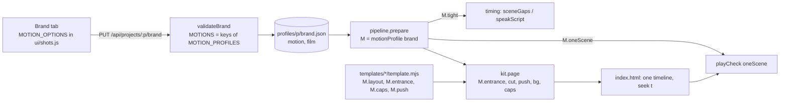

# motion-presets — four more values for `brand.motion`

**Status:** in-review
**Author:** tech-lead
**Branch:** none (the folder is not a git repository)
**Created:** 2026-10-23
**Risk tier / auto-enabled phases:** shared code (`templates/kit.mjs`, `engine/brand.mjs`, `engine/pipeline.mjs`) → QA; template look → USER_REVIEW with stills; brand validation → engine tests. The user may override this routing before implementation.

## Intent
The user asked "for video, what other kinds of motion are there — add them to choose in the brand" (2026-10-23) and picked four: `clean`, `editorial`, `kinetic`, `parallax`. Today `brand.motion` is `standard` (absent) or `cinematic`, plus `brand.film: false` (cinematic without grain and vignette).
**For whom / outcome:** the person who sets up a brand in the Brand tab and makes every video of that brand with it (today: the user, for the Niteco award film and later social and brand films). One choice per brand gives every template of that brand one feel, without editing templates or scripts. First concrete outcome: the NSC award film can switch from `cinematic` to `clean` and lose the blur, the push-in and the grain while keeping its layout.

## Options considered
Skills read for this plan: `template-authoring` (renderer rules, `contentArea`, the `if (cine)` convention, pinned hashes), `testing-patterns` (node:test, no Chrome in unit tests, never weaken an assertion). No server route changes, so `server-route` was not needed.

| Option | Pros | Cons | Chosen? |
|--------|------|------|---------|
| A. Six forks: add `brand.motion === 'clean'` checks next to every `cine` check in the kit and the five templates | Smallest first diff | 15 fork sites today become 15 × 6; every new preset touches every template again; standard and cinematic drift silently | no |
| B. One motion profile object per preset in `engine/brand.mjs`; the kit and the templates read profile fields (`entrance`, `cut`, `push`, `bg`, `caps`, `layout`, `tight`, `oneScene`), never the preset name; cinematic is expressed the same way | One table shows what each preset does; a template branches on a layout family, not on a name; standard and cinematic stay byte for byte the same (hashes prove it); a new preset is one row plus its kit strings | One refactor of the kit and five templates before the first new preset, with a parallel session editing the same files | yes |
| C. One module per preset (`templates/motion/<id>.mjs` exporting helpers, cut, css) | Isolation per preset | Six files for ~30 lines each; the page() contract spreads over seven files; proving standard unchanged is harder | no |

## Scope
- [x] `engine/brand.mjs`: `MOTION_PROFILES` (six rows), `motionProfile(brand)` (unknown or absent → standard), `MOTIONS = Object.keys(MOTION_PROFILES)`; `validateBrand` stores any motion but `standard`, keeps `film: false` only for a profile with `bg: 'grain'`; the error lists all six names.
- [x] `templates/kit.mjs`: `page()` reads `const M = motionProfile(brand)` and every `cine` read becomes a field read; helpers come from a table (`entranceJs(ENTRANCE[M.entrance])` for standard, clean, kinetic, parallax; `CINE_HELPERS` and `EDITORIAL_HELPERS` as their own strings); the cut block comes from `CUTS[M.cut]`; the surface from `M.bg`; captions from `M.caps`; the camera from `M.push`; the editorial panel and the parallax layers are written only for their preset.
- [x] `templates/explainer`, `data-story`, `code-story`, `before-after`, `ui-story`: `brand.motion === 'cinematic'` becomes `motionProfile(brand).layout === 'stage'` (layouts), `.entrance === 'cine'` (the flash blur), `.caps === 'lines'` and `.push` (ui-story's caption lift).
- [x] `engine/pipeline.mjs`: `tight` and the play-through flag from the profile (three call sites); `engine/playcheck.mjs`: option `cinematic` renamed `oneScene` (its meaning: two scenes with text at once is an error).
- [x] `ui/shots.js`: `MOTION_OPTIONS` (id, label, hint) — the UI twin of `MOTIONS`; `ui/app.js` Brand tab: the Motion style select built from it, the hint under it follows the selection; a "Film grain and vignette" checkbox (checked by default) shown only while Cinematic is chosen, unchecked saves `film: false` (lead's answer to open question 2).
- [x] Tests: `CINE_BASELINE` (sha1 of cinematic sample pages) in `tests/cinematic.test.mjs`; `tests/motion-presets.test.mjs` (validation, profile table, page strings per preset, the twin test, a Chrome block per preset); `tests/playcheck-templates.test.mjs` runs every preset as its own subtest; `tests/helpers/chrome-folder.mjs` shared by the two Chrome tests.
- [x] The four presets, one at a time, in this order: `clean`, `editorial`, `kinetic`, `parallax` (see `## Pattern` and `## Epic Backlog`).
- [x] Docs: `CLAUDE.md` Layout paragraph (the `motion` sentence), `.ai/docs/file-index.md` (`brand.mjs`, `kit.mjs`, `brand.json`, tests rows), `.ai/docs/architecture.md` ("Scene gaps": which presets use `tight`), `.claude/skills/template-authoring/SKILL.md` (lines 49 and 53: profile fields instead of `cine`).

## Out of scope
- A Director rule per preset (the Director already gets `brand.motion` in `cli context`; open question 4).
- Sweeping the seven renderers that tween `ease: 'back.out(…)'` directly (`event` 1, `lifestyle` 1, `logo-reveal` 2, `lower-third` 1, `product-demo` 1, `promo` 2, `testimonial` 1): under `clean` and `parallax` those elements keep their bounce. Reported here; a follow-up once the user has seen the stills.
- ui-story's `liftCap` reads `sub-<id>` and misses the caption when a standard brand uses a subtitle preset (captions are then `sub-<id>-0`): a pre-existing bug, reported, not fixed here.
- The Templates tab preview estimates timing without `tight` (true for cinematic today too).
- New scene kinds, new templates, new subtitle presets.

## Reuse & extension
- **Reused:** `cutWindows` (`templates/gl.mjs`, already imported by the kit for leaks and the liquid wipe) gives the editorial panel its per-cut window so two close cuts never overlap; `captionLines` and the `caps` path (one caption line at a time) serve every new preset unchanged; `contentArea`, `hasLogoBug`, `geometry().px` size everything; `draw()` is the editorial "self-drawing rule"; `validateBrand`'s shape (`errors.push`, stored only when set) for the new values; `tests/cinematic.test.mjs`'s Chrome block (lint at each still, one scene at a time, one lit word after a jump back) is the model for each preset's Chrome test; `sampleScript` (`engine/template-preview.mjs`) feeds the sweep. Twins kept in step: `MOTIONS` (validator) ↔ `MOTION_OPTIONS` (Brand tab) by a test; `MOTION_PROFILES.tight` (engine) ↔ the kit's caption and cut code (same row).
- **Extracted:** `motionProfile(brand)` in `engine/brand.mjs` (consumers: `kit.mjs`, five templates, `pipeline.mjs`); `entranceJs(params)` in `kit.mjs` (consumers: the standard, clean, kinetic and parallax rows); `tests/helpers/chrome-folder.mjs` (a temp folder with GSAP, assets and clips; consumers: `tests/motion-presets.test.mjs`, `tests/playcheck-templates.test.mjs`).
- **Extension point:** a preset is one row in `MOTION_PROFILES` plus the kit strings its fields name plus one `MOTION_OPTIONS` entry. The standard row carries today's values, so a brand without `motion` builds today's page byte for byte; the cinematic row carries today's cinematic values. Code for a preset is written only when its field asks for it (`M.cut === 'panel'`, `M.push > 1`), never on the preset name.
- **Old path proven by:** `PARTS_BASELINE`, `NO_FLASH_BASELINE`, `NO_MODEL_BASELINE`, `NO_SHOT_BASELINE` in `tests/templates.test.mjs` (standard, unchanged) and the new `CINE_BASELINE` (cinematic, recorded in T1 before any refactor).

## Architecture

The seam is `motionProfile(brand)`: one function, one table, read by the engine (timing, play-through), the kit (motion) and the templates (layout family). Nothing reads the preset name after validation. State lives in `brand.json` only; a job's `index.html` is rebuilt by prepare, so a preset change applies on the next prepare, as `cinematic` does today.

### The profile table (`engine/brand.mjs`)

| preset | entrance | cut | push | bg | caps | layout | tight | oneScene |
|---|---|---|---|---|---|---|---|---|
| standard | `std` | `fade` 0.3 s | 1 | `particles` | `block` | `classic` | no | no |
| cinematic | `cine` | `blur` | 1.03 | `grain` | `lines` | `stage` | yes | yes |
| clean | `clean` | `fade` 0.15 s | 1 | `none` | `lines` | `stage` | yes | yes |
| editorial | `editorial` | `panel` | 1 | `none` | `lines` | `stage` | no | yes |
| kinetic | `kinetic` | `zoom` | 1 | `particles` | `lines` | `classic` | yes | yes |
| parallax | `parallax` | `fade` 0.4 s + layers | 1.05 | `particles` | `lines` | `stage` | no | yes |

Field meanings:
- `entrance`: which helper set the page gets as `fadeUp`, `pop`, `countUp` (`draw` and `typeText` are shared). `std`, `clean`, `kinetic`, `parallax` share one shape and come from `entranceJs({ dy, d, ease, popFrom, popEase, popD, countEase, countK })`; `entranceJs(ENTRANCE.std)` must equal today's `STD_HELPERS` text (the hashes check it). `cine` keeps `CINE_HELPERS` as it is (word split, blur). `editorial` is its own string: `maskWords(el)` wraps each word of a `.hd` in `…` (outer `overflow:hidden`), inner spans rise from `y: '110%'` with a 0.04 s stagger on `power4.out` 0.7 s, so lines reveal top to bottom; other elements wipe in with `clipPath: 'inset(0 100% 0 0)' → 'inset(0 0% 0 0)'`, 0.5 s `power3.inOut`.
- `cut`: the scene loop block, `CUTS[M.cut]`. `fade` takes a duration (`0.3` emits today's standard text; `0.15` clean; `0.4` parallax): old scene out over its last `d`, new scene in over its first `d`, never two at once. `blur` is today's cinematic block. `panel`: one `
` (z-index 21, `background: var(--primary)`; `var(--secondary)` when the next scene is `dark`) sweeps `xPercent: -100 → 0` ending on the cut and `0 → 100` from it, windows from `cutWindows(cuts, 0.25, 0.25)`; the old scene is hidden at the cut and the new shown at it. Skipped when the brand has a `wipe` (two sweeps at one cut). `zoom`: cut `k` even — old `scale 1 → 1.1, opacity → 0` over 0.12 s, new `scale 0.9 → 1` over 0.22 s `back.out(1.4)`; `k` odd — old `xPercent 0 → -8`, new `xPercent 8 → 0` 0.22 s `power4.out`. Index-driven, never random.
- `push`: the end scale of the camera on every scene group. 1 = none. 1.03 = today's push-in. 1.05 (parallax) = `scale 1.02 → 1.05` with `x: ±10 U → ∓10 U`, `y: ±6 U → ∓6 U`, sign from the scene index. ui-story's caption lift uses `(M.push - 1)` where it hard-codes `0.03` today. Templates never tween a scene group's transform.
- `bg`: `particles` (today's canvas), `grain` (grain + vignette; `brand.film: false` turns it off), `none`. A brand `backdrop` replaces particles in every preset, as today.
- `caps`: `block` (today's standard pill) or `lines` (one caption line at a time, each word lit as spoken — today's cinematic captions, same entrance tween, same `.sw` rules). A brand subtitle preset forces `lines` and its own look in every preset, as today.
- `layout`: `classic` (today's standard layouts) or `stage` (today's cinematic layouts: content centred between the corner logo and the caption band in larger type, explainer footage full frame under a lower third, no progress bar, fine-line icon, single step without "/ 01").
- `tight`: `config/studio.json → timing.tight` gaps (0.15 s / 0.4 s).
- `oneScene`: play-through check reports two scenes with text at once as an error.

### Parallax layers (kit only, no template markup)
The scene loop tweens a CSS variable on the group, `tl.fromTo(g, { '--par': -1 }, { '--par': 1, duration: e - s, ease: 'none' }, s)`, and the stage carries `class="par"` for this preset only. CSS maps depth to the `translate` property, which composes with GSAP's `transform` so entrances (`y`) are untouched: `.par .hd,.par .kick{translate:calc(var(--par)*${px(6)}) 0}` and `.par video,.par img,.par canvas,.par svg{translate:calc(var(--par)*${px(-14)}) 0}`. The far layer is the kit's own canvas: `#bgc` (or `#glb`) gets `x: 24 U → -24 U` per scene. Everything is a function of the timeline, so `seek(t)` stays pure. Numbers are starting points; the stills review sets them.

### What conflicts and what wins
| Brand knob | With a preset |
|---|---|
| `backdrop` | Replaces particles in every preset (as today). Draws under grain. |
| `wipe: liquid` | Draws over every cut in every preset. The editorial panel is skipped when a wipe is set; kinetic's zoom stays (it moves the scene, the wipe covers the cut). |
| `leaks`, `shine`, `sfx`, `logoBug` | Unchanged in every preset. |
| `subtitles` (preset or custom box) | Wins over the profile's caption look, as it does over cinematic today. |
| `film: false` | Only with `cinematic` (the one `bg: 'grain'` row); dropped otherwise, as today. `cinematic + film: false` is not `clean`: it keeps the blur entrances, the blur cuts and the push-in. |
| `motion: cinematic` pages | Byte for byte as today (`CINE_BASELINE`). |

### Data
`brand.json` → `motion`: one of six names, absent for standard; `film: false` only next to `cinematic`. No migration: every stored brand keeps its meaning. A hand-edited unknown name still renders as standard (as today) and is refused on the next save.

## Files to create / modify
| File | Change |
|------|--------|
| `engine/brand.mjs` | modified — `MOTION_PROFILES`, `motionProfile`, `MOTIONS` derived; store any non-standard motion; `film` only with `bg: 'grain'` |
| `templates/kit.mjs` | modified — `M = motionProfile(brand)`; `ENTRANCE` table + `entranceJs`; `EDITORIAL_HELPERS`; `CUTS`; panel markup/css/js; parallax css/js; `film`, `particles`, `caps` from `M` |
| `templates/explainer/template.mjs` | modified — `cine` → `M.layout === 'stage'` (footage, prog, icon, sizes, video js, step number) and `M.entrance === 'cine'` (flash blur) |
| `templates/data-story/template.mjs`, `templates/code-story/template.mjs`, `templates/before-after/template.mjs` | modified — `cine` → `M.layout === 'stage'` |
| `templates/ui-story/template.mjs` | modified — `CINE_SUB` on `M.caps === 'lines'`, `CINE_PUSH` factor `M.push - 1` when `M.push > 1` |
| `engine/pipeline.mjs` | modified — `tight` and `oneScene` from `motionProfile(brand)` at the three `brand.motion === 'cinematic'` sites |
| `engine/playcheck.mjs` | modified — option `cinematic` → `oneScene` (JSDoc, `install` arg, the check) |
| `ui/shots.js` | modified — `MOTION_OPTIONS` |
| `ui/app.js` | modified — Brand tab select from `MOTION_OPTIONS`, hint follows the selection |
| `tests/cinematic.test.mjs` | modified — `CINE_BASELINE` test |
| `tests/motion-presets.test.mjs` | new — validation, profile table, page strings per preset, twin test, Chrome block per preset |
| `tests/helpers/chrome-folder.mjs` | new — temp folder with GSAP, sample assets and clips for Chrome tests |
| `tests/playcheck-templates.test.mjs` | modified — one subtest per preset, uses the helper |
| `tests/playcheck.test.mjs` | modified — the `cinematic:` option becomes `oneScene:` (one call site) |
| `CLAUDE.md`, `.ai/docs/file-index.md`, `.ai/docs/architecture.md`, `.claude/skills/template-authoring/SKILL.md` | modified — the six presets, profile fields instead of `cine` |

## Task breakdown

### T1 — Pin the cinematic pages
- **Files:** `tests/cinematic.test.mjs`
- What: a `CINE_BASELINE` test modelled on `PARTS_BASELINE`: sha1 of `build()` for the `sampleScript` of explainer, data-story, testimonial and event in every format with `HASH_BRAND + { motion: 'cinematic' }` and `HASH_TIMING`. Record the hashes against the untouched code (a scratchpad script prints them). This is the only proof that the refactor leaves cinematic byte for byte the same.
- **Verify:** `node --test tests/cinematic.test.mjs` → the new test passes on untouched code; `node --test tests/templates.test.mjs` → all hashes pass.
- [x] done

### T2 — Profile table, kit and engine on the profile (no new preset)
- **Depends:** T1. Confirm first that the review-fixes session's edits to `kit.mjs`, `pipeline.mjs` and `playcheck.mjs` are final (its plan is in-review); re-read those files at the start.
- **Files:** `engine/brand.mjs`, `templates/kit.mjs`, `engine/pipeline.mjs`, `engine/playcheck.mjs`, `tests/playcheck.test.mjs` (option rename), `tests/motion-presets.test.mjs` (validation + profile table cases)
- What: `MOTION_PROFILES` with the standard and cinematic rows only; `motionProfile`; `MOTIONS` derived; `validateBrand` stores `b.motion` when it is not `standard`, `film` only for `bg: 'grain'`; the error text `motion must be one of standard, cinematic` stays as today's test expects (it grows as rows are added). In `kit.mjs`: `const M = motionProfile(brand)`; `particles` off unless `M.bg === 'particles'`; `film = M.bg === 'grain' && !transparent && brand.film !== false`; `caps` on `M.caps === 'lines' || P`; `.cw` css on `M.entrance === 'cine'`; the caption `.sw` rules on `M.caps === 'lines'`; helpers `M.entrance === 'cine' ? CINE_HELPERS : entranceJs(ENTRANCE.std)`; the scene loop block `CUTS[M.cut](M)` with `fade` taking `d` and `blur` carrying the push (`M.push`). Pipeline: `motionProfile(brand).tight` and `.oneScene`. Playcheck: rename the option. Surgical edits in place; do not move blocks.
- **Verify:** `node --test tests/templates.test.mjs tests/cinematic.test.mjs tests/timing-tight.test.mjs tests/playcheck.test.mjs tests/fix-templates-pure.test.mjs tests/motion-presets.test.mjs` → every hash and string holds; `grep -n "motion === 'cinematic'" templates/kit.mjs engine/*.mjs` → no output.
- [x] done

### T3 — Templates on the profile
- **Depends:** T2
- **Files:** `templates/explainer/template.mjs`, `templates/data-story/template.mjs`, `templates/code-story/template.mjs`, `templates/before-after/template.mjs`, `templates/ui-story/template.mjs`
- What: replace `const cine = brand.motion === 'cinematic'` with `const M = motionProfile(brand)` and the field reads listed in the files table. The constants keep their names where they still describe the branch (`cineSicon` → `stageSicon`).
- **Verify:** `node --test tests/templates.test.mjs tests/cinematic.test.mjs tests/mix.test.mjs tests/ui-story-shot.test.mjs` → all pass, hashes unchanged; `grep -rn "motion === 'cinematic'" templates/` → no output.
- [x] done

### T4 — Brand tab reads the options list
- **Depends:** T2
- **Files:** `ui/shots.js`, `ui/app.js`, `tests/motion-presets.test.mjs` (twin test)
- What: `MOTION_OPTIONS = [{ id, label, hint }]` (standard, cinematic for now); the select is built from it; the hint `` under the select shows the chosen option's hint and switches on `change`; the save path keeps `motion: $('#br-motion').value`. A "Film grain and vignette" checkbox under the select, checked by default, shows only while the chosen option's profile has `bg: 'grain'` (cinematic); unchecked saves `film: false`. The twin test asserts `MOTION_OPTIONS.map((o) => o.id)` deep-equals `MOTIONS` and every hint is a short English sentence ending with "Applies on the next prepare."
- **Verify:** `node --test tests/motion-presets.test.mjs` → twin test passes; browser (`npm run ui`, Brand tab): the select shows Standard and Cinematic, the hint changes with the choice, Save then reload shows the saved value; the review link (`npm run ui:review`) shows the select locked.
- [x] done

### T5 — `clean` (first of the epic; the award film may switch to it)
- **Depends:** T3, T4. Recipe in `## Pattern`.
- **Files:** `engine/brand.mjs`, `templates/kit.mjs`, `ui/shots.js`, `tests/motion-presets.test.mjs`, `tests/helpers/chrome-folder.mjs` (new, extracted here), `tests/playcheck-templates.test.mjs` (per-preset subtests, uses the helper)
- Numbers: `ENTRANCE.clean = { dy: 24, d: 0.35, ease: "'power2.out'", popFrom: 0.96, popEase: "'power2.out'", popD: 0.3, countEase: "'power2.out'", countK: 1 }`; cut `fade` 0.15 s; `bg: 'none'`; `caps: 'lines'`; `layout: 'stage'`; `tight: true`; `oneScene: true`. The page has no `filter:`, no `drawBg`, no `#grain`, no `scale: 1.03`.
- **Verify:** `node --test tests/motion-presets.test.mjs --test-name-pattern clean` (strings + Chrome: lint at stills, one scene at a time, one lit word after a jump back) and `node --test tests/playcheck-templates.test.mjs --test-name-pattern clean` → pass. Then a scratch copy of `profiles/nsc-award/brand.json` with `motion: "clean"` (keep `logoBug`): `node engine/cli.mjs prepare <project> <job>` on one award job → the person reads `stills/` and `review/sheet.jpg` (USER_REVIEW): stage layout kept, sharp text, no grain, captions one line at a time.
- [x] done

### T6 — `editorial`
- **Depends:** T5. Recipe in `## Pattern`.
- Numbers: `EDITORIAL_HELPERS` as described under "The profile table"; cut `panel` with `cutWindows(cuts, 0.25, 0.25)`; `bg: 'none'`; `caps: 'lines'`; `layout: 'stage'`; `tight: false`. Chrome block adds: at each cut time `#panel` covers the frame (`xPercent` within 2 of 0), 0.3 s later it is off frame; with `wipe: 'liquid'` the page has no `#panel`.
- **Verify:** `node --test tests/motion-presets.test.mjs --test-name-pattern editorial`; `node --test tests/playcheck-templates.test.mjs --test-name-pattern editorial`; stills of explainer + data-story samples in 16:9 and 9:16 (USER_REVIEW).
- [x] done

### T7 — `kinetic`
- **Depends:** T5. Recipe in `## Pattern`.
- Numbers: `ENTRANCE.kinetic = { dy: 60, d: 0.45, ease: "'back.out(1.8)'", popFrom: 0.4, popEase: "'back.out(2.2)'", popD: 0.45, countEase: "'expo.out'", countK: 0.6 }`; cut `zoom` alternating by cut index; `bg: 'particles'`; `caps: 'lines'`; `layout: 'classic'`; `tight: true`. Chrome block adds: at `s + 0.05` of an even cut the group's scale is below 1, of an odd cut its `x` is above 0; every `[data-lint]` box stays inside the safe area at `s + 0.15` (the overshoot moment).
- **Verify:** `node --test tests/motion-presets.test.mjs --test-name-pattern kinetic`; `node --test tests/playcheck-templates.test.mjs --test-name-pattern kinetic`; stills (USER_REVIEW).
- [x] done

### T8 — `parallax`
- **Depends:** T5. Recipe in `## Pattern`.
- Spike first (10 minutes, scratchpad): one page in Chrome proves GSAP tweens `'--par'` on an element (`style.setProperty`) and `translate: calc(var(--par) * 6px) 0` composes with a GSAP `y` transform on the same element. If either fails, fall back to tweening `x` on wrapper-free targets: text `.hd/.kick` and media get their own small `x` tweens in the scene loop, and the plan's Risks entry is updated before coding.
- Numbers: `ENTRANCE.parallax = { dy: 30, d: 1.1, ease: "'expo.out'", popFrom: 0.94, popEase: "'expo.out'", popD: 1.0, countEase: "'expo.out'", countK: 1.2 }`; cut `fade` 0.4 s; `push: 1.05` with the drift above; layers text 6, media −14, background 24 (1080 units); `bg: 'particles'`; `caps: 'lines'`; `layout: 'stage'`; `tight: false`. Chrome block adds: mid-scene, `getComputedStyle(h).translate` of a `.hd` is not `none` and differs from its value at the scene start; `playCheck` played vs jumped reports nothing.
- **Verify:** `node --test tests/motion-presets.test.mjs --test-name-pattern parallax`; `node --test tests/playcheck-templates.test.mjs --test-name-pattern parallax`; stills of explainer, data-story and ui-story (open question 7) in 16:9 and 9:16 (USER_REVIEW).
- [x] done

### T9 — Sweep and docs
- **Depends:** T5–T8
- **Files:** `CLAUDE.md`, `.ai/docs/file-index.md`, `.ai/docs/architecture.md`, `.claude/skills/template-authoring/SKILL.md`
- What: docs as listed in Scope; the template-authoring skill says "never tween a scene group's transform or `--par`; write layout overrides under `if (M.layout === 'stage')`".
- **Verify:** `npm test` on a quiet machine (no UI server building previews, no second test run) → all pass; `node .claude/scripts/check-propagation.js` → clean; `node .ai/scripts/prose-audit.js .ai/plans/motion-presets.md` → clean; Brand tab shows six options with their hints (screenshot); Templates tab preview of explainer in the project's brand plays the chosen preset (screenshot).
- [x] done

## Acceptance criteria
- [x] Brand tab: the Motion style select lists Standard, Cinematic, Clean, Editorial, Kinetic, Parallax; the hint under it follows the choice; Save round-trips; the review link shows it locked (screenshot of the tab). (Review-link lock checked in T4 with two options; the lock is generic to every select.)
- [x] `PUT /api/projects/:p/brand` with `motion: "epic"` answers 400 `motion must be one of standard, cinematic, clean, editorial, kinetic, parallax`, and the Brand tab shows that text.
- [x] A prepared `nsc-award` job on a brand copy with `motion: "clean"`: `stills/` show the stage layout with no grain and no blur, `review/sheet.jpg` is written, the play-through check reports no error, captions show one line at a time (stills and `status.json` lint).
- [ ] The Templates tab preview of a project whose brand uses a new preset plays that preset (visible in the iframe: no particles under clean, the panel sweep under editorial, the zoom under kinetic, the drift under parallax). Checked in the iframe for editorial only; clean, kinetic and parallax were checked through `out/_motion-stills/<preset>/` (the same kit page), not in the Templates tab.
- [x] `tests/templates.test.mjs` hashes unchanged; `CINE_BASELINE` unchanged after T2–T9.
- [x] `tests/playcheck-templates.test.mjs`: every template's sample in every format plays with no error under each of the six presets.
- [ ] `npm test` green on a quiet machine. 695/696 under load; the one failure (EPERM file lock in `fix-jobs-brief`) passed 10/10 alone. Not run on a quiet machine.
- [x] No `Math.random`, `Date.now`, `setTimeout` or `setInterval` in any new kit string (`grep` on `templates/kit.mjs`); every new tween sits on the shared `tl`.

## External system contract
- **Chrome (playwright-core, `openComposition` in `engine/media.mjs`):** used by prepare (stills, play-through) and by the Chrome tests. The new presets are DOM, CSS and GSAP only; no `data-gl`, so no SwiftShader. Parallax needs the CSS `translate` property and CSS-variable tweens (Chrome 104+; the installed Chrome). Each test opens one browser per page and closes it in `finally`; `openComposition` has its own timeout. When Chrome is missing the tests skip (`t.skip`), as the cinematic test does.
- **ffmpeg (`ffmpeg-static`):** unchanged; the sample photo and clip for tests come from `lavfi` as today, each call with `timeoutMs`.
- **No model, no network, no key.** Nothing here touches `server/director.mjs`, `server/generate.mjs` or the Director's allowlist.
- **Human-only gates (HARD):** reading stills and `review/sheet.jpg` per preset (T5–T8), the Brand tab and Templates tab checks (T4, T9), the one prepare of an award job (T5). The loop cannot judge a look; it can only prove the page lints, plays and matches its strings.

## Risks & impact
- **Shared code:** `templates/kit.mjs` `page()` is used by all 15 renderers (feature-launch and social-teaser through `extends`) and by `engine/mix.mjs` `buildMixed`. `engine/brand.mjs` is read by the server (brand save), `engine/jobs.mjs` (`createProject`), the kit and now five templates and the pipeline. Mitigation: T1's `CINE_BASELINE` and the four standard baselines; T2 and T3 change nothing visible by design and are verified by hashes alone.
- **Parallel session (high):** `review-fixes-2026-10-23` (in-review) edits `kit.mjs`, `pipeline.mjs`, `playcheck.mjs`, product-demo and app-walkthrough, and owns the `fix-*` tests. Two sessions editing `page()` at once will clash. Mitigation: start T2 only after that session's edits to those three files are final; re-read each file at the start of every task; keep every edit in place (replace the `cine` read, do not move the block); record `CINE_BASELINE` against the merged state; `tests/fix-templates-pure.test.mjs:115` pins the cinematic caption entrance string and must keep passing.
- **Helper reach is uneven:** ui-story (86 direct tweens, no helpers), app-walkthrough (0 helpers) and product-demo (1 helper) get only the kit-level parts of a preset: cut, camera, surface, captions, timing. That is already true for cinematic. Seven renderers carry direct `back.out` tweens (listed under Out of scope). The stills review per preset decides whether a sweep is worth it.
- **Kinetic overshoot on the scene group** (`scale 0.9 → 1` on `back.out(1.4)`, peak about 1.02) can push edge text toward the safe-area line for a few frames; the stills lint sits at `end − 0.45`, the mid-motion lint is a warning. The Chrome block lints at `s + 0.15` to catch it. Rule for templates (already in the skill): edge text at least 2 % inside the safe area.
- **Parallax on redrawn UIs:** ui-story's labels and icons would drift inside the app window. Open question 7; if the user rejects it, ui-story's `parts()` can return `layers: false` and the kit skips the stage class for that page (one optional field with a default that keeps every other page the same).
- **Parallax CSS-variable tween:** the T8 spike proves it before any kit code. Result (2026-10-23): the variable tweens, but GSAP folds a CSS `translate` into its own transform on the first transform tween of an element, so the `--par` layers cannot work. Taken instead: `layerDrift(g, s, e)` in the kit adds an `x` drift (text 6 U, media −14 U) to `.hd`, `.kick`, `img`, `video` of each scene, skipping an element a tween of that scene already moves on `x`, a layer inside another layer and media at least 90 % of the frame wide; the camera is a `fromTo` on the scene group (scale 1.02 → 1.05, x ±10 U, y ±6 U, direction alternating by scene index) and the particle canvas drifts ±24 U with it. A renderer returns `layers: false` from `parts()` to stay out of the drift (ui-story); a mixed page drifts only when every renderer in it allows it.
- **Play-through sweep time:** two presets take about 3.5 minutes at 1/6 s; six take about 10 minutes against the file's 900 s timeout. Per-preset subtests each carry their own timeout and `--test-name-pattern` runs one preset alone.
- **`tight` changes job length** for clean and kinetic brands (0.15/0.4 s gaps instead of 0.2/0.5 s): a job prepared again on a brand that switched preset gets new timing, like switching to cinematic today. Expected; "Applies on the next prepare".
- **Validation and UI twins:** a preset added to the table without its `MOTION_OPTIONS` entry fails the twin test; an entry without its row fails it too.
- **Conventions:** no new rule. The template-authoring skill wording changes (T9) and `check-propagation.js` runs after it.

## Verification
- Byte-for-byte proof: a scratchpad sweep hashed 816 pages (17 templates × their formats × 12 brand variants: standard and cinematic, each plain and with the corner logo, a subtitle preset, a custom box, GL layers, film off) before T2 and again after T2, T3, T6 and T7 (with the kinetic and parallax kit code in place): 0 changed each time. `PARTS_BASELINE`, `NO_*_BASELINE` and `CINE_BASELINE` pass unedited.
- Per-preset checks: `tests/motion-presets.test.mjs` (profile table, validation, Brand tab twin, page strings, a Chrome block per preset) and `tests/playcheck-templates.test.mjs` (one test per profile: every template sample in every format).
- Browser QA on a second instance (port 4791, review 4792) with scratch project `zz-motion-qa` (a copy of the nsc-award brand): Brand tab lists the six styles, each hint follows the choice, the film box shows only under Cinematic, Save round-trips (`film: false` / absent, Standard, Editorial), an injected `epic` answers 400 and the tab shows `motion must be one of standard, cinematic, clean, editorial, kinetic, parallax`, the review link shows the select and the box disabled; the Templates tab explainer preview under Editorial has `#cutpanel` and the panel crossing the frame before a cut (`.playwright-mcp/t9-brand-six.png`, `t9-templates-editorial.png`).
- Award job: `zz-clean-award/a1-hook` prepared on `motion: clean`: lint 0/0, `review/sheet.jpg` written.
- Docs: `CLAUDE.md`, `.ai/docs/file-index.md`, `.ai/docs/architecture.md`, `.claude/skills/template-authoring/SKILL.md`; `check-propagation.js` exit 0 (two allowed warnings on the abbreviated CLAUDE.md NEVER list, not from this change); `prose-audit.js` on this plan: 1 finding (rule 7, the bold-lead bullets of the planning sections share one skeleton), left as written by the planner.

## Loop autonomy & process invariants
- **No pop-up questions.** The loop runs fully autonomously — it does NOT stop to ask "which item first / pause to review / how to proceed". On any ambiguous-but-reversible choice, pick the **most optimal option** (best satisfies AC + conventions, lowest risk), note it in the Loop Journal, and continue. Only the 3 safety valves (no-progress, AC-unreachable, high-risk/irreversible) may stop the loop.
- **Full gate per item, no skipping** — IMPLEMENT → CODE_REVIEW → VERIFY (mandatory build of the touched layer) → UNIT_TEST → QA (when enabled). A red gate heals + retries; it is never bypassed.
- **QA everything** — every UI-bearing item gets real browser QA; a final end-to-end QA pass before DONE. The stills reviews in T5–T8 are human gates: the loop prepares the stills and stops for the person.
- **Commit per item** — once the folder is a git repository: after an item's gates are green, commit that item with an explicit file list (`git add <files>`, never `-A`/`.`). High-risk items (server boundary, secrets, model calls) stop at the commit step for human diff review instead.
- **No `git push`.** Commit locally only. There is no remote or PR tooling for this project.

## Resume across quota reset
This loop runs in an interactive session. When you see **"You've hit your session limit · resets <time>"**, the in-session loop CANNOT self-resume — the process is API-blocked, and `/loop` wrapping does not bypass it (confirmed against Claude Code docs). To continue after the reset:
1. At/after the reset time, come back to this chat and either **re-run the same loop command** (`/loop /loop-ticket .ai/plans/motion-presets.md`) or run **`claude --continue`**.
2. The loop reads this plan's `## Acceptance criteria` checkboxes + `## Loop Journal` to know where it left off, and continues from the first un-`[x]` item — no work is lost.
3. Keep the local UI (`npm run ui`) running so the QA gate can run when the loop reaches a UI item.

Resume manually. Do not schedule `claude -p` jobs or other unattended runs: the seat and its quota are company-owned.

## Loop Journal
<One line per heal iteration, appended by /loop-ticket. Format: `<iso-ts> | iter N | <gate> | <failure-signature or "green"> | <action taken>`.>
- 2026-10-23 | T1 | VERIFY | green: cinematic + templates 66/66 | `CINE_BASELINE` pins seven templates (the plan's four plus code-story, before-after, ui-story, which T3 touches) on the code as it stood (with `brand.film`, the "w" word class, `numBreak`). A scratchpad sweep also recorded 816 pages (17 templates × formats × 12 brand variants: standard and cinematic with logo bug, subtitle preset, custom box, GL layers, film off) to compare after T2/T3.
- 2026-10-23 | T2 | VERIFY | green: 6 files 97/97, grep empty, sweep 816/816 pages unchanged | `MOTION_PROFILES` (standard, cinematic) + `motionProfile` in `engine/brand.mjs`; kit reads `M` (`ENTRANCE`/`entranceJs`, `HELPERS`, `CUTS`); fade rows carry `cutD`. `tests/playcheck-templates.test.mjs` got the one-word option rename now (`cinematic:` → `oneScene:`), or its cinematic pass would have stopped checking two scenes at once until T5.
- 2026-10-23 | T3 | VERIFY | green: 4 files 104/104, grep empty, sweep 816/816 unchanged | five templates read `motionProfile(brand)`: `stage` (layout), explainer `focus` (entrance `cine`, the flash blur); ui-story `LINES_SUB` on `caps === 'lines'`, `PUSH_LIFT(k)` with k = push − 1 rounded to 3 places (1.03 − 1 is 0.030000000000000027 in JS, which would have moved the hash).
- 2026-10-23 | T4 | VERIFY | green: motion-presets + fix-ui-helpers 10/10; browser on a second instance (4791, review 4792) with scratch project `zz-motion-qa` (brand copied from nsc-award: cinematic, film false): select lists Standard and Cinematic, hint follows the choice, film box shows only under Cinematic, uncheck → `film: false`, check → absent, Standard saves and reloads; review link shows select and box disabled | `MOTION_OPTIONS` carries `film: true` on cinematic (twin-tested against `bg: 'grain'`) and `motionOpt(id)` (unknown → Standard). Screenshots `.playwright-mcp/t4-brand-film.png`, `t4-review-locked.png`.
- 2026-10-23 | T5 clean | VERIFY | green: motion-presets `clean` 2/2 (strings + Chrome), playcheck-templates `clean` 1/1 (every template, every format, 78 s); award job `zz-clean-award/a1-hook` (copy of the nsc-award profile with `motion: clean`, script and source copied through claim + commit) prepared: awaiting_review, lint 0 errors 0 warnings, 7 stills + `review/sheet.jpg`, no `blur` in its index.html (the soft frames at the start of king/nsc/online are in the source footage; the nsc-award sheet shows the same) | `tests/helpers/chrome-folder.mjs` extracted; `tests/playcheck-templates.test.mjs` is one test per `MOTIONS` entry (`--test-name-pattern <motion>`), timed with `tight` per profile as prepare does. Stills: `out/_motion-stills/clean/` (explainer and data-story, 16:9 and 9:16, plus two frames around each of the first two cuts). Lint 0, play errors 0 on all four pages.
- 2026-10-23 | T8 spike (run early) | GSAP tweens `--par` on the group (−0.998 → 0.998), but the first GSAP transform on a child folds its CSS `translate` into GSAP's own matrix and pins it (translate stays `none`, x frozen at −6 px). Fallback taken, per the plan: the kit adds a small `x` drift per layer to text and media that no tween of the scene moves on `x`, decided at build time from the scene's own tweens.
- 2026-10-23 | T6 editorial | VERIFY | first pass: motion-presets 10/10, playcheck `editorial` red: ui-story and feature-launch "sb Search × span All customers" text over text | heal: ui-story already owns `#panel`; the kit's sheet is now `#cutpanel` (classes `cp`/`cpd`, data `D.cutPanel`) and a test builds ui-story under editorial to keep the id apart. Second pass green: motion-presets `editorial|each profile` 3/3, playcheck `editorial` 1/1, sweep 816/816 unchanged. Stills: `out/_motion-stills/editorial/`, lint 0 and play errors 0 on all four pages. Deviation from the plan: the panel id is `cutpanel`, not `panel`. For the stills review: the corner logo stays the light-surface logo while the dark panel crosses it (it switches at the cut), so it reads faint for about 0.25 s.
- 2026-10-23 | T7 kinetic | VERIFY | green: sweep 816/816 unchanged (kinetic and parallax kit code both in place); motion-presets `kinetic|each profile|every motion|Brand tab|film` 7/7 (zoom cut: scale < 1 at s + 0.05 on even cuts, xPercent > 0 on odd cuts; no safe-area lint at s + 0.15 on any cut); playcheck `kinetic` 1/1 (92 s). Stills: `out/_motion-stills/kinetic/`, lint 0 and play errors 0 on all four pages | the outgoing scene also fades to 0 over its last 0.12 s (the plan named only the scale or slide), so the cut never shows a hard jump.
- 2026-10-23 | T8 parallax | VERIFY | green: motion-presets `parallax|each profile` 3/3 (camera and drift strings; ui-story has the camera and the 0.05 caption lift but no `layerDrift`; a WebGL backdrop does not drift; in Chrome a heading's x differs between scene start and middle, and `playCheck` reports no error); playcheck `parallax` 1/1 (100 s). Stills: `out/_motion-stills/parallax/` (explainer and data-story 16:9 + 9:16, ui-story 16:9, the only format it has), lint 0 and play errors 0 on all five pages | built on the spike fallback (see Risks): x drift per element instead of `--par` and CSS `translate`; profile field `layers: true` on the parallax row only; `page({ layers })` and `parts()` → `layers: false` in ui-story; `buildMixed` passes `layers` only when every renderer allows it.
- 2026-10-23 | T9 (partial) | docs done: `CLAUDE.md` motion sentence, `.ai/docs/file-index.md` (brand.mjs, kit.mjs, shots.js, brand.json, timing.mjs, test rows), `.ai/docs/architecture.md` (scene gaps, play-through `oneScene`), template-authoring skill (profile fields, `M.layout === 'stage'`, `layers: false`), engine comments in `timing.mjs`/`tts.mjs`; `check-propagation.js` exit 0; `prose-audit.js` 1 finding (rule 7 on the planner's bold-lead bullets); Brand tab six options + `epic` 400 text + Templates tab editorial preview checked in the browser. Full `npm test` running; so far 434 results, 1 `not ok`: `fix-jobs-brief.test.mjs` "content fields still send the job back to the Director", EPERM on the `status.json` rename (the known Windows indexer flake), to rerun alone.
- 2026-10-23 | T9 | VERIFY | `npm test`: tests 696, pass 695, fail 1, cancelled 0, skipped 0 (655 s; the lead's UI server and other node processes were running, so not fully quiet). The one failure is `tests/fix-jobs-brief.test.mjs` "content fields still send the job back to the Director": EPERM renaming `out/zz-fix-jobs-brief/edit-16x9/status.json.<pid>.tmp`, a file lock, not this change; rerun alone: 10/10. All six `playcheck-templates` profiles passed inside the full run (standard 202 s, cinematic 106 s, clean, editorial, kinetic, parallax).

## Understanding trail
<`.claude/state/loop-explainers/motion-presets-iterN.md` files written by /loop-ticket on green product-code iterations.>

## What the loop built
A brand can now pick one of six motion styles in the Brand tab (Standard, Cinematic, Clean, Editorial, Kinetic, Parallax), and every video of that brand takes its entrances, cuts, camera, background, captions, layout and voice gaps from that one choice on the next prepare. Standard and Cinematic pages are unchanged byte for byte. Each style is one row of `MOTION_PROFILES` plus the kit strings its fields name; templates branch on fields (`layout`, `entrance`, `caps`, `push`), never on the name.

## Pattern
One preset = one vertical slice. Complexity: `senior-dev` (kit JS strings plus a Chrome test); no `dev-quick`.

1. `engine/brand.mjs`: add the row to `MOTION_PROFILES` with the numbers from its task. The name joins `MOTIONS` and the validator's error text by itself.
2. `templates/kit.mjs`: the entrance — a row in `ENTRANCE` when it shares the simple shape, else its own helper string next to `CINE_HELPERS`; the cut — an entry in `CUTS` (a function of `M` and the cut index, returning the scene-loop text); css and markup the preset needs, guarded on the field that asks for it (`M.cut === 'panel'`, `M.push > 1`), never on the name. A standard page must not gain one byte: run the hash tests after every kit edit.
3. `ui/shots.js`: the `MOTION_OPTIONS` entry — `label` one word, `hint` one short English sentence of what the viewer sees plus the use it fits, ending "Applies on the next prepare."
4. `tests/motion-presets.test.mjs`: validation stores the name; page strings present (its helper text, its cut text) and absent (`filter:` for clean, `drawGrain` for every non-cinematic, `#panel` with a wipe); the Chrome block from `tests/helpers/chrome-folder.mjs` (explainer and data-story samples, 16:9 and 9:16: lint at each still, one scene at a time, one lit word after a jump back, the preset's own check from its task). `tests/playcheck-templates.test.mjs`: the preset joins its `PRESETS` list.
5. Stills: a scratch job (explainer + data-story samples, the project's real brand, 16:9 and 9:16) → the person reads `stills/` and `review/sheet.jpg`.
6. Verify: `node --test tests/motion-presets.test.mjs --test-name-pattern <preset>` and `node --test tests/playcheck-templates.test.mjs --test-name-pattern <preset>` pass; the stills are accepted.

## Epic Backlog
- [x] clean (T5) — the award film candidate; also extracts `tests/helpers/chrome-folder.mjs`
- [x] editorial (T6)
- [x] kinetic (T7)
- [x] parallax (T8) — spike the CSS-variable tween first

## Open questions for the user
1. `clean` keeps the cinematic *layout* (`stage`: centred content, larger type, full-frame footage under a lower third, no progress bar) and the tight gaps, so the award film only loses blur, push-in and grain. Right? Or should `clean` use the standard layouts?
2. `brand.film` has no Brand tab control. Keep it JSON-only, or add a "Film grain and vignette" checkbox shown under Cinematic?
3. All four new presets show captions one line at a time with each word lit (like cinematic). OK for kinetic too, or should kinetic keep the standard block?
4. No new Director hint per preset (the Director sees `brand.motion` in its context already). Want one (e.g. kinetic: shorter titles)?
5. Editorial panel: brand primary, and the secondary colour before a dark scene? And a brand `wipe` replaces the panel — agreed?
6. Sequencing: wait for the review-fixes session's `kit.mjs` / `pipeline.mjs` / `playcheck.mjs` edits to land before T2?
7. Parallax moves headings, icons and images at different speeds inside every scene, including ui-story's redrawn app window. Accept, or let ui-story opt out of the layers?

**Answers (lead, 2026-10-23):** 1 yes, `clean` keeps `stage` and `tight`. 2 a Brand tab checkbox "Film grain and vignette", checked by default, shown only under Cinematic; unchecked saves `film: false` (T4). 3 one-line lit captions for all four, kinetic included. 4 no Director hint. 5 agreed. 6 the review-fixes session is finished; T2 may start. 7 ui-story opts out of the parallax layers (`parts()` returns `layers: false`); the camera drift and the rest of parallax still apply there (T8).
