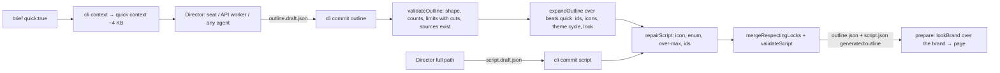

# quick-video — Quick mode: a short outline the engine expands into a finished script

**Status:** planning
**Author:** tech-lead
**Branch:** master
**Created:** 2026-10-28
**Risk tier / auto-enabled phases:** job state + locks → engine tests; shared Director rules → `tests/worker-prompt.test.mjs`; template look (the looks) → USER_REVIEW with stills; UI (brief form, Script tab) → QA in the real UI. Windows only.

## Intent
Any Director should be able to make a simple marketing video that looks finished and moves well: the Claude seat, the API worker on any provider in `config/providers.json` (GPT, Gemini, Grok, Qwen, Claude API), or a coding agent a person types the Director request into (Claude Code, Cursor, Copilot, Antigravity, and ones we have not named: Codex, Windsurf, Gemini CLI, Zed). Today a job's quality depends on the model writing a 26 KB-rules-compliant `script.json` in one go; a weak model fails validation or writes a flat video. Quick mode moves the quality into the deterministic engine: the model writes a short outline, the engine expands it.

**For whom / outcome:** the person who runs Motion Studio with whatever model or agent they have (a provider key, a cheaper seat, a different IDE), and who wants a usable storyboard on the first run. Outcome: a quick brief reaches `awaiting_review` with a varied, branded, on-limit script on any Director, and the person reviews a finished-looking video rather than a validation error.

Decisions already made by the user (not reopened here): quick mode is outline-in, engine-expands; the engine never rewrites words (over-limit text is an error naming the cut; only mechanical repairs happen at commit, reported, for every script); Windows only. The full-script path stays for strong models.

## Options considered
Skills read for this plan: `template-authoring` (the `beats.json` contract and the kit renderers), `server-route` (the job route and the brief route), `testing-patterns` (node:test shape, Chrome-gated cases, temp projects).

Where the per-template expansion lives:

| Option | Pros | Cons | Chosen? |
|--------|------|------|---------|
| A `quick.mjs` module per template folder | full freedom per template | code per template, each one a new place for bugs; social-teaser (`extends`) would need its own or a lookup | ❌ |
| A table in `engine/quick.mjs` keyed by template id | one file | the template's rules split between `beats.json` and an engine table | ❌ |
| A declarative `quick` block in each `beats.json`, read by one generic mapper in `engine/quick.mjs` | the rules stay with the template, `extends` templates declare their own stricter block, a test can prove every mapping covers the kind's required fields, no per-template code | the mapper needs a few generic knobs (`vary`, `or`, `icons`) | ✅ the mapper is ~150 lines and the block is the same shape for every template |

Where the look (mood → motion, backdrop, sfx, music) lives:

| Option | Pros | Cons | Chosen? |
|--------|------|------|---------|
| `brief.look`, set in the brief form | a person picks it | the engine would write into a person-owned file when it derives it from mood | ❌ |
| Recomputed from `outline.json` at prepare | nothing new in the script | a person cannot change it without the Director; a full-script job gets none | ❌ |
| `script.look`, a name from `LOOKS`; prepare overlays it on the brand; the Script tab shows a select; `look` is lockable | one field, visible, editable, lockable; works for full scripts too | `diffLocks`/`mergeRespectingLocks` gain one top-level script field | ✅ |

How the shared rules reach the API worker in quick mode:

| Option | Pros | Cons | Chosen? |
|--------|------|------|---------|
| One `director-prompt.md` with a quick section; the worker sends it all | no sync change | a weak model reads 12 KB of mixed-brief and ui-story rules it does not need, every turn | ❌ |
| Three rules files (shared, full script, quick); the skill carries all three between markers; the worker sends shared + the one that applies | ~6 KB less per turn in quick mode, fewer distractions | the sync script and its test handle three marker pairs | ✅ |

## Scope
- [x] Precise limit errors in `validateScript`: every "is N chars, limit M" and "has N words, limit M" error ends with how much to cut.
- [x] Mechanical repair at commit for every script (`engine/repair.mjs`): unknown icon → nearest icon, invalid enum → field dropped, scenes over a slot's `max` dropped, missing or bad scene ids filled. Reported in the commit result, the CLI output, the worker tool result and the job history. Never on a locked field.
- [x] Looks (`engine/looks.mjs`): four named rows built from existing brand fields (`motion`, `backdrop`, `wipe`, `leaks`, `shine`, `sfx`, `music`), applied by prepare from `script.look`; brand fields a person set win. Script tab select; `look` lockable.
- [x] The pacing review treats a `theme` change as a layout change, so alternating themes end a "same layout" run (explainer).
- [x] The outline contract and its validator (`engine/quick.mjs`), with errors that name the outline field, the template field it lands in, the limit and the cut.
- [x] The generic expander over `beats.quick`: stable scene ids, source tracing, icon matching (brand icons first, then a keyword table, then the template's fallback cycle), theme or decor cycling, `number` → stat where the template has one, hero image from `source.image`, `look` from mood, `generated: "outline"`.
- [x] `beats.quick` for explainer, product-demo and social-teaser.
- [x] `cli commit <p> <j> outline`: validate → expand → repair → merge locks → validate script → write `outline.json` + `script.json` → `scripted`, step 5.
- [ ] Brief flag `quick: true` (`validateBrief`: the template has `beats.quick`, no mix); toggling it after a script exists sends the job back from step 3 like a template change. Brief form checkbox; "quick" pill in the job list.
- [x] A quick context from `directorContext` (no template rules; the outline shape with this template's limits, the moods, the icons, the source, the committed outline, locks, notes). The full context stays when the job has draft scenes.
- [x] Shared rules split into `server/worker/director-prompt.md` (shared), `director-script.md` (full script) and `director-quick.md` (outline); skill with three marker pairs; worker system prompt per job picks script or quick; `write_draft`/`commit`/`read_job_file` take `outline`.
- [x] A generic entry for unnamed agents: `AGENTS.md` and `.agents/skills/studio/SKILL.md` are enough on their own; a plain request ("run the Motion Studio director on `<project>/<job>`") leads to the skill, actor `<tool>-agent`.
- [ ] Script tab: a banner and a read-only outline panel on a generated script; the job route returns `outline`.
- [ ] Docs and propagation: `conventions.md` NEVER line (the worker writes the draft files: source, script, outline), mirrors regenerated, `CLAUDE.md`, `architecture.md`, `file-index.md`, `kit-process.md` § Other coding agents.
- [ ] Tests: `tests/repair.test.mjs`, `tests/looks.test.mjs`, `tests/quick.test.mjs`, cases added to `tests/worker-prompt.test.mjs` and `tests/review-sheet.test.mjs`; a Chrome-gated prepare smoke on a temp quick job.
- [ ] Manual provider trial, run by a person from the UI: one quick brief per provider that has a key. Never automated.

## Out of scope
- Promo in quick mode: its `offer` scene needs prices, a code and a countdown, which the outline does not carry. Phase 2 of this plan adds an `offer` block to the outline for promo once the three templates above are proven.
- Mixed briefs in quick mode (`quick` + `mix` is refused).
- Draft scenes on a quick job: a person who leaves a draft scene gets the full-script path for that run (the context then carries the template rules as today).
- Re-expanding a kept outline after a template change without the Director. The Director writes the outline again, starting from `outline.json`.
- An outline editor in the UI. The person edits the expanded script in the Script tab as today.
- The approve/render guard for agents without a seat allowlist. The coordinator is taking that up with the user separately.
- macOS or Linux.
- Keyword matching in languages other than English. A non-English outline gets the fallback icon cycle unless it names `icon`.

## Reuse & extension
- **Reused:** `validateScript` / `assertValidScript` (the expanded script goes through the same check as a model's script); `mergeRespectingLocks`, `commitBase`, `assertCommittable`, `setStatus` (the outline commit is the script commit with a different draft); `sampleScript`'s walk over `beats.sequence` + `beats.defaults` (`engine/template-preview.mjs`) as the model for filling a kind; `ICON_NAMES` / `iconsFor` / `loadBrandIcons` for the icon lists; `MOTION_PROFILES`, `BACKDROPS`, `WIPES`, `CUT_SOUNDS`, `MUSIC` for the looks; `validateBrand` to prove a look overlay is a valid brand; `estimateTiming` + `pacing` to prove layout variety without Chrome; the brand overlay point in `prepare` (`engine/pipeline.mjs:142`, where `voiceFor` already overlays the voice); `sync-director-prompt.js` and `tests/worker-prompt.test.mjs` for the rules split; `checkArgs` schemas in `server/worker/tools.mjs`; the temp-project seed in `tests/worker-prompt.test.mjs` and the real-prepare case in `tests/review-sheet.test.mjs`. Twins kept in step: `beats.quick` ↔ `validateOutline` limits (one test derives both from the same block); `LOOKS` ↔ the Script tab select (the UI reads the names from the job route); `validateBrief.quick` ↔ the brief form (the checkbox is disabled where the server would refuse).
- **Extracted:** `engine/icon-match.mjs` (`nearestIcon`, `matchIcon`, `ICON_KEYWORDS`) with two consumers: `repairScript` and `expandOutline`. `engine/looks.mjs` (`LOOKS`, `lookBrand`) with two consumers: `prepare` and `expandOutline`.
- **Extension point:** a template joins quick mode by adding `beats.quick`; a new look is a row in `LOOKS`; a new repair is a function in `repair.mjs` that returns `{ doc, repairs }`. A script without `look` and a brief without `quick` run byte for byte as before: `PARTS_BASELINE` in `tests/templates.test.mjs` and every existing test pass unedited, except the two assertions this plan names (the worker prompt's tail, the limit message suffix).
- **Old path proven by:** `npm test` (templates, drafts, bullet-screenshots, film-budget, worker-prompt) after each task, plus `node engine/cli.mjs commit <p> <j> script` on an existing demo job printing `repairs: []`.

## Architecture

The seam this change touches is the commit: today `commit(project, id, kind, by)` reads a draft, merges locks, validates and writes. Quick mode adds a step in front (validate the outline, expand) and a step for every kind (repair). State stays on disk as JSON: `outline.draft.json` (the model's), `outline.json` (the committed outline), `script.json` with two new top-level fields (`look`, `generated`). The Director boundary is unchanged: the seat still runs under the allowlist (`Bash(node engine/cli.mjs commit *)` and `Edit(out/**)` already cover the outline), the API worker still writes only draft files through `write_draft`, and no new model call site appears. The look is applied where the voice already is (`prepare`), so templates read `motionProfile(brand)` and `brand.backdrop` as before and never learn the look's name.

## Data design

The outline (`outline.draft.json`, then `outline.json`; the same shape for every template; limits come from the template):

```json
{
  "lang": "en",
  "mood": "energetic",
  "headline": { "text": "MegaMax Classic is back", "say": "MegaMax Classic is back, and it is better.", "source": "bullets[0]" },
  "points": [
    { "label": "Absorbency", "text": "Up to 12 hours dry", "tag": "12 h", "say": "Twelve hours of protection, day or night.", "number": { "value": 12, "unit": "h" }, "source": "bullets[1]" },
    { "label": "Free shipping", "text": "On every order over $30", "source": "bullets[2]" },
    { "label": "Easy returns", "text": "30 days, no questions", "icon": "return", "source": "facts[0]" }
  ],
  "cta": { "text": "Try it today", "button": "Shop now", "say": "Try it today." }
}
```
Required: `headline.text`; 2-5 `points` (the template's `quick.points`), each `label`, `text`, `source`; `cta.text` + `cta.button` when the template's closing slot has `min: 1`; `headline.source` when the opening kind requires `source` (product-demo). Optional: `say` (default: `text`), `tag`, `number`, `icon`, `mood` (default `calm`), `lang`. `source` is `bullets[n]` or `facts[n]` and must exist in `source.json`. Limits are the template's, mapped per field: on-screen fields in characters (with a words hint in the context), `say` in words (`voWords`).

`beats.quick` (explainer; product-demo and social-teaser differ in kinds, fields and counts):

```json
"quick": {
  "points": [2, 5],
  "open":  { "kind": "title", "text": "title", "say": "vo", "source": "source", "theme": "theme" },
  "point": { "kind": "step", "label": "title", "text": "text", "say": "vo", "icon": "icon", "source": "source" },
  "close": { "kind": "cta", "text": "title", "button": "button", "say": "vo", "source": "source" },
  "vary":  { "theme": ["light", "dark", "accent"] },
  "icons": ["check", "bolt", "star", "shield", "sparkle"]
}
```
product-demo adds `"number": { "kind": "stat", …, "number": "stat" }` (a point with `number` becomes a stat scene), `"image": "asset"` on `open` (filled from `source.image` when it is a listed image asset), `"or": { "tag": "label" }` (a missing tag shows the label in the chip) and `"vary": { "decor": ["walls", "waves", "none"] }`. social-teaser: `"points": [1, 1]`. Every key of `open`/`point`/`number`/`close` but `kind` maps an outline field to a scene field; the mapper copies values and never composes text. Scene ids are `open`, `point-1` … `point-5`, `close`, so a person's locks hold across re-runs. `theme` on `open` comes from the mood (premium, bold → `dark`). `look` = the mood's name.

Looks (`LOOKS` in `engine/looks.mjs`; names double as moods):

| name | motion | backdrop | wipe | sfx | music (when the brand has none) | extras |
|---|---|---|---|---|---|---|
| `calm` | `clean` | `aurora` | – | none | `library:calm-pad`, duck | – |
| `energetic` | `kinetic` | `shapes` | `liquid` | `whoosh` −12 | `library:bright-drive`, duck | `shine` |
| `premium` | `cinematic` | – (grain) | – | `hit` −18 | `library:soft-pulse`, duck | `leaks` |
| `bold` | `editorial` | `flow` | – | `click` −12 | `library:steady-tech`, duck | – |

`lookBrand(name, brand)` returns the brand untouched for `brand` or no name; else each field the brand sets (`motion`, `backdrop`, `wipe`, `leaks`, `shine`, `sfx`, `music.file`) wins and the look fills the rest. `script.look` is validated as one of `[...LOOK_NAMES, 'brand']`.

Repairs (`repairScript(draft, beats, { icons })` → `{ doc, repairs: string[] }`), run on the draft before the lock merge, for the script and the outline commit:

| Repair | Rule | Report |
|---|---|---|
| unknown icon | `nearestIcon`: normalised exact match, then prefix/suffix/substring, then `ICON_KEYWORDS`, then the kind's `defaults.icon`, then the first built-in | `point-2: icon "trucks" is not an icon; using truck` |
| invalid enum value | the field is removed; the renderer default applies | `point-3: theme "blue" is not light\|dark\|accent; removed` |
| scenes over a slot's `max` | the later scenes of that slot are dropped | `dropped 2 scene(s) over the 5 the body takes: point-6, point-7` |
| missing, invalid or duplicate `id` | `<kind>-<n>`, unique | `scene 3: id "Step 3!" is now step-3` |

Whitespace at the ends of strings is trimmed silently (no words change). Nothing else is repaired: a missing required field, a missing `source`, a wrong scene order and any over-limit text stay errors. The commit answers `{ kept, repairs }` (CLI JSON, worker tool result) and the history event reads `script.json committed from outline (quick mode), look energetic, kept locked: …, repaired: …`.

Limit errors, both validators: `point-1: text is 83 chars, limit 72: cut 11` and `point-1: voice line has 30 words, limit 24: cut 6`; the outline validator names the outline path and the template field: `points[0].text is 83 characters, limit 72 (product-demo benefit text): cut 11`.

The quick context (`cli context` for a brief with `quick: true` and no draft scenes): `brief`, `status`, `brand: { name, voice: { lang } }`, `voiceNotes`, `urlCheck`, `source` (when committed), `outline` (when committed), `locks` (keys only), `notes` + `notesRule`, and `quick: { template, points, cta: "required" | "optional", moods, fields (per outline field: chars, words hint or voWords), icons: { brand, builtIn }, shape (an example outline at this template's limits), rule }`. No `template` block. Target: under 4 KB without the source on a demo project.

## Files to create / modify
| File | Change |
|------|--------|
| `engine/script.mjs` | limit errors append the cut; `look` validated when present |
| `engine/icon-match.mjs` | new: `ICON_KEYWORDS`, `matchIcon(words, icons, brandIcons)`, `nearestIcon(name, icons, fallback)` |
| `engine/repair.mjs` | new: `repairScript`, one function per repair |
| `engine/looks.mjs` | new: `LOOKS`, `LOOK_NAMES`, `lookBrand` |
| `engine/quick.mjs` | new: `validateOutline`, `expandOutline`, `quickRules(beats)` (the context block), `isQuick(beats)` |
| `engine/review.mjs` | `pacing`: a `theme` change ends a same-kind run |
| `engine/pipeline.mjs` | `commit` takes `outline`; repair for every kind; `prepare` overlays `lookBrand` |
| `engine/jobs.mjs` | `validateBrief.quick`, `BRIEF_FIELDS`, new-script class; `diffLocks`/`mergeRespectingLocks` for `look` |
| `engine/context.mjs` | the quick context |
| `engine/cli.mjs` | usage line for `commit … outline` |
| `templates/explainer/beats.json`, `templates/product-demo/beats.json`, `templates/social-teaser/beats.json` | `quick` blocks |
| `server/worker/director-prompt.md`, `director-script.md` (new), `director-quick.md` (new) | the rules split |
| `.ai/scripts/sync-director-prompt.js`, `.claude/skills/studio/SKILL.md` (+ the two copies) | three marker pairs; run loop branch; actions rows; generic-agent wording |
| `server/worker/prompt.mjs`, `run.mjs`, `tools.mjs`, `loop.mjs` | `systemPrompt({ quick })` per job; `outline` kinds and files; `repairs` in the commit result and log line |
| `server/server.mjs` | job route returns `outline`; brief routes pass `quick` through `validateBrief` as today |
| `ui/app.js`, `ui/app.css` | brief form checkbox + hint; job list pill; Script tab banner, outline panel, Look select |
| `AGENTS.md`, `.agents/rules/motion-studio.md`, `.ai/docs/kit-process.md` | the generic agent entry |
| `.ai/docs/conventions.md` → mirrors, `CLAUDE.md`, `.ai/docs/architecture.md`, `.ai/docs/file-index.md` | docs |
| `tests/repair.test.mjs`, `tests/looks.test.mjs`, `tests/quick.test.mjs` | new |
| `tests/worker-prompt.test.mjs`, `tests/review-sheet.test.mjs`, `tests/engine.test.mjs` | cases added; two assertions updated (prompt tail, limit message) |

## Task breakdown
Phase A (commit hygiene for every script), Phase B (looks), Phase C (outline + explainer), Phase D (product-demo + social-teaser), Phase E (human-only trials). Each task's Verify runs before the next task starts.

### T1 — Limit errors say how much to cut
- Files: `engine/script.mjs`, `tests/engine.test.mjs`
- Keep today's prefix (`is N chars, limit M`, `has N words, limit M`) and append `: cut K`. Existing `includes('limit')` assertions keep passing; one exact-equality assertion, if any, is updated and named in the commit.
- Verify: `node --test tests/engine.test.mjs tests/drafts.test.mjs tests/mix.test.mjs` → green; `node -e` is not used; a scratch script with a 50-char explainer title prints `cut 6`.
- [x] done

### T2 — Icon matching module
- Files: `engine/icon-match.mjs`, `tests/repair.test.mjs`
- `ICON_KEYWORDS`: name → English words, covering every name in `motion-kit/icon-list.json` and the 11 hand-drawn ones (a test asserts coverage). `matchIcon(words, builtIn, brand)`: brand icon names first (a brand name that appears in the words wins), then the keyword table by hit count, ties to the earlier table entry; null when nothing matches. `nearestIcon(name, icons, fallback)` as in Data design.
- Verify: `node --test tests/repair.test.mjs` → "free shipping on every order" → `truck`; "30-day returns" → `return`; a brand icon `megamax` wins over `tag` for "MegaMax tag"; `nearestIcon('trucks')` → `truck`, `nearestIcon('xyz', …, 'star')` → `star`; the same input twice gives the same answer.
- [x] done

### T3 — Mechanical repair at every commit
- Depends: T2
- Files: `engine/repair.mjs`, `engine/pipeline.mjs` (`commit`), `engine/cli.mjs` (nothing to print beyond the JSON it already prints), `server/worker/tools.mjs` (`commit` result), `server/worker/loop.mjs` (`toolLine`), `tests/repair.test.mjs`
- Repair runs on the draft, then `mergeRespectingLocks`, then `assertValidScript`. The history event lists the repairs.
- Verify: `node --test tests/repair.test.mjs tests/drafts.test.mjs tests/bullet-screenshots.test.mjs tests/engine.test.mjs` → a clean draft gives `repairs: []` and a byte-equal doc; each repair row of Data design has one case; a locked valid icon stays when the draft carries an unknown one (the merge wins); a temp-project commit records `repaired:` in `status.history`.
- [x] done

### T4 — Looks module and prepare overlay
- Files: `engine/looks.mjs`, `engine/pipeline.mjs` (`prepare` line 142), `engine/script.mjs` (`look` enum), `engine/jobs.mjs` (`look` in `diffLocks` / `mergeRespectingLocks`), `tests/looks.test.mjs`
- Verify: `node --test tests/looks.test.mjs tests/engine.test.mjs tests/templates.test.mjs` → `validateBrand(lookBrand(name, DEFAULT_BRAND))` passes for every look; a brand with `motion: cinematic` keeps it under `energetic`; `look: "brand"` returns the same object; every quick template builds with every look in every format it lists (`build()` only, no Chrome); `PARTS_BASELINE` unchanged; a person's `look` edit is locked and kept on the next merge.
- [x] done

### T5 — Looks play through in Chrome
- Depends: T4
- Files: `tests/looks.test.mjs`
- One Chrome-gated case per look on the explainer sample in 16:9 and 9:16, the `chromeChecks` shape of `tests/motion-presets.test.mjs` (stills lint clean, one scene and one caption line at a time). Skipped without Chrome, as there.
- Verify: `node --test tests/looks.test.mjs` on a quiet machine → 4 looks × 2 formats pass; the user looks at one still per look from `node engine/cli.mjs prepare` on the demo job of T13 before the looks table is called final.
- [x] done

### T6 — Script tab Look select
- Depends: T4
- Files: `ui/app.js`, `ui/app.css`, `server/server.mjs` (the job route already returns `script`; add `looks: LOOK_NAMES`)
- A select above the scenes: `Look: brand (as set in the Brand tab) | calm | energetic | premium | bold`. Saved with the script through the existing save; the lock line shows `look` like a scene field.
- Verify: in the UI, open a job's Script tab, pick `energetic`, save → `script.json.look === "energetic"` and `locks.look` set; run prepare → `index.html` contains `data-gl` (the shapes backdrop) and `status.history` shows the re-prepare; pick `brand` → the page has no `data-gl`.
- [ ] done

### T7 — A theme change ends a same-layout run
- Files: `engine/review.mjs`, `tests/review-sheet.test.mjs`
- Verify: `node --test tests/review-sheet.test.mjs` → three `step` scenes with themes light, dark, accent carry no `repeat` flag; three with the same theme (or none) still do; footage and posed scenes behave as before.
- [x] done

### T8 — Outline validator and the generic expander (explainer)
- Depends: T2, T4, T7
- Files: `engine/quick.mjs`, `templates/explainer/beats.json` (`quick` block), `tests/quick.test.mjs`
- `validateOutline(outline, beats, { source, assets, icons })` → `{ errors, warnings }`; `expandOutline(outline, beats, { source, assets, icons, brandIcons })` → `{ script, notes }` (`notes`: which icon matched how, the look chosen). Deterministic: no clock, no random.
- Verify: `node --test tests/quick.test.mjs` → a maximal outline (5 points at every limit) and a minimal one (2 points, no optional field) both expand to a script with zero `validateScript` errors; `expandOutline` twice → `deepEqual`; `pacing(estimateTiming(script), script)` carries no `repeat` flag for 5 points; a design-time case walks every template with `beats.quick` and asserts each mapped kind's required fields are covered by a required outline field, an `or` fallback or the engine (`id`, `icon`, `theme`, `decor`); an over-limit `text`, a `say` over `voWords`, a `source` that is not in `source.json`, a 6th point and an unknown mood each give the exact error text of Data design.
- [x] done

### T9 — `cli commit … outline`
- Depends: T3, T8
- Files: `engine/pipeline.mjs` (`commit`), `engine/cli.mjs` (usage), `tests/quick.test.mjs`
- Order inside `commit` for kind `outline`: `assertCommittable` (the same age and status rules), `validateOutline` (400 with the errors), `expandOutline`, then the script path (repair → merge → validate → write), `outline.json` written after the script, the draft removed, status `scripted` step 5.
- Verify: `node --test tests/quick.test.mjs` on a temp project → `script.json` has `generated: "outline"`, `look`, ids `open`, `point-1`…; a person's lock on `scene:point-2.title` survives a second outline commit with a new `point-2.label`; an over-limit outline leaves no `outline.json` and no new `script.json`; a `script.draft.json` commit on the same quick job still works (the full path stays).
- [x] done

### T10 — Brief flag `quick`
- Depends: T8
- Files: `engine/jobs.mjs`, `server/server.mjs` (no new route; the brief routes validate as today), `ui/app.js`, `tests/quick.test.mjs`
- `validateBrief`: `quick` boolean; refused with a template that has no `quick` block ("Template X has no quick mode yet; explainer, product-demo and social-teaser do") or with a mix. `BRIEF_FIELDS` gains `quick`; a change with a script present archives the script and sets `dirty_from: 3`, like a template change. Brief form: a checkbox with a one-line hint, disabled when the chosen template has no quick mode or a mix is ticked; job list shows a `quick` pill.
- Verify: `node --test tests/quick.test.mjs tests/film-budget.test.mjs` → the validateBrief cases above; `updateBrief` toggling `quick` on a scripted job → `script.prev.json` + `dirty_from: 3`. UI: New brief with Quick ticked on explainer saves `quick: true`; on talking-head the box is disabled with the hint.
- [ ] done

### T11 — The quick context
- Depends: T8, T10
- Files: `engine/context.mjs`, `engine/quick.mjs` (`quickRules`), `tests/quick.test.mjs`
- Verify: `node --test tests/quick.test.mjs` → for a quick brief the context has `quick` and no `template`; with a draft scene it has `template` and `drafts` as today; `node engine/cli.mjs context <demo> <quick-job> | wc -c` under 4096 before a source exists; `quick.shape` passes `validateOutline` for that template (the example the model copies is valid).
- [x] done

### T12 — Shared rules split, skill, worker tools, generic agent entry
- Depends: T9, T11
- Files: `server/worker/director-prompt.md`, `director-script.md`, `director-quick.md`, `.ai/scripts/sync-director-prompt.js`, `.claude/skills/studio/SKILL.md` (+ copies via the script), `server/worker/prompt.mjs`, `run.mjs` (system prompt per job), `tools.mjs` (`KINDS`, `JOB_FILES`), `AGENTS.md`, `.agents/rules/motion-studio.md`, `.ai/docs/kit-process.md`, `tests/worker-prompt.test.mjs`
- The quick rules: the outline shape, limits in words where they are words, "commit the outline", what the commit answers (the repairs; an error names the cut: fix only that), `dirty_from` 1/3/4 → write the outline again from `outline.json`, drafts → full path. The skill's run loop step 2.4 branches on `quick` in the context. The "Outside Claude Code" section becomes "Outside the seat" and names any agent; `AGENTS.md` gets one sentence: a plain request to run the Director means read `.agents/skills/studio/SKILL.md` and follow it with actor `<tool>-agent`. The approve/render guard text stays as it is.
- Verify: `node .ai/scripts/sync-director-prompt.js && node --test tests/worker-prompt.test.mjs tests/director.test.mjs` → the three blocks are byte-synced into the skill and the two copies; the quick rules name no CLI command or tool; `systemPrompt({ quick: true })` ends with the quick rules and never with the full-script ones; `AGENTS.md` names the skill path and the plain-request sentence; the seat allowlist is unchanged (`tests/director.test.mjs` green). The `endsWith(RULES)` assertion changes to the shared + script tail and is named in the commit.
- [x] done

### T13 — Script tab for a generated script, demo job
- Depends: T9, T6
- Files: `server/server.mjs` (job route `outline`), `ui/app.js`, `ui/app.css`, `briefs/csr-console/quick-explainer-16x9.json` (a demo brief)
- A banner on `generated === "outline"` ("Built from an outline (quick mode). Your edits lock as usual; the Director's next run writes a new outline and keeps locked fields.") and a `<details>` panel with the outline (headline, points with source, cta, mood), read-only. Hidden on the review link like every edit control.
- Verify: UI on the demo job after an outline commit → the banner and the panel show the outline's points and sources; editing a scene title and saving locks it; the review link (`npm run ui:review`) shows the script read-only with the panel and no save bar.
- [ ] done

### T14 — product-demo and social-teaser quick blocks
- Depends: T8
- Files: `templates/product-demo/beats.json`, `templates/social-teaser/beats.json`, `tests/quick.test.mjs`
- Verify: `node --test tests/quick.test.mjs` → both templates pass the design-time coverage case; a point with `number` becomes a `stat` scene; a missing `tag` shows the label in `chip`; `source.image` lands in the hero `asset` only when listed; social-teaser refuses 2 points with the exact count error; every expanded script builds in every listed format with every look (reuse T4's loop).
- [x] done

### T15 — Prepare smoke and docs propagation
- Depends: T12, T13, T14
- Files: `tests/quick.test.mjs` (Chrome-gated real prepare, the shape of `tests/review-sheet.test.mjs:183`), `.ai/docs/conventions.md` (NEVER line: "write only the draft files: source, script or outline"), mirrors, `CLAUDE.md`, `.ai/docs/architecture.md`, `.ai/docs/file-index.md`
- Verify: `node .claude/scripts/generate-mirrors.js && node .claude/scripts/check-propagation.js && npm test` → green on a quiet machine; the gated case reaches `awaiting_review` with 0 lint errors and no `repeat` flag; `node engine/cli.mjs prepare csr-console quick-explainer-16x9` prints the stills; the user reviews `review/sheet.jpg`.
- [ ] done

### T16 — Provider trial (human-only)
- Depends: T15
- For each provider in `config/providers.json` that has a key in the person's `.env`: set `default` to it, create one quick brief (explainer, 16:9, 30 s, a URL on an allowed host or three fact lines), click Run Director, wait for the run to end, record in Verification: provider, model, outcome, turns, tokens, repairs reported, whether the storyboard was reviewable. Set `default` back to `seat`. Then one seat run on the same brief, and one run from a second agent the person has installed (Cursor or another) typed as a plain request, to prove the generic entry.
- Never scripted, never looped, no retries, caps unchanged. A failed provider run is a finding for the rules text, not a reason to add a call site.
- Verify: the Verification section lists one line per run; at least the seat and one provider reach `awaiting_review`.
- [ ] done

## Acceptance criteria
- [ ] A quick explainer brief, run by the seat, reaches `awaiting_review` with a script of `open`, 2-5 points, `close`, alternating themes, matched icons, a look from the mood, and `review/pacing.json` carries no `repeat` flag. Surface: the Storyboard tab's stills and the Preview tab's pacing table.
- [ ] The same outline committed twice gives byte-identical `script.json` (locks aside). Surface: `tests/quick.test.mjs`.
- [ ] The engine never rewrites words: every over-limit field in a script or an outline is an error naming the field, the length, the limit and the cut. Surface: `node engine/cli.mjs commit` output on an over-limit draft; `tests/repair.test.mjs`, `tests/quick.test.mjs`.
- [ ] Every mechanical repair at commit (icon, enum, over-max scenes, ids) appears in the commit's JSON, in the worker's tool result and log line, and in `status.history`. Surface: the Run Director log in the UI after a provider run; `tests/repair.test.mjs`.
- [ ] A person's edits on a generated script survive the next outline commit (`locks` on `scene:point-N.*` and `look`). Surface: edit a point title in the Script tab, click Run Director for the job, the title stays.
- [ ] The four looks build and play through in every format of the three templates (build), and in 16:9 and 9:16 of explainer under Chrome (lint, one scene and one caption at a time). Surface: `tests/looks.test.mjs`; the user signs off one still per look.
- [ ] Brand fields a person set win over the look. Surface: `tests/looks.test.mjs`; a brand with `motion: cinematic` keeps its grain under `energetic` in the Storyboard tab.
- [ ] The quick context has no template rules and is under 4 KB without a source; the API worker in quick mode receives the shared and quick rules only. Surface: `node engine/cli.mjs context … | wc -c`; `tests/worker-prompt.test.mjs`.
- [ ] `AGENTS.md` and `.agents/skills/studio/SKILL.md` alone take an unnamed agent from "run the Motion Studio director on `<p>/<j>`" to an outline commit. Surface: the T16 run from a second agent; `tests/worker-prompt.test.mjs` for the wording.
- [ ] The brief form's Quick checkbox is disabled where the server would refuse it, the job list shows the `quick` pill, the Script tab shows the outline a generated script came from, and the review link shows it read-only. Surface: the real UI on the demo job.
- [ ] A brief without `quick` and a script without `look` behave byte for byte as before (`PARTS_BASELINE`, every existing test unedited but the two named assertions).
- [ ] No new model call site, no new route that invokes a model, seat allowlist unchanged, caps unchanged. Surface: `tests/director.test.mjs`, `git diff config/studio.json` empty.

## External system contract
- **Endpoints:** none new. Provider calls stay in `server/worker/` (the adapters' chat/messages endpoints, the key in a header); the seat stays `claude.exe -p` under the allowlist. Quick mode changes the tool schemas (`write_draft.kind`, `commit.kind`, `read_job_file.name` gain `outline`) and the system prompt text per job.
- **Wire conventions:** the outline is JSON the model writes whole, as `script.draft.json` is today; `write_draft` keeps `maxDraftBytes`; the commit result adds `repairs: string[]`.
- **Config split:** the provider's model id and key live where they do today (`config/providers.json`, the environment or the gitignored `.env`). Nothing in a provider dashboard.
- **Propagation:** the skill copies regenerate with `node .ai/scripts/sync-director-prompt.js`; the convention mirrors with `node .claude/scripts/generate-mirrors.js`.
- **Human-only gates:** setting a key in `.env`, choosing `default` in `config/providers.json`, clicking Run Director, reviewing stills and approving, typing the request into a second agent. T16 is a person's afternoon, not a test.

## Risks & impact
- Shared code: `engine/script.mjs` (every commit and prepare; the message suffix is append-only), `engine/jobs.mjs` (`validateBrief` on every brief save, `diffLocks`/`mergeRespectingLocks` on every UI edit and commit; `look` is one extra key), `engine/pipeline.mjs` (`commit` for every Director; `prepare` for every template through the brand overlay, which is the identity without `script.look`), `engine/context.mjs` (every Director run), `engine/review.mjs` (`pacing` for every prepare: the theme rule only removes a flag). Consumers: all 18 templates through prepare; the seat, the API worker, the three agent skill copies.
- The theme rule weakens "same layout" for explainer: three steps that differ only in colour pass. The user decides (open question 1); without it, a quick explainer of 3-5 points always flags.
- product-demo has two body kinds, so 3-5 points without a `number` still flag "same layout" after `decor` cycling (the pacing rule looks at kind and theme). The quick rules ask for a number on every other point where the source has one; the outline validator warns on 3+ points with none. Open question 2 settles whether that is a warning or an error.
- A weak model may write a full script anyway, or an outline with prose outside the fields. Both are handled: the full path stays, and `checkArgs` + `validateOutline` answer with one precise error at a time.
- The looks are taste: the table is a first cut; the Chrome case proves it plays, the user's still review proves it looks right. Tuning a row changes no API.
- The rules split touches `tests/worker-prompt.test.mjs`'s tail assertion and the skill's byte copies; the sync script loops over three marker pairs, and a missing marker fails loudly as today.
- No job has been made by the API worker yet; T16 is the first time it runs end to end with a person watching. A provider failure is recorded, never retried in code.
- Spikes: none. Every piece builds on code that exists (`sampleScript`, `motionProfile`, `mergeRespectingLocks`, the worker tools).

## Verification
Not run yet. Each task records its Verify result on its line; T16 adds one line per provider run here: `<date> — <provider> <model> — <outcome> in <n> turns, <repairs> repairs, reviewable: yes|no`.

## Loop autonomy & process invariants
- No pop-up questions inside a loop run: on an ambiguous but reversible choice, take the lowest-risk option that meets the AC, note it in the Loop Journal, continue. Only the three safety valves stop the loop (no progress, AC unreachable, irreversible or high-risk step).
- Full gate per task: IMPLEMENT → CODE_REVIEW → VERIFY → UNIT_TEST → QA for the UI tasks (T6, T10, T13). A red gate heals and retries; it is never skipped.
- Commit per task with an explicit file list (`git add <files>`, never `-A`). T12 (shared Director rules) and T15 (conventions) stop at the commit step for a human diff review.
- T16 is never run by a loop. It is a person's step.
- No `git push` from a loop. The person pushes.

## Resume across quota reset
On "You've hit your session limit", come back after the reset and re-run the loop command or `claude --continue`. The loop reads the task checkboxes and the Loop Journal and continues from the first open task. Keep `npm run ui` running for the UI tasks. Resume by hand; never schedule unattended runs on the seat.

## Loop Journal
<!-- `<iso-ts> | iter N | <gate> | <failure-signature or "green"> | <action taken>` -->
2026-10-28 | Phase A | IMPLEMENT | code and tests written for T1-T3; Verify not run (the implementing session had no shell) | boxes stay open until `node --test tests/repair.test.mjs tests/engine.test.mjs tests/mix.test.mjs tests/drafts.test.mjs tests/bullet-screenshots.test.mjs tests/worker-tools.test.mjs tests/worker-prompt.test.mjs` is green
2026-10-28 | Phase A | decisions | (1) the worker `commit` result carries `repairs` only when there are some, so `tests/worker-tools.test.mjs` stays unedited; the CLI JSON always has `repairs`. (2) A failed script check appends the repairs to the error, since it may name a repaired id. (3) The over-max drop removes only scenes no later slot takes. (4) A required enum field is never removed. (5) A locked scene order (`locks.scenes`, also set by draft scenes) turns off id and over-max repairs. (6) The draft-note limit error also gets `: cut N`. (7) Exact limit messages updated in `tests/mix.test.mjs` (3 assertions), not `tests/engine.test.mjs`
2026-10-28 | Phase A | VERIFY | green: 16 files, 282/282 (repair, engine, mix, drafts, bullet-screenshots, fix-pipeline-render, worker-tools/loop/run/prompt, director, templates, cinematic, marks, scene-captions, cli-approve), run one file at a time | T1-T3 ticked; full npm test still to run
2026-10-28 | Phase B | IMPLEMENT | T4-T6 code and tests written (`engine/looks.mjs`, prepare/render/playJob overlay via `jobBrand`, `look` in `validateScript`, `diffLocks`/`mergeRespectingLocks`/`carryLocks`, job route `looks` + preview music, Script tab Look select, `tests/looks.test.mjs`); Verify not run (the implementing session had no shell) | boxes stay open until `node --test --test-concurrency=1 tests/looks.test.mjs tests/engine.test.mjs tests/templates.test.mjs tests/motion-presets.test.mjs tests/sfx.test.mjs tests/repair.test.mjs tests/drafts.test.mjs tests/film-budget.test.mjs tests/bullet-screenshots.test.mjs` is green, then T6's UI check by a person
2026-10-28 | Phase B | decisions | (1) "A field the brand sets" = present in `brand.json`: `validateBrand` drops `motion: standard`, `backdrop`/`wipe: none`, `sfx.cut: none` and `shine`/`leaks: false`, so a brand cannot say "none" to one look field; it picks the look `brand`. (2) Music is filled whole (file + `duck: true`, the brand's `gainDb` kept) only when the brand has no track; a brand track keeps its own duck setting. (3) The overlay also applies at render (final-mix music) and in `playJob` (`oneScene`), through one helper `jobBrand`; the job route's preview music follows it, ignoring a hand-edited bad look so the job still opens. (4) An unknown look is a `validateScript` error, not a repair (Phase A repairs scene enums only). (5) A `look` lock carries over a template or mix change (`carryLocks`), since the look is not a template rule. (6) Picking Brand on a script without a look leaves `look` absent (no lock); picking Brand after another look stores `"brand"`. (7) Sequence music beds and join sounds keep the brand's own music and `sfx`, not a part's look. (8) T5 per the coordinator: every explainer format (six) per look, not only 16:9 and 9:16: lint at every still in all six; the one-scene/one-caption scan frame by frame in 16:9 and 9:16 and within 0.5 s of every cut in the other four (a full scan of six formats on SwiftShader WebGL is too slow); 20 min timeout per look
2026-10-28 | Phase B | VERIFY | first run 256/257: energetic 1:1 diagram-2 nodes outside the safe area. Not the look: the plain brand failed the same (explainer standard layout, 4-node row at 1:1, min-width 250 px). Fix in templates/explainer/template.mjs: the square node rule (4+ nodes stack) for the standard layout too; 1:1 golden hashes updated in tests/templates.test.mjs (3). Rerun green: looks (4 Chrome looks pass), templates 49/49, cinematic, transitions, motion-presets | T4-T5 ticked; T6 waits for the UI check by a person
2026-10-28 | Phase C1 | IMPLEMENT | T7-T9 code and tests written (`engine/review.mjs` theme rule + `layoutRule` text, `engine/quick.mjs`, explainer `beats.quick`, `commit … outline` in `engine/pipeline.mjs`, cli usage, `tests/quick.test.mjs`, a case in `tests/review-sheet.test.mjs`); Verify not run (the implementing session had no shell, and its worktree was cut at f0ca8b2, before Phases A-B, so the edits to existing files were written against master's text) | boxes stay open until `node --test --test-concurrency=1 tests/quick.test.mjs tests/review-sheet.test.mjs tests/notes.test.mjs tests/repair.test.mjs tests/looks.test.mjs tests/engine.test.mjs tests/templates.test.mjs tests/drafts.test.mjs` is green
2026-10-28 | Phase C1 | decisions | (1) Pacing compares `theme` as written: an unset theme and "light" differ, so the expander writes a theme on every point. (2) Signatures as in T8: `validateOutline(outline, beats, { source })` (no `assets`: nothing in explainer's block reads them; Phase D adds them with `image`), `expandOutline(outline, beats, { icons, brandIcons })`. (3) Explainer `quick` exactly as Data design: `tag` and `number` are not shown, a warning per point. (4) A matched icon an earlier point already shows falls to the fallback cycle (first unused from the point's position), so the step icon changes on every cut. (5) The opening theme is `dark` for premium and bold, else unset (the title's light). (6) The script carries `template` (beats.id) and `lang` only when the outline gives one. (7) The outline commit answers `{ kept, repairs, warnings, notes }` (source and script keep `{ kept, repairs }`); warnings also go into the history event. (8) Nothing is written on any error and the draft stays; `outline.json` is the draft as written. (9) An outline commit on a mixed brief is refused (T10 adds the brief rule). (10) The `layoutRule` text keeps "3 scenes in a row the same kind", so `tests/notes.test.mjs` passes unedited
2026-10-28 | Phase C1 | VERIFY | worktree (no gitignored profiles/): quick 15/15, review-sheet, notes 30/30 with them; 113/116 across 10 files, the 3 failures are worktree-only (tests read profiles/nsc/brand.json and expect more than one project). Full check reruns in the main folder after the merge | T7-T9 ticked; scope line 48 waits for Phase D (number → stat, hero image)
2026-10-28 | Phase C2 | IMPLEMENT | T10-T11 code and tests written in the main folder (`validateBrief`/`updateBrief` `quick` in `engine/jobs.mjs`, `quickRules` in `engine/quick.mjs`, the quick context in `engine/context.mjs`, brief form box + `quick` pill in `ui/app.js`, `#bf-quickrow` in the review-link hide list in `ui/app.css`, new `tests/quick-brief.test.mjs`); Verify not run (the implementing session had no shell) | boxes stay open until `node --test --test-concurrency=1 tests/quick-brief.test.mjs tests/quick.test.mjs tests/engine.test.mjs tests/drafts.test.mjs tests/worker-tools.test.mjs tests/director.test.mjs tests/notes.test.mjs tests/film-budget.test.mjs` is green, then T10's UI check by a person
2026-10-28 | Phase C2 | decisions | (1) The commit's own mix refusal stays beside the new brief rule: it still guards a hand-edited brief and an outline committed on a non-quick mixed brief, and keeps `tests/quick.test.mjs` unedited. An outline commit does not require `brief.quick` (the T9 tests commit outlines on a plain brief). (2) The brief stores `quick: true` only; false and absent are one choice (`BRIEF_FLAGS` in `updateBrief`), so a brief without quick is byte for byte as before. (3) Ticking or unticking `quick` with a script present takes the template-change path (`archiveScript`): the template's rules are the same, so every field lock carries to `script.locks.json`; a lock on a full-script scene id that the outline does not use drops at the next commit, as after a template change. Without a script, a quick change on a started job goes back from step 1, like a template change. (4) The refusal names the templates that have quick mode, read from `listTemplates()`, so Phase D needs no text change. (5) The brief form keeps the person's tick while the box is disabled (a template without quick, a mix ticked) and sends `quick: false` until it is allowed again; the hint says why. The `quick` pill shows in the job list and in the job header. (6) The quick context also needs no mix (`!brief.mix?.length`) beside `beats.quick` and no draft scenes. (7) It carries only the brief fields the person filled in (no empty strings, false flags or empty lists, and not `director`, `createdBy`, `createdAt`, `updatedAt`), `status` as `{ status, step, dirty_from, error? }` without the history, `brand` as `{ name, voice: { lang } }`, `urlCheck` only when the brief has a URL, `locks` as keys of script.json or, before one, of the carried script.locks.json. (8) No `layoutRule` in the quick context: the expander cycles the themes, so the Director cannot cause a "same layout" run in explainer; Phase D adds a number hint for product-demo with its `number` mapping. (9) `quick.fields` gives one line per mapped outline field (`required: max 44 chars (~7 words)`, words as 1 per 6 characters), plus `mood` and `lang`; `quick.icons.builtIn` is one comma-separated line, so `cli context`'s two-space print stays one line instead of 81. (10) `quick.shape` has two points (within `quick.points`) and only the fields the template maps or the outline requires; a test runs it through `validateOutline` for every template with a quick block. (11) Until T12 lands, the worker's `write_draft` and `commit` do not take `outline`, so a quick brief run by the API worker cannot commit an outline yet; the seat can (`Edit(out/**)`, `commit *`) but its skill does not tell it how. Test quick briefs only after T12
2026-10-28 | T10-T11 | VERIFY | green: quick-brief, quick, engine, drafts, worker-tools, director, notes, film-budget 132/132 (run one file at a time); quick context 3714 B printed / 3107 B compact vs full 11511 B compact / 16748 B printed | T11 ticked; T10 waits for the brief-form check by a person; not pushed until T12 so no one ticks Quick before a Director can write an outline
2026-10-28 | T12 | IMPLEMENT | rules split into `server/worker/director-prompt.md` (shared), `director-script.md`, `director-quick.md`; `.ai/scripts/sync-director-prompt.js` loops over three marker pairs (`DIRECTOR-RULES`, `DIRECTOR-SCRIPT`, `DIRECTOR-QUICK`); the skill and its two copies written by hand to the script's output (the session had no shell); `jobPrompt` in `server/worker/prompt.mjs`, called per job in `run.mjs`; `outline` in `write_draft`/`commit`/`read_job_file`; `AGENTS.md`, `.agents/rules/motion-studio.md`, docs; tests in `tests/worker-prompt.test.mjs` and `tests/worker-tools.test.mjs`. Verify not run | box stays open until `node .ai/scripts/sync-director-prompt.js` reports every file "already current" and `node --test --test-concurrency=1 tests/worker-prompt.test.mjs tests/worker-tools.test.mjs tests/worker-loop.test.mjs tests/worker-run.test.mjs tests/director.test.mjs tests/quick.test.mjs tests/quick-brief.test.mjs tests/repair.test.mjs` is green
2026-10-28 | T12 | decisions | (1) Shared: Source, a new "Language and tone" (the script's voiceNotes bullet, now "set `lang` in your draft"), Storyboard (worded for "your draft"; "same layout" defers to the mode's rules), "Notes on the preview" (moved out of the dirty section) and "Which rules apply". Script: the template notes (moved from Source), Script, the same-layout line (`layoutRule`), Mixed briefs, the dirty steps (`dirty_from: 3` also names quick mode). Quick: Outline (step 4) and its own dirty steps. (2) The quick context has no `history`, so the quick `dirty_from: 1` step reads `status.json` for the changed fields; the skill gains a "read a job file" action. (3) The worker builds the system prompt per job from one `directorContext` read (`jobPrompt`); quick = the context has `quick`. The header changes with the mode too: the drafts named, step 1's reading list, step 4, the draft's actions rows (only that kind), the pacing row (`layoutRule` only for a script). (4) The tools take `outline` whatever the mode; the engine decides. The commit result carries `repairs`, `warnings` and `notes` only when non-empty, so the existing exact results stay; the log line adds a warnings count. (5) Seat allowlist unchanged: `Edit(out/**)` covers `outline.draft.json` and `Bash(node engine/cli.mjs commit *)` covers `commit … outline`. (6) Assertions changed and to name in the commit: `tests/worker-prompt.test.mjs` `endsWith(RULES)` → shared + script tail, its marker test now covers the three blocks in order; `tests/worker-tools.test.mjs` the `checkArgs` enum text (`source, script, outline`). (7) `CLAUDE.md` needs no change for T12 (it names only the sync script); its quick-mode lines stay with T15
2026-10-28 | T12 | VERIFY | sync script: all blocks already current (the hand-written copies matched); worker-prompt, worker-tools, worker-loop, worker-run, director, quick, quick-brief, repair, cli-approve 137/138, the one a CLI spawn ETIMEDOUT on a busy machine (95 node, 25 chrome); quick.test.mjs alone 15/15 twice; check-propagation clean | T12 ticked; pushed with T10-T11
2026-10-28 | T13 | IMPLEMENT | `outlineOf` + `outline` in the job route (`server/server.mjs`), Script tab banner and read-only `<details>` outline panel (`ui/app.js` `outlineHtml`, `.outline`/`.olist` in `ui/app.css`), new `tests/server-outline.test.mjs` (ports 4807/4808), demo brief `briefs/csr-console/quick-explainer-16x9.json` (queued; facts copied verbatim from `out/csr-console/explainer-16x9/source.json`), `architecture.md`, `file-index.md`. Verify not run (the implementing session had no shell) | box stays open until `node --test --test-concurrency=1 tests/server-outline.test.mjs tests/quick.test.mjs tests/quick-brief.test.mjs tests/review-sheet.test.mjs tests/server-hardening.test.mjs` is green, a Director run commits the demo job's outline, and a person does the UI and review-link check
2026-10-28 | T13 | decisions | (1) The route sends `outline` only when `script.generated === "outline"`: a full script committed later on a quick job leaves a stale `outline.json` behind, and showing it would mislead. Every other job's detail is byte for byte as before (no key, not `null`). (2) A broken `outline.json` is read as no outline: nothing in the UI can fix it, so it must not keep the job from opening (the same reasoning as `musicFor`'s bad look). (3) The review link needs no change: `/api/jobs/<p>/<j>` is already on its GET allowlist and `outline.json` stays outside `JOB_FILE_RE`, so only the route's copy is reachable. (4) The banner shows on the review link too, without its edit sentence (`REVIEW`); the panel shows unchanged. Neither is in the review hide list. (5) The panel is a closed `<details>` with a summary (`3 point(s), mood energetic`) so the scenes stay near the top; each source ref shows its source.json line (from the Script tab's `refs`) or "(not in source.json)"; `say` shows only when it differs from `text`; `tag`, `number` and `icon` are one muted line; an unset mood reads "not set (default)", so the UI does not copy `DEFAULT_MOOD`. Values are printed through `esc` as text whatever their type. (6) The plan names only the brief for the demo job: it stays queued. Its outline commit is a Director run started by a person; no source, outline or script was written by hand
2026-10-28 | T13 | VERIFY | server-outline (review-link checks ran), quick, quick-brief, server-hardening, review-sheet 40/40; every value in the new panel goes through esc; demo brief briefs/csr-console/quick-explainer-16x9.json is gitignored (local only), queued | box stays open until a person runs the demo job through a Director and checks the panel in npm run ui and ui:review
2026-10-28 | T14 | IMPLEMENT | `quick` blocks in `templates/product-demo/beats.json` and `templates/social-teaser/beats.json`; the generic mapper in `engine/quick.mjs` gains `number` (a point with a figure maps through `quick.number`), `or` (blank field → fallback field), `vary` only on kinds that take the field, `image` (engine-filled from `source.image`), the number check, and the "same layout" warning; `STAT_UNIT_MAX` and `IMAGE_ASSET_RE` exported from `engine/script.mjs`; `outlineScript` in `engine/pipeline.mjs` passes `source` and `assets`; `director-quick.md` + the skill and its two copies (the same two-line edit, by hand); new `tests/quick-templates.test.mjs`; the coverage case in `tests/quick.test.mjs` widened. Verify not run (the implementing session had no shell) | box stays open until `node .ai/scripts/sync-director-prompt.js` reports every file "already current" and `node --test --test-concurrency=1 tests/quick-templates.test.mjs tests/quick.test.mjs tests/quick-brief.test.mjs tests/templates.test.mjs tests/review-sheet.test.mjs tests/worker-prompt.test.mjs tests/looks.test.mjs tests/engine.test.mjs` is green
2026-10-28 | T14 | decisions | (1) product-demo: `open` → `hero` (`text`→`title`, `say`→`vo`, `source`, engine `image`→`asset`); `point` → `benefit` (`label`→`kicker`, `text`, `tag`→`chip`, `say`→`vo`, `icon`, `source`); `number` → `stat` (the same plus `number`→`stat`); `close` → `cta`; `or: { tag: label }`; `vary: { decor: [walls, waves, none] }`; fallback icons shield, star, heart, leaf, sparkle. social-teaser: the same block with `points: [1, 1]` (its own limits apply: voWords 14). (2) `vary` cycles by the point's position and only on a kind that lists the field, so a stat gets no `decor`. (3) The same-layout warning is generic: it fires on any run of points with one kind and one `vary` theme of `REVIEW_DEFAULTS.sameKindRun` (3) or more, the pacing rule, so it covers decision 2 (3+ points and no number) and also a run of benefits or stats among numbered points; a test proves it fires exactly when the pacing flags a point, for every number pattern of 2-5 points. Its fix names the cure: add a number to a benefit run, leave one off a stat run. `decor` does not count as a layout change in the pacing (the user's decision 1 named theme only). (4) The number keeps the existing source rule: the point's `source` must exist; the engine does not search the line for the figure (a possible warning later). Shape: `{ value: finite number, unit?: text }`, no other keys, unit at most `STAT_UNIT_MAX` (4, the stat check in `validateScript`). (5) The opening image is set only when `source.image` is a listed .png/.jpg/.webp (the bullet-screenshot rule); otherwise no asset and a note, never an error. (6) The example outline (`quick.shape`) carries no `number`, so a model never copies a made-up figure; `quick.fields` explains the shape. (7) `required` in the outline check is deduplicated, so a point missing a source required twice (outline and kind) reports once. (8) The rules change (warnings now include the same-layout runs; the "same layout" line says to follow the warning and commit again) went into `director-quick.md` and, by the same edit, into the three skill copies; the sync script must still confirm them. (9) Changed assertion to name in the commit: `tests/quick.test.mjs` design-time coverage case now walks `open`/`point`/`number`/`close`, accepts `image` as an engine key, counts `or` fallbacks and filters `vary` by the kind's fields. (10) `template-authoring` skill gains the `quick` row in the beats.json contract table
2026-10-28 | T14 | scope | line 48 (generic expander) is covered in code now: number → stat, hero image, decor cycling; line 49 (`beats.quick` for the three templates) too. Both stay unticked until the Verify above is green
2026-10-28 | T14 | VERIFY | sync script: all current; quick-templates (13), quick, quick-brief, templates (golden hashes unchanged), review-sheet, worker-prompt, engine, repair, bullet-screenshots, server-outline 166/166 run one file at a time; check-propagation clean | T14 and scope lines 48-49 ticked

## Decisions (user, 2026-10-28)
1. Pacing: a `theme` change counts as a layout change (T7). Yes.
2. product-demo with 3 or more points and no `number`: a warning in the commit output, not an error.
3. Look precedence: brand fields a person set win; the mood's look fills only what the brand leaves unset.

Earlier the same day: quick mode is an outline the engine expands; the engine never rewrites words; Windows only; approval is UI-only (`cli approve` refuses, done outside this plan).
